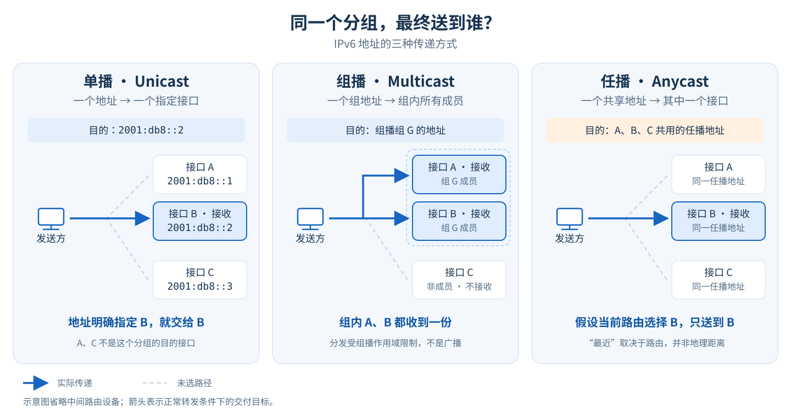
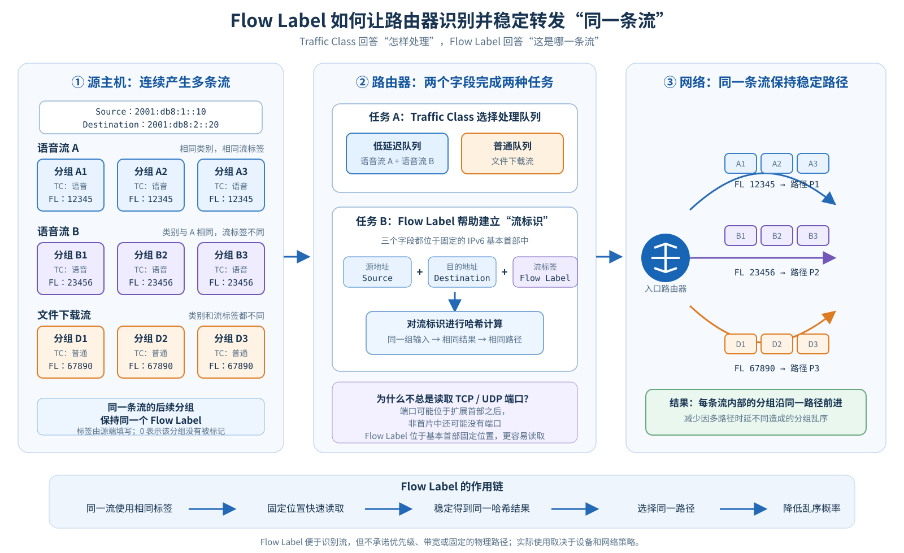
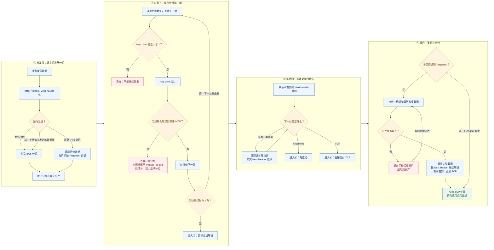
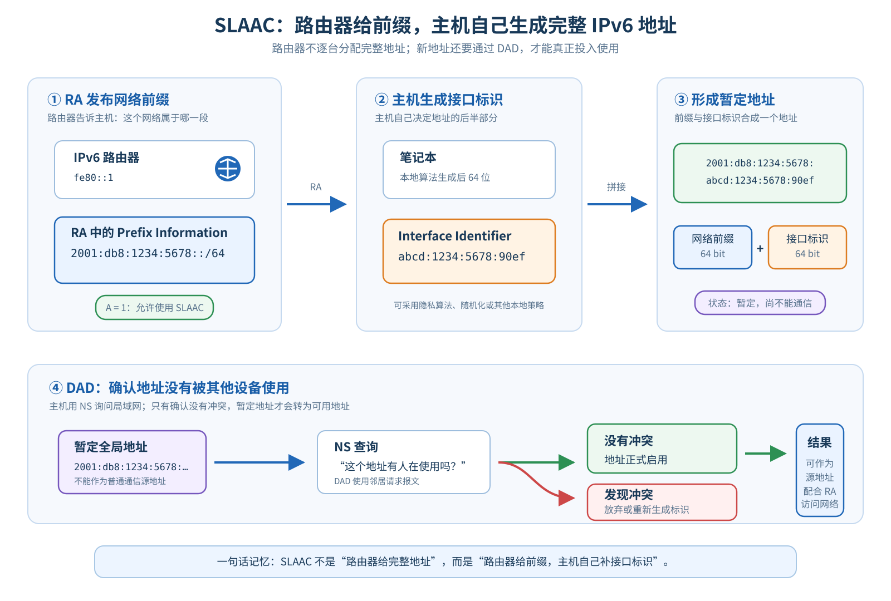
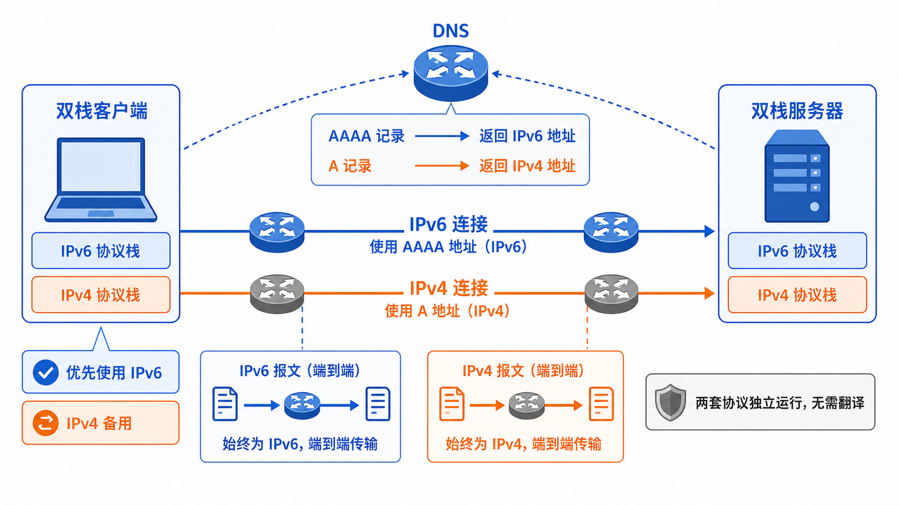
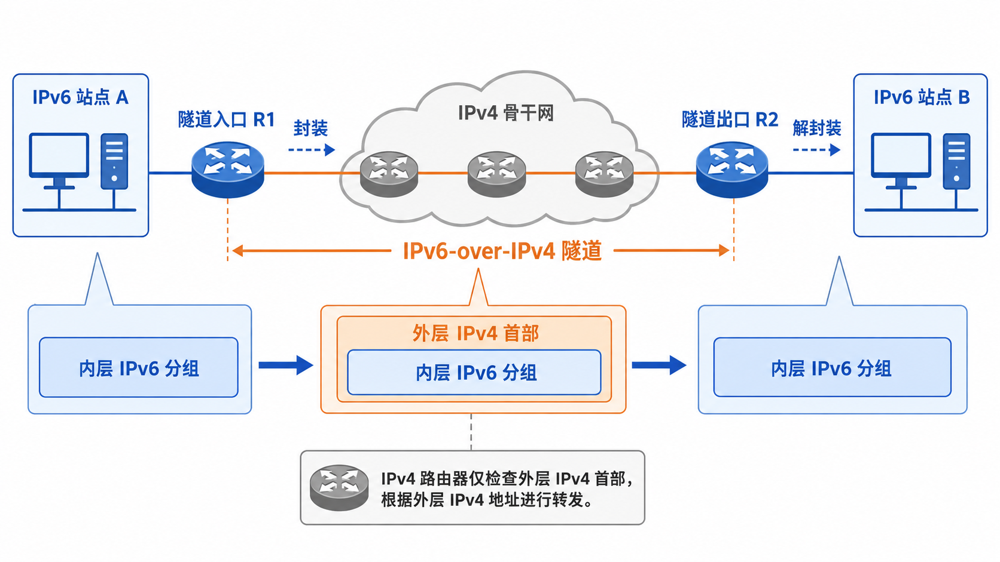
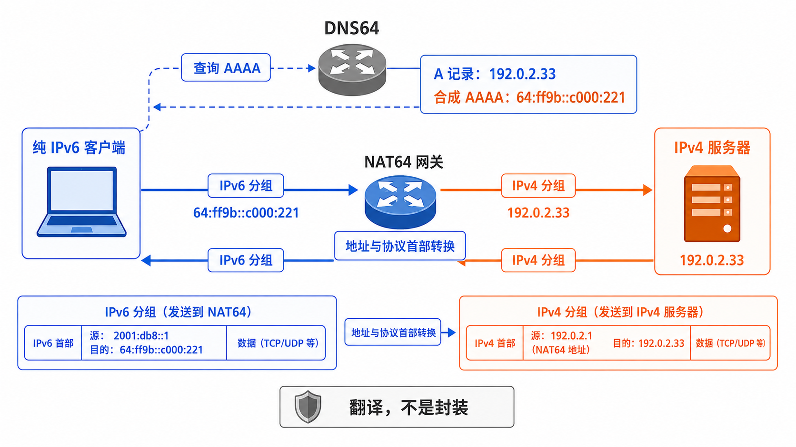

# IPv6 系统解析：地址、分组、自动配置与过渡机制

IPv4 地址只有 32 位，理论上约有 43 亿个地址。这个数字在互联网诞生之初看起来十分充裕，但随着个人电脑、智能手机、云计算和物联网的发展，IPv4 地址逐渐成为稀缺资源。网络地址转换（NAT）通过改写地址和端口，让多台内部设备共享较少的公网 IPv4 地址，从而延缓了地址耗尽；但它也削弱了通信功能主要由两端主机完成的端到端模型，并让网络排障、点对点通信和部分应用协议变得更加复杂。

IPv6 将地址长度扩展到 128 位，但它绝不仅是“地址变长的 IPv4”。它还重新设计了分组结构、邻居发现方式和地址配置过程。由于 IPv4 网络不可能一夜之间消失，IPv6 还必须借助多种过渡技术与 IPv4 长期共存。

本文按照“协议体系—地址—分组—自动配置—过渡机制”的顺序展开，最后通过三个典型案例梳理考试和实际网络分析中最常见的问题。


## 一、IPv6 的定位与核心变化

IPv6 工作在网络层，与 IPv4 一样，负责寻址、路由选择和分组转发。在它之上，仍可运行提供可靠传输的传输控制协议（TCP）、面向数据报的用户数据报协议（UDP），以及网页使用的超文本传输协议（HTTP）、把域名解析为地址的域名系统（DNS）等协议。

IPv6 相比 IPv4 的主要变化包括：

- 地址从 32 位扩展为 128 位；
- 每个分组都必须携带的基本首部固定为 40 字节，可选功能则放在附加的扩展首部中；
- 不再使用向链路所有节点发送的广播，改用发给特定节点集合的组播，以及通常送往最近一个成员的任播；
- 使用互联网控制报文协议第 6 版（ICMPv6）传递差错与控制信息，并由邻居发现协议（NDP）取代 IPv4 的地址解析协议（ARP）；
- 中间路由器不再把过大的分组拆成多个小分组，也就是不再执行分片；
- 原生支持无状态地址自动配置（SLAAC），主机可根据路由器通告自动生成地址；
- 通过“下一个首部”字段指向后续扩展首部或上层协议，形成可扩展的首部链。

## 二、IPv6 地址体系

### 1. 地址表示与压缩规则

一个 IPv6 地址由 128 位组成，通常写成 8 组十六进制数，每组 16 位：

```text
2001:0db8:0000:0000:0000:00a0:0000:0001
```

IPv6 有两条常用的压缩规则：

1. 每组开头的零可以省略，例如 `0db8` 写成 `db8`，`0000` 写成 `0`；
2. 一段连续的全零组可以用 `::` 代替，但一个地址中只能使用一次 `::`。

因此，上面的地址可以压缩为：

```text
2001:db8::a0:0:1
```

### 2. 单播、组播与任播

IPv6 地址可以分为三大类：

- **单播（Unicast）**：标识一个接口，分组被送到一个确定的接口；
- **组播（Multicast）**：标识一组接口，分组被送到组内所有成员；
- **任播（Anycast）**：多个接口使用同一地址，路由系统通常把分组送到拓扑意义上最近的一个接口。

IPv6 没有广播地址。IPv4 中许多依赖广播的功能，在 IPv6 中由范围更精确的组播完成。



*图：蓝色箭头表示实际传递。单播明确指定一个接口，组播向组内所有成员分发，任播则从使用同一地址的多个接口中选择一个；任播中的“最近”由路由决定，不等于地理距离最近。*

### 4. 常见地址类型与作用域

| 类型 | 前缀或地址 | 说明 |
|---|---|---|
| 全球单播地址 | `2000::/3` | 可在全球 IPv6 网络中路由 |
| 链路本地地址 | `fe80::/10` | 只在当前链路有效，路由器不会转发 |
| 唯一本地地址（ULA，Unique Local Address） | `fc00::/7` | 用于组织内部；实际本地生成通常位于 `fd00::/8` |
| 组播地址 | `ff00::/8` | 一对多通信，地址中包含作用域信息 |
| 未指定地址 | `::` | 表示“尚无地址”，不能作为正常目的地址 |
| 环回地址 | `::1` | 相当于 IPv4 的 `127.0.0.1` |
| IPv4 映射地址 | `::ffff:0:0/96` | 常用于应用程序接口（API）表示 IPv4 节点，并非普通公网过渡地址 |
| 文档地址 | `2001:db8::/32` | 专供文档和示例使用 |

一块启用 IPv6 的接口往往同时拥有多个地址，例如一个链路本地地址、一个或多个全球单播地址，以及若干组播成员地址。这不是冲突，而是 IPv6 的正常状态。

## 三、IPv6 分组格式与首部设计

### 1. 固定基本首部与扩展首部

一台路由器收到分组后，需要迅速找到目的地址、判断下一跳，再把分组发出去。因此，首部设计不只影响“能装多少信息”，还影响“设备每转发一个分组要做多少工作”。

IPv4 给这个过程留下了两类负担。

**第一类是常规转发的处理负担。** IPv4 首部长度可变，设备需要根据首部长度确定后续数据的位置；路由器每转发一跳，还会修改跳数相关字段，因此必须更新首部校验和。这个更新可以用增量算法和硬件完成，并不一定每次从头计算，但仍是一项需要执行的操作。

**第二类是：一些不常用的功能，也需要在首部中安排位置。** 可以分成两个例子理解。

第一个例子是“选项”。有些 IPv4 分组会提出额外要求，例如请沿途路由器记录经过的地址。这些要求写在首部末尾的“选项”区域：不带选项时，首部通常是 20 字节；带上选项后，首部就会变长，最长为 60 字节。因此，设备既要确认首部在哪里结束，遇到需要处理的选项时，还要执行额外操作。可放置选项的空间也最多只有 40 字节。

第二个例子是“分片信息”。当一个 IPv4 分组被拆成几片时，接收方需要知道“这些片属于哪个原分组”“每一片应拼在什么位置”。IPv4 为这些信息在基本首部里预留了固定字段，**即使分组没有被拆开，这些字段也仍然存在**。这和选项不同：选项可以不带，分片相关字段却不会随之消失。

这样一来，IPv4 首部既要容纳日常转发信息，也要照顾选项和分片等功能。IPv6 希望把这些用途分开，让常用部分保持简单，把需要时才用的信息另外携带。

IPv6 的思路是：**让每个分组必需的信息保持固定，把按需使用的功能放到后面。**

- **固定长度基本首部（Base Header）**：永远是 40 字节，放置版本、地址、跳数等常用信息，便于硬件在固定位置取字段。
- **扩展首部（Extension Header）**：需要某种功能时，再附加对应首部；不需要时就不携带，并通过字段把它们串成一条链。

可以把它想成“规格固定的火车头，按需连接不同车厢”。回到真实分组中，就是基本首部始终在最前面，后面可以直接跟上层协议，也可以先跟若干扩展首部。

```text
不需要扩展功能：
[ 基本首部：40 字节 ][ 上层协议首部 ][ 应用数据 ]

需要扩展功能：
[ 基本首部：40 字节 ][ 扩展首部 ][ 扩展首部 ][ 上层协议首部 ][ 应用数据 ]
```

### 2. IPv6 首部字段分类

```text
                 IPv6 基本首部：320 位 = 40 字节

  0       4              12                                      32
  +-------+---------------+---------------------------------------+
  |Version| Traffic Class |              Flow Label               | 协议与流量标记
  | 4 位  |     8 位      |                 20 位                 | 32 位
  +-------------------------------+---------------+---------------+
  |        Payload Length         |  Next Header  |   Hop Limit   | 载荷控制层
  |             16 位             |     8 位      |     8 位      | 32 位
  +-------------------------------+---------------+---------------+
  |                                                               |
  |                 Source Address：128 位                        | 寻址层
  |                                                               | 256 位
  +---------------------------------------------------------------+
  |                                                               |
  |               Destination Address：128 位                      |
  |                                                               |
  +---------------------------------------------------------------+
```

IPv6 基本首部一共有 8 个字段，可以按作用分成三类：

- **协议与流量标记**：Version、Traffic Class、Flow Label，用来说明分组格式和流量特征；
- **载荷控制**：Payload Length、Next Header、Hop Limit，用来说明后面有多长、下一段如何解析以及最多还能转发几跳；
- **寻址**：Source Address、Destination Address，用来标明分组从哪里来、要送到哪里。

#### 2.1 协议识别与流量标记

##### Version：分组格式标识

只负责一件事：告诉接收设备该按哪一种 IP 格式解释这个分组。对于 IPv6，这个值固定为 6。

##### Traffic Class：流量处理类别

说明这类流量应如何对待。分组携带这一标记后，路由器可按网络策略为不同类别选择相应队列。

##### Flow Label：同一流的识别标签

说明哪些分组属于同一条流。同一条流的相关分组可使用相同的非零标签。支持它的设备结合源地址、目的地址和流标签识别该流，并可辅助稳定地选择路径；它不表示优先级。[RFC 6437](https://www.rfc-editor.org/rfc/rfc6437.html) 描述了这种用法。



*图：同一条流的多个分组使用相同的 Flow Label。路由器结合源地址、目的地址和 Flow Label 识别具体流，再通过哈希把同一流稳定地映射到同一路径，从而降低多路径转发造成的乱序概率；Traffic Class 则负责表达处理类别。*

#### 2.2 载荷控制与首部链解析

**载荷长度（Payload Length，16 位）** 描述基本首部之后的载荷长度，扩展首部也属于这部分载荷。

**下一个首部（Next Header，8 位）** 说明紧接着当前首部的是什么。它既可以指向一个扩展首部，也可以直接指向 TCP 等上层协议。接收方据此选择下一步的处理方式，因此它是连接固定基本首部与扩展链的关键。

**跳数限制（Hop Limit，8 位）** 给分组设置转发次数上限。否则，一旦路由配置形成环路，同一个分组就可能在网络中不断绕行。具体如何递减，见下一节的分组处理流程。


### 3. 分组从发送到接收的处理过程

假设主机通过 TCP 向服务器发送数据，下面用一张图串起完整过程。**路径 MTU** 是沿途链路能承载的最大分组长度中的最小值；源端若要分片，就为各片添加**分片扩展首部（Fragment Header）**，记录它们属于哪个分组、应拼在什么位置。




### 4. IPv4 与 IPv6 首部设计对比

理解了整趟旅程后，再回看 IPv4 字段，就能知道哪些工作被取消，哪些工作换了位置。

| IPv4 旧字段 | IPv6 的处理方式 | 设计带来的收益 |
|---|---|---|
| 首部校验和（Header Checksum） | **直接删除**，基本首部没有对应字段 | 省去首部校验和的检查与逐跳更新；差错检测仍由链路层及 TCP 等上层机制承担 |
| 分片标识、标志和偏移（Identification / Flags / Fragment Offset） | **分片所需信息迁移至 Fragment 扩展首部**，并调整字段设计 | 未分片的分组不必携带这一扩展；IPv6 分片由源端负责，中间路由器不再承担分片工作 |
| 选项（Options） | **迁移至扩展首部链** | 按需携带可选功能，使基本首部长度保持固定 |
| 互联网首部长度（IHL，Internet Header Length） | **直接删除** | 基本首部固定为 40 字节，无需另设字段描述它的长度 |
| 生存时间（TTL，Time to Live） | 改为 **Hop Limit** | 名称直接表达跳数限制，不把它误解为按秒倒计时 |
| 协议（Protocol） | 扩展为 **Next Header** | 既能指向上层协议，也能指向下一段扩展首部 |

这里的“迁移”是功能上的重组，并非把 IPv4 字段逐位搬过去。例如，IPv4 的分片标志中有“禁止分片”，而 IPv6 已通过“路由器不执行分片”的规则改变了处理方式。

回到最初的问题：IPv6 让更长的地址住进了一个**布局固定的基本首部**，让可选功能进入**按需携带的扩展链**。路由器能够集中处理常规转发，源端和目标端则承担分片、重组及相应扩展功能，整个设计的重点是让这些职责更清晰。

## 四、IPv6 地址自动配置机制

### 1. 主机接入网络时的配置目标

一台电脑刚接入 IPv6 网络，至少要解决五个问题：

1. **我自己是谁？**——如何获得一个 IPv6 地址；
2. **当前网络是什么？**——如何知道这个网络使用哪个 IPv6 前缀；
3. **网关是谁？**——如何找到可以把分组送出本地网络的 IPv6 路由器；
4. **DNS 从哪里来？**——访问网站时，如何把域名解析成 IPv6 地址；
5. **地址会不会冲突？**——如何确保自己生成的地址没有被其他主机使用。

后面每个协议，都是为了解决其中一个问题。

### 2. 从联网到上网的自动配置流程

贯穿全文的场景是：一台笔记本刚连接家庭 Wi-Fi，家里的 IPv6 路由器已经正常工作。路由器的链路本地地址是 `fe80::1`，它向家庭网络发布的 IPv6 前缀是 `2001:db8:1234:5678::/64`。

下面按知识依赖关系梳理从电脑接入 Wi-Fi 到访问互联网的主干过程。它用于说明各组件分别解决什么问题，**不是所有实现都必须逐包串行执行的报文时序**：RA 可能在主机发送 RS 前就周期性到达；主机没有可用单播地址时也可以以未指定地址 `::` 为源地址发送 RS。因此，不要把图中的箭头理解为每一步都必须等前一步完全结束。

```text
电脑刚连上 Wi-Fi
      │
      ▼
生成链路本地地址（先获得一个只在本链路使用的身份）
      │
      ▼
第一次地址查重（DAD，确认链路本地地址没有冲突）
      │
      ▼
发送路由器请求（RS，主动寻找 IPv6 路由器）
      │
      ▼
收到路由器通告（RA，获得前缀、默认路由和链路最大分组长度等信息）
      │
      ▼
使用无状态地址自动配置（SLAAC）生成全局 IPv6 地址
      │
      ▼
第二次地址查重（DAD，确认新生成的全局地址没有冲突）
      │
      ▼
获得默认路由和 DNS 信息
      │
      ▼
使用 IPv6 正常访问互联网
```

这不是“一次 DHCP 请求就拿到所有参数”的过程，而是一连串各司其职的动作：主机形成链路本地身份，发现或接收路由器信息，随后形成地址，最后具备完整的互联网通信条件。

在真实实现中，部分动作可以重叠。路由器会周期性主动发送 RA；主机也可以在生成并验证链路本地地址的同时等待或接收 RA。即使主机已经收到前缀，新生成的 SLAAC 地址在自己的 DAD 成功前仍是暂定地址，不能作为普通通信的源地址使用。

### 3. Link-Local 地址：本链路内的初始身份

电脑刚接入网络时，还不知道家庭网络的 IPv6 前缀，也没有可在互联网中使用的全球地址。它会先给自己生成一个只能在当前链路使用的身份，这就是**链路本地地址（Link-Local Address）**。链路本地地址可用后，主机能以稳定的本地身份与路由器和邻居交换控制消息；初始 RS 是一个例外，在还没有可用单播地址时也可使用 `::` 作为源地址。

链路本地地址通常位于 `fe80::/10`。它有三个重要特点：

- 由主机自己生成，不需要先依赖地址分配服务器；
- 只能在同一个二层链路或本地网段中使用，路由器不会把它转发到其他网络；
- 可以用来和本链路上的 IPv6 路由器、邻居主机交换控制消息。

在本例中，路由器的链路本地地址是 `fe80::1`。笔记本也会先生成一个属于自己的链路本地地址，例如 `fe80::abcd:1234:5678:90ef`。此时它还不能据此访问互联网，但已经有了和路由器对话的起点。

### 4. DAD：地址启用前的冲突检测

电脑在正式使用一个 IPv6 地址前，必须先确认局域网里没有别人已经使用它。这个检查叫**重复地址检测（DAD，Duplicate Address Detection）**。一句话概括：DAD 就是在启用地址前，先问一遍“这个地址有人用吗？”。

以刚生成的链路本地地址为例：

1. 主机把该地址标记为“暂定”，暂时不把它当作正常源地址使用；
2. 主机向本链路上的其他节点发送一条邻居请求消息（NS，Neighbor Solicitation），询问这个地址是否已经被占用；
3. 在 DAD 的检测窗口内，如果没有收到表明目标地址已被使用的邻居发现报文，地址通过 DAD，主机可以启用它；
4. 常见情形是已有地址的节点返回邻居通告消息（NA，Neighbor Advertisement）；若另一节点也正在对同一地址执行 DAD，主机还可能收到以该地址为目标的邻居请求消息（NS，Neighbor Solicitation）。发现冲突后，主机必须放弃或重新生成该地址。

为什么链路本地地址也要做 DAD？因为它同样可能由两个主机独立生成，地址冲突会导致主机无法可靠地找到路由器。为什么全局地址还要再做一次？因为全局地址是在获得网络前缀之后新生成的，前一次检查并没有检查这个新地址。

### 5. RS：主机主动请求路由器配置

RS 的作用是请求路由器尽快发送 RA，而不是请求一个 IPv6 地址。路由器本来也会周期性发送 RA；RS 只是让刚接入的主机不必等待下一次周期通告。

RS 的本质不是“请求一个 IPv6 地址”，而是：

> **主机主动问：附近有没有 IPv6 路由器？请尽快告诉我网络配置。**

RS 通常发送到“本链路所有路由器”的组播地址 `ff02::2`。这里的组播可以理解为“只叫可能是路由器的那一组人”，而不是向链路上所有设备逐个打扰。如果主机已经有可用的链路本地单播地址，可以使用它作为 RS 的源地址；若还没有可用单播地址，也可以使用未指定地址 `::`。后者收到的响应会以组播方式发送。

RS 做完以后，主机只知道自己已经提出了请求；它还不知道网络前缀、默认网关和链路最大分组长度，这些信息要等待路由器的 RA。

### 6. RA：路由器发布前缀、路由与配置提示

路由器既会周期性主动发送 RA，也会在收到 RS 后发送 RA。RA 的本质是：

> **路由器告诉主机：这个网络有哪些前缀、默认路由怎么走、链路最大分组长度（MTU）是多少，以及是否允许主机自行生成地址（这种方式后文称为 SLAAC）。**

在本例中，路由器通过 RA 告诉笔记本至少四类信息：

- **网络前缀**：`2001:db8:1234:5678::/64`，说明这个家庭网络属于哪一段 IPv6 地址空间；
- **默认路由信息**：告诉主机，去往本地网络之外的分组应交给这台路由器；
- **最大传输单元（MTU，Maximum Transmission Unit）**：说明链路一次能够承载的最大分组长度；
- **地址配置提示**：告诉主机是否可以根据这个前缀自行生成地址，以及是否还需要其他配置服务（后文会把前一种方式称为 SLAAC）。

因此，RA 不只是“告诉主机一个前缀”。它还承担了 IPv6 路由器发现和默认路由发现的职责。有效 RA 的源地址是路由器在该链路上的链路本地地址；主机据此维护默认路由器信息，并处理其中的前缀、MTU 和配置标志。即使后面采用某种地址分配服务，主机通常仍要依靠 RA 找到默认路由器。

### 7. SLAAC：由前缀和接口标识生成地址

现在主机已经拿到了前缀，但路由器并没有逐台指定一个完整地址。主机根据前缀自行生成地址的机制叫**无状态地址自动配置（SLAAC，Stateless Address Autoconfiguration）**。

SLAAC 的核心思想是：

> **路由器告诉你网络属于哪一段，主机自己决定这一段网络中的具体地址。**

例如，路由器通过 RA 发布 **`2001:db8:1234:5678::/64`**，主机自己生成接口标识 **`abcd:1234:5678:90ef`**，最终得到 **`2001:db8:1234:5678:abcd:1234:5678:90ef`**。



*图：SLAAC 的重点是分工。路由器通过 RA 发布前缀，主机生成接口标识并拼成暂定地址；这个新地址只有通过 DAD 后才能正式使用。*

注意，SLAAC 不要求路由器为每台主机维护一张“地址—租约”表；路由器负责发布前缀，主机负责形成自己的完整地址。

### 8. 接口标识的来源与隐私演进

主干流程已经清楚后，再回答接口标识的来源问题。早期设备常把网卡的媒体访问控制地址（MAC 地址）转换成修订版 64 位扩展唯一标识符（Modified EUI-64）：在 48 位 MAC 地址中插入 `ff:fe`，并调整表示全球或本地管理的 U/L 位。

这种方式容易理解，但也有明显问题：MAC 地址具有设备身份特征，固定生成的接口标识可能让同一设备在不同网络之间被追踪。因此，现代操作系统更多使用以下方式：

- **稳定隐私地址**：地址在一段时间内稳定，但不直接暴露 MAC 地址；
- **随机化接口标识**：通过随机或伪随机方式生成接口部分；
- **临时隐私地址**：定期更换，主要用于主动访问外部服务。

所以，看到一个 `/64` IPv6 地址时，不能认为后 64 位一定来自 MAC 地址。

### 9. 全局地址启用前的再次 DAD

主机根据 `2001:db8:1234:5678::/64` 生成全局地址后，必须再次执行 DAD。原因很简单：第一次 DAD 检查的是链路本地地址，第二次 DAD 检查的是刚刚生成的全局地址，它们是两个不同的地址。

这一次的过程仍然是：地址先处于暂定状态，主机使用 NS 询问是否有人已经使用该地址；没有冲突响应后，地址才进入可用状态。若发现冲突，主机不能继续使用这个全局地址。


### 10. 默认网关的发现机制

主机有了全局 IPv6 地址，并不代表它知道如何访问外部网络。它还需要一条默认路由：当目的地址不属于本地前缀时，把分组交给谁？

答案仍然来自 RA。家庭路由器在 RA 中表明自己可以作为默认路由器，主机随后形成类似下面的路由关系：

```text
目的前缀：::/0（所有未匹配到更具体路由的地址）
下一跳：  fe80::1（家庭 IPv6 路由器的链路本地地址）
```

这里的 `::/0` 表示默认路由，`fe80::1` 是路由器在本链路上的链路本地地址。IPv6 默认网关通常由 RA 发现，而不是由地址租约服务单独下发；下一节比较不同地址配置方式时，会进一步说明这一点。

### 11. SLAAC 与 DHCPv6 的分工

**DHCPv6** 是 IPv6 版动态主机配置协议（Dynamic Host Configuration Protocol for IPv6）。它由服务器向主机提供 IPv6 地址或其他网络参数，和“主机根据 RA 自己生成地址”的 SLAAC 形成互补。

理解两者关系的关键是分清“地址从哪里来”和“其他参数从哪里来”。常见的三种模式如下：

```text
模式一：SLAAC
  地址       ← RA 发布的前缀 + 主机自行生成的接口标识
  默认网关   ← RA
  DNS        ← RA 中的递归 DNS 服务器选项（RDNSS）等方式

模式二：SLAAC + Stateless DHCPv6
  地址       ← SLAAC
  默认网关   ← RA
  DNS 等参数 ← DHCPv6

模式三：Stateful DHCPv6
  地址       ← DHCPv6 服务器分配
  默认网关   ← 通常仍然来自 RA
  DNS 等参数 ← DHCPv6
```

这里的无状态 DHCPv6（Stateless DHCPv6）只负责 DNS 等“其他配置”，不负责维护地址租约；有状态 DHCPv6（Stateful DHCPv6）则会维护地址分配状态。

有状态 DHCPv6 的典型消息顺序是：

```text
Solicit → Advertise → Request → Reply
寻找服务器     提供配置     正式请求     确认结果
```

最容易考错的一点是：**即使 DHCPv6 负责分配 IPv6 地址，也通常不负责告诉主机默认网关；默认网关仍然通常从 RA 获得。**

### 12. RA 标志位 M/O/A/L 的作用

现在再看标志位，就不会把它们混在一起。它们属于 RA 的不同位置：

```text
RA 报文本身
  ├── M（Managed）              是否提示使用有状态 DHCPv6 获取地址
  └── O（Other Configuration）  是否提示使用 DHCPv6 获取其他配置

RA 携带的 Prefix Information Option（前缀信息选项）
  ├── A（Autonomous）           该前缀是否允许 SLAAC
  └── L（On-link）               该前缀是否认为是本链路直连
```

分别理解：

- **M**：如果为 1，主机应考虑通过有状态 DHCPv6 获取地址；
- **O**：如果为 1，主机应考虑通过 DHCPv6 获取 DNS 等其他配置；
- **A**：如果为 1，主机可以把该前缀用于 SLAAC；
- **L**：如果为 1，主机可以把该前缀用于判断目的是否在本链路。

重点区分 A 和 M：A 关注的是“这个前缀能不能让主机自己生成地址”，M 关注的是“是否提示主机去 DHCPv6 获取地址”。因此，A 与 M 不是同一个开关，也不一定一开一关地成对出现。

### 13. 自动配置流程复盘

最后按逻辑依赖关系把家庭 Wi-Fi 场景重新走一遍。实际报文时序中，RS、周期性 RA 的到达与链路本地地址 DAD 可以重叠：

1. **电脑刚连上 Wi-Fi**：它还没有可用于互联网通信的完整 IPv6 配置；
2. **生成链路本地地址**：主机先获得一个只在本链路使用的身份，例如 `fe80::abcd:1234:5678:90ef`；
3. **执行第一次 DAD**：主机检查这个链路本地地址是否已经被占用；同时等待周期性 RA，或发送 RS 主动请求 RA；
4. **收到并处理 RA**：路由器 `fe80::1` 通告前缀 `2001:db8:1234:5678::/64`、默认路由、MTU 以及地址配置提示；
5. **执行 SLAAC**：主机把前缀和接口标识 `abcd:1234:5678:90ef` 拼成 `2001:db8:1234:5678:abcd:1234:5678:90ef`；
6. **执行第二次 DAD**：主机确认这个新生成的全局地址也没有冲突；
7. **安装默认路由并获得 DNS**：默认下一跳通常来自 RA，DNS 可以来自 RA 的 RDNSS，也可以由 DHCPv6 提供；
8. **访问互联网**：主机根据目的地址选择路由，使用 IPv6 分组与外部服务器通信。

最后用六句话保留整个知识框架：

1. IPv6 主机刚联网时，首先要解决身份、前缀、路由器、DNS 和地址冲突五个问题。
2. 链路本地地址让主机先能在本链路上与路由器交换控制消息，但它本身不能作为互联网中的全球身份。
3. DAD 用来确认地址没有重复，链路本地地址和 SLAAC 生成的全局地址都要分别检查。
4. RS 是主机主动寻找路由器，RA 则同时发布前缀、默认路由、MTU 和地址配置提示。
5. SLAAC 让主机用 RA 的网络前缀加上自己形成的接口标识生成完整 IPv6 地址，后 64 位不一定来自 MAC 地址。
6. DHCPv6 可以分配地址或提供其他参数，但 IPv6 默认网关通常仍由 RA 发现。

## 五、IPv4 到 IPv6 过渡的基本问题

IPv4 和 IPv6 的首部格式、地址长度不同，二者不能仅靠“换一个地址”直接通信。在迁移过程中，常见网络状态包括：

- 一台设备同时接入 IPv4 和 IPv6；
- 两个 IPv6 网络之间隔着只支持 IPv4 的骨干网；
- 纯 IPv6 客户端需要访问仍然只有 IPv4 的服务器。

这三个问题分别对应三种核心思路：

| 机制 | 核心动作 | 主要解决的问题 |
|---|---|---|
| 双栈 Dual Stack | 同时运行 IPv4 与 IPv6 | 同一节点按需使用任一协议 |
| 隧道 Tunneling | 把 IPv6 分组封装进 IPv4 分组 | 让 IPv6 流量穿越 IPv4 网络 |
| 翻译 Translation | 在 IPv6 与 IPv4 分组之间转换 | 让只支持不同协议的端点互通 |

双栈、隧道和翻译看似是三种独立技术，本质上都在回答同一个问题：**现有网络如何适应 IPv6**。它们处理的障碍不同——双栈解决节点对两种协议的共存支持，隧道解决中间网络暂不支持 IPv6 的问题，翻译则解决通信两端协议不一致的问题。下面把三种典型场景放在同一章中进行分析。

## 六、IPv6 过渡机制案例：双栈、隧道与翻译

### 案例一：双栈共存（Dual Stack）

#### 1. 公司门户网站的双栈改造

假设某公司原来的门户网站 `portal.example.com` 只通过 IPv4 提供服务。为了逐步迁移到 IPv6，管理员没有立即关闭 IPv4，而是给同一台 Web 服务器增加了 IPv6 地址，并在 DNS 中发布两类记录：A 记录保存服务器的 IPv4 地址，AAAA 记录保存服务器的 IPv6 地址。

员工的笔记本接入公司网络后，通过动态主机配置协议（DHCP）获得 IPv4 地址 `192.0.2.10`，同时通过前文介绍的 SLAAC 获得 IPv6 地址 `2001:db8:1::10`。Web 服务器也同时监听 IPv4 地址 `198.51.100.20` 和 IPv6 地址 `2001:db8:2::20`。此时，客户端和服务器都是典型的双栈节点：

```text
员工笔记本                            公司门户服务器
IPv4: 192.0.2.10                      IPv4: 198.51.100.20
IPv6: 2001:db8:1::10                  IPv6: 2001:db8:2::20
           └──── IPv4 或 IPv6 网络 ────┘
```

DNS 为 `portal.example.com` 同时返回：

```text
A     → 198.51.100.20
AAAA  → 2001:db8:2::20
```

员工在浏览器中打开 `portal.example.com` 时，操作系统会获得两个候选地址。如果公司的 IPv6 路径工作正常，连接可以直接使用 IPv6；如果 IPv6 路由异常或响应不及时，浏览器仍可通过 IPv4 地址访问同一个网站。整个访问过程如下：



*图：双栈客户端和服务器同时运行 IPv4、IPv6。DNS 提供 A 与 AAAA 记录，应用优先尝试 IPv6，并可在需要时使用 IPv4；两种协议端到端独立运行，不发生封装或翻译。*

客户端会根据本地地址、路由和地址选择策略决定尝试哪个地址。现代应用常采用名为 Happy Eyeballs 的双栈快速连接策略：IPv6 不可用或响应较慢时，应用会迅速尝试 IPv4，避免用户长时间等待。

#### 2. 协议选择与连接建立

- 查询到 AAAA 记录不等于一定能够通过 IPv6 建立连接；本机还需要 IPv6 地址、路由和连通性；
- 最终连接到 IPv6 地址时，使用 IPv6 协议栈；连接到 A 记录对应地址时，使用 IPv4 协议栈；
- 双栈不会把 IPv4 分组翻译成 IPv6 分组，两套协议各自独立运行。

#### 3. 双栈的优势与运维成本

双栈的优点是原理直接、兼容性高，并能逐步把业务从 IPv4 迁移到 IPv6。它的代价是网络需要同时规划、监控和保护两套协议：两套路由、两套访问控制规则、两种故障路径都可能增加运维成本。

它也不能凭空让纯 IPv6 节点访问纯 IPv4 节点。如果通信两端没有共同协议，就要使用本章第三个案例介绍的协议翻译机制。


### 案例二：IPv6-over-IPv4 隧道（Tunneling）

#### 1. IPv6 孤岛跨越 IPv4 网络

两个 IPv6 网络之间隔着 IPv4 骨干网：



*图：IPv6 分组在 R1 被加上外层 IPv4 首部，穿过 IPv4 骨干网后由 R2 去掉外层首部；内层 IPv6 分组在隧道中保持完整。*

R1 收到发往站点 B 的 IPv6 分组后，在外面添加 IPv4 首部；IPv4 骨干网只看外层 IPv4 地址，把它送到 R2。R2 去掉外层 IPv4 首部，再按内层 IPv6 目的地址转发。

#### 2. 隧道封装与解封装

假设原始 IPv6 分组为：

```text
内层源 IPv6：2001:db8:1::10
内层目的 IPv6：2001:db8:2::20
```

经过普通 IPv6-in-IPv4 封装后：

```text
外层 IPv4 首部
  源 IPv4：R1 的 IPv4 地址
  目的 IPv4：R2 的 IPv4 地址
  Protocol：41（IPv6 封装，表示载荷是完整的 IPv6 分组）

内层 IPv6 分组
  源 IPv6：2001:db8:1::10
  目的 IPv6：2001:db8:2::20
```

关键点是：**隧道通常保留完整的内层 IPv6 分组，只是在外面增加一个供中间网络转发的首部。** IPv4 中间路由器看不到或不需要理解内层 IPv6 地址。

封装会增加额外开销，并降低隧道可以承载的有效 MTU。若忽略这一点，可能导致分片、丢包或路径 MTU 黑洞——也就是过大的分组持续被丢弃，而源节点又没有收到有效的减小分组提示。

#### 3. 常见隧道方案

##### 6to4：基于 IPv4 地址的自动隧道

6to4 使用 `2002::/16` 前缀，把 32 位 IPv4 地址编码进 IPv6 前缀中。假设隧道端点的 IPv4 地址为 `192.0.2.4`：

```text
192  = c0
0    = 00
2    = 02
4    = 04
```

拼成十六进制得到 `c000:0204`，对应的 6to4 站点前缀为：

```text
2002:c000:0204::/48
```

这类换算很适合作为考试题。但在现实部署中，负责在 6to4 网络与原生 IPv6 网络之间转发流量的公共中继存在路径不对称、可靠性和排障困难等问题；制定互联网技术标准的互联网工程任务组（IETF）已弃用 6to4 任播中继机制，并建议新实现默认关闭 6to4。因此，6to4 更适合作为理解自动隧道和地址嵌入的历史案例，而不是新网络的首选方案。

##### ISATAP：组织内部的站内隧道

站内自动隧道寻址协议（ISATAP，Intra-Site Automatic Tunnel Addressing Protocol）把 IPv4 网络视为一种不能直接广播、但可以连接多个节点的链路，常用于在组织内部 IPv4 基础设施上连接 IPv6/双栈节点。其接口标识中可以嵌入 IPv4 地址。它同样更多见于旧环境和教材，新部署一般会优先选择原生 IPv6 或更易管理的方案。

##### GRE：可控的通用封装隧道

通用路由封装（GRE，Generic Routing Encapsulation）是一种通用隧道封装机制，不只承载 IPv6，也可以承载其他三层协议。它通常由管理员明确配置隧道端点，拓扑和路由关系更可控，但需要维护隧道状态、路由、安全策略与 MTU。


### 案例三：NAT64/DNS64 协议翻译（Translation）

这一方案由两个职责不同的组件配合完成。网络地址与协议翻译网关（NAT64）负责在 IPv6 与 IPv4 分组之间转换地址和协议首部，并在有状态工作模式下维护通信映射；DNS64 是具备地址合成功能的 DNS 服务，它能根据服务器的 IPv4 A 记录生成一个供 IPv6 客户端使用的 AAAA 记录。NAT64 使用的专用 IPv6 前缀称为翻译前缀，DNS64 会把服务器的 IPv4 地址嵌入该前缀。

#### 1. 纯 IPv6 客户端访问 IPv4 服务

一个纯 IPv6 客户端需要访问只有 IPv4 地址的服务器：



*图：DNS64 根据服务器的 A 记录合成带 NAT64 前缀的 AAAA 记录；业务流量随后到达 NAT64 网关，由网关完成 IPv6/IPv4 地址和协议首部转换。这个过程是翻译，不是把 IPv6 分组封装进 IPv4 分组。*

#### 2. DNS64 的地址合成

客户端向 DNS64 查询服务器的 AAAA 记录。如果服务器没有 AAAA 记录，但存在 A 记录 `192.0.2.33`，DNS64 可以把这个 IPv4 地址嵌入 NAT64 前缀中，合成一个 AAAA 记录。

使用协议专门预留、各方都能识别的知名前缀（Well-Known Prefix）`64:ff9b::/96` 时：

```text
IPv4：192.0.2.33
十六进制：c0.00.02.21
合成 IPv6：64:ff9b::c000:221
```

它也可以写成混合形式：

```text
64:ff9b::192.0.2.33
```

生产网络也可以使用仅在本组织翻译环境中约定的网络特定前缀，而不一定使用 `64:ff9b::/96`。

#### 3. NAT64 的分组转换

客户端把合成地址当作普通 IPv6 目的地址发送。路由把分组引向 NAT64 网关。NAT64 识别前缀，从目的 IPv6 地址中提取 `192.0.2.33`，并完成两类转换：

- 把 IPv6 首部转换为 IPv4 首部，处理 Hop Limit/TTL 等对应字段；
- 从自己的 IPv4 地址池中选择源 IPv4 地址和端口，建立有状态映射。

转换前后可抽象为：

```text
转换前（IPv6 侧）
源：[2001:db8::1]:50000
目的：[64:ff9b::c000:221]:443

转换后（IPv4 侧，示意）
源：192.0.2.1:40001
目的：192.0.2.33:443
```

服务器的响应回到 `192.0.2.1:40001` 后，NAT64 查询状态表，将其还原为发往 `[2001:db8::1]:50000` 的 IPv6 分组。

#### 4. DNS64 与 NAT64 的配合

NAT64 负责实际业务分组的转换，DNS64 则让客户端获得“看起来是 IPv6”的目的地址。如果应用不查询域名，而是直接写死一个 IPv4 地址，也就是使用 IPv4 地址字面量，或者协议在应用数据中携带 IPv4 地址，DNS64 就无法单独解决问题，应用可能需要额外适配。

#### 5. 有状态 NAT64 的方向限制

常见的有状态 NAT64 在首次收到 IPv6 客户端发出的流量时创建映射。因此，一般场景是**纯 IPv6 客户端主动访问 IPv4 服务器**。IPv4 客户端通常不能在没有已有状态或静态映射的情况下，主动访问任意 IPv6 客户端。

此外，NAT64 不是对任何协议都自动透明。经典有状态 NAT64 主要面向单播 TCP、UDP 和互联网控制报文协议（ICMP）；依赖端到端地址可见性、在负载中嵌入 IP 地址或受 IPsec 保护的协议，需要额外评估。


## 七、双栈、隧道与翻译对比

| 对比维度 | 双栈 | 隧道 | NAT64/DNS64 |
|---|---|---|---|
| 核心操作 | 同时运行两套协议 | 给 IPv6 分组增加外层 IPv4 首部 | 转换 IPv6/IPv4 地址与协议首部 |
| 典型场景 | 节点和业务逐步迁移 | IPv6 孤岛跨越 IPv4 网络 | 纯 IPv6 客户端访问 IPv4 服务 |
| 中间网络要求 | 相应路径支持所选协议 | 中间网络只需支持 IPv4 | 网关两侧分别支持 IPv6、IPv4 |
| 是否保留原 IPv6 分组 | 直接走 IPv6 时保留 | 作为内层分组保留 | 不保留原网络层首部，进行翻译 |
| 是否需要状态 | 协议本身不要求转换状态 | 普通配置隧道不做地址转换 | 有状态 NAT64 需要维护映射 |
| 主要优点 | 兼容性强、迁移直接 | 可复用既有 IPv4 基础设施 | 不同协议的端点可以互通 |
| 主要代价 | 双重规划和运维 | 封装、MTU与隧道维护 | 状态容量和应用兼容性问题 |

可以用一句话记忆：

> **双栈是“二选一”，隧道是“包一层”，翻译是“改格式”。**


## 八、核心脉络总结

理解 IPv6，可以抓住五条主线：

1. **地址**：128 位地址不仅扩大空间，也支持更清晰的层次化寻址；
2. **首部**：固定 40 字节基本首部配合扩展首部链，简化常规转发路径；
3. **控制协议**：ICMPv6 和 NDP 承担邻居解析、路由器发现与网络诊断等核心职责；
4. **自动配置**：SLAAC、RA 和 DHCPv6可以按场景组合，默认网关通常从 RA 获得；
5. **过渡**：双栈解决协议共存，隧道解决中间网络不支持 IPv6，NAT64/DNS64 解决异构端点互通。


## 参考资料

下面列出的 RFC（Request for Comments）是互联网协议的标准或技术说明文档：

- [RFC 8200：Internet Protocol, Version 6 (IPv6) Specification](https://www.rfc-editor.org/rfc/rfc8200.html)
- [RFC 4291：IP Version 6 Addressing Architecture](https://www.rfc-editor.org/rfc/rfc4291.html)
- [RFC 4861：Neighbor Discovery for IP version 6](https://www.rfc-editor.org/rfc/rfc4861.html)
- [RFC 4862：IPv6 Stateless Address Autoconfiguration](https://www.rfc-editor.org/rfc/rfc4862.html)
- [RFC 8415：Dynamic Host Configuration Protocol for IPv6](https://www.rfc-editor.org/rfc/rfc8415.html)
- [RFC 3056：Connection of IPv6 Domains via IPv4 Clouds](https://www.rfc-editor.org/rfc/rfc3056.html)
- [RFC 5214：Intra-Site Automatic Tunnel Addressing Protocol](https://www.rfc-editor.org/rfc/rfc5214.html)
- [RFC 7526：Deprecating Anycast-Prefix-Based 6to4 Transition](https://www.rfc-editor.org/rfc/rfc7526.html)
- [RFC 6052：IPv6 Addressing of IPv4/IPv6 Translators](https://www.rfc-editor.org/rfc/rfc6052.html)
- [RFC 6146：Stateful NAT64](https://www.rfc-editor.org/rfc/rfc6146.html)
- [RFC 6147：DNS64](https://www.rfc-editor.org/rfc/rfc6147.html)
