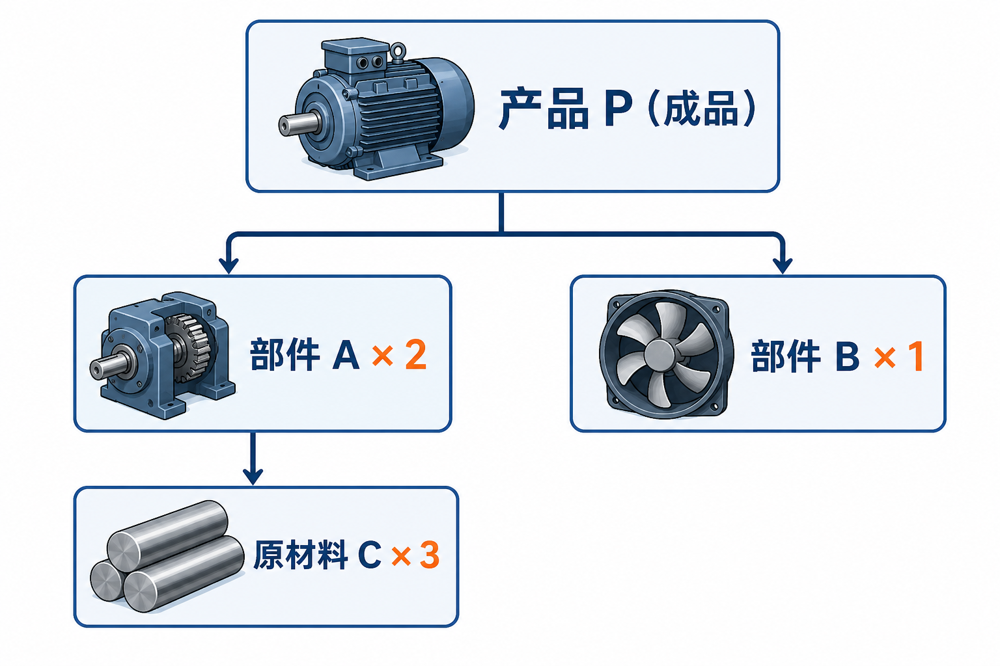
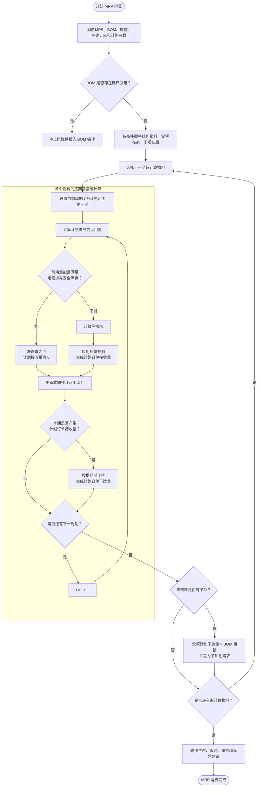

# 制造业 MRP 运算原理与程序实现：从生产计划到物料需求计算

在制造企业中，生产计划很少只是“下个月生产 100 台产品”这么简单。

为了生产这 100 台产品，企业需要知道：

- 要准备哪些零部件和原材料？
- 每种物料需要多少？
- 现有库存是否足够？
- 应该在什么时候采购或开始生产？
- 在途订单能否按时满足需求？

如果仅靠人工计算，当产品结构较深、物料数量达到数千甚至数万种时，计划工作很快就会失去控制。MRP 正是为解决这一问题而产生的。

MRP 是 Material Requirements Planning 的缩写，中文通常称为“物料需求计划”。它将销售需求、生产计划、BOM、库存和提前期结合起来，计算未来各个时间段的物料需求，并生成采购与生产建议。

本文将从一个制造案例出发，介绍 MRP 的核心原理，并使用 Python 实现一个简化但完整的 MRP 运算程序。

---

## 一、MRP 要解决什么问题

假设一家企业计划在第 4 周交付 100 台产品 P。

产品 P 由两个部件 A 和一个部件 B 组成，而部件 A 又需要三个原材料 C：

```text
产品 P
├── 部件 A × 2
│   └── 原材料 C × 3
└── 部件 B × 1
```

如果不考虑库存，生产 100 台 P 需要：

```text
A = 100 × 2 = 200
B = 100 × 1 = 100
C = 200 × 3 = 600
```

但现实情况通常更加复杂：

- 成品 P 可能已有库存；
- 部件 A 可能还有一批采购订单即将到货；
- B 必须按照 50 个一批采购；
- C 的采购提前期可能是两周；
- 部分物料需要保留安全库存；
- 同一种物料可能被多个产品共同使用。

因此，简单地将产品需求乘以 BOM 用量并不能得到真正的采购计划。

MRP 的任务可以概括为三个问题：

1. 需要什么物料？
2. 需要多少物料？
3. 应该在什么时候获得这些物料？

---

## 二、MRP 术语地图：用生活例子建立整体认识

MRP 的术语很多，但它们并不是互不相关的一组缩写，而是在回答一连串非常生活化的问题：准备做什么、需要哪些东西、家里已经有什么、还缺多少、什么时候必须去买。

可以先用“准备一场家庭聚餐”建立整体印象：

| MRP 术语 | 生活中的对应事物 |
|---|---|
| 物料 | 菜品、半成品和各种食材 |
| MPS | 写在日历上的聚餐日期和用餐人数 |
| BOM | 每道菜的菜谱和用料表 |
| 可用库存 | 冰箱里真正可以使用的食材 |
| 预计接收量 | 已经下单、正在配送的食材 |
| 安全库存 | 为临时加人准备的备用食材 |
| 批量规则 | 饮料只能整箱买、鸡蛋只能整盒买 |
| 提前期 | 从下单到送达需要等待的时间 |
| 计划订单 | 根据缺口生成的购买或制作建议 |

下面按照 MRP 运算中实际出现的先后关系，把这些术语逐一讲清楚。

### 1. 物料与主生产计划 MPS

MRP 中的“物料”（Item/Material）不只指钢材、塑料等原材料。只要需要单独管理供需，就可以作为物料，包括成品、半成品、零部件、原材料和包装物。就像准备聚餐时，整道蛋糕、尚未装饰的蛋糕胚、奶油和包装盒都可以分别列入备料清单。

主生产计划（Master Production Schedule，MPS）描述企业计划在什么时间生产或交付多少成品。它像餐厅的订餐日历：先确定周六要交付 100 份套餐，厨房才能继续计算要准备多少食材。

例如：

| 产品 | 第1周 | 第2周 | 第3周 | 第4周 |
|---|---:|---:|---:|---:|
| P | 0 | 0 | 0 | 100 |

主生产计划是顶层独立需求的主要来源。它说明“最终要完成什么”，但还没有回答零部件够不够、什么时候采购等问题。

### 2. 物料清单 BOM

BOM 是 Bill of Materials 的缩写，中文称为“物料清单”。它描述一个产品由哪些部件、零件和原材料组成，以及生产一个上层物料需要消耗多少下层物料。可以把 BOM 理解为制造业的“产品配方”或“装配说明书”：它不仅回答产品里面有什么，还回答这些物料之间的层级和数量关系。

下面是一张三层 BOM 结构示意图：



*图：产品 P 由两个部件 A 和一个部件 B 组成，每个部件 A 又需要三个原材料 C。*

在这张图中，P、A、B、C 分别位于不同的产品结构层级：

| BOM 层级 | 物料 | 在当前结构中的角色 |
|---:|---|---|
| 第 0 层 | P | 最终交付的成品 |
| 第 1 层 | A、B | 直接装入成品 P 的部件 |
| 第 2 层 | C | 用于生产部件 A 的原材料 |

系统通常把 BOM 保存为一行行“父项—子项”关系：

| 父项 | 子项 | 单位用量 |
|---|---|---:|
| P | A | 2 |
| P | B | 1 |
| A | C | 3 |

“单位用量”表示生产一个父项需要多少个子项。例如 `P → A，单位用量为 2`，表示生产一个 P 需要两个 A；`A → C，单位用量为 3`，表示生产一个 A 需要三个 C。因此，在完全不考虑库存和损耗时，生产一个 P 间接需要：

```text
C 的数量 = P 的数量 × 每个 P 使用的 A 数量 × 每个 A 使用的 C 数量
          = 1 × 2 × 3
          = 6
```

不过，MRP 不能简单地把所有 BOM 用量一次乘到底。假如仓库里已有一个 A，那么生产一个 P 只需要再生产一个 A，与这个 A 对应的 C 需求也会减少。因此，系统必须逐层计算：先计算 P 的净需求，再计算 A、B 的净需求，最后根据 A 的实际计划生产量计算 C 的需求。

真实制造系统中的一条 BOM 明细通常不只有父项、子项和数量，还可能包括：

| BOM 字段 | 作用 |
|---|---|
| 计量单位 | 区分个、千克、米、升等数量单位 |
| 损耗率 | 考虑领料、加工和报废造成的额外用量 |
| 生效与失效日期 | 决定某个版本在什么时间可以使用 |
| 发料方式 | 指定按订单领料、倒冲或工序领料 |
| 供应类型 | 区分自制、采购、外协或虚拟件 |
| 替代关系 | 主料缺少时允许使用哪些替代物料 |
| 使用工序 | 指定子项在父项的哪个加工阶段投入 |

企业中还可能同时存在不同用途的 BOM。例如，设计 BOM（EBOM）强调产品在工程设计上的组成，制造 BOM（MBOM）则按照实际生产、装配和领料方式组织。MRP 应使用当前工厂、当前日期下有效的制造或计划 BOM，否则即使计算公式完全正确，也可能得到错误的采购和生产建议。

因此，BOM 同时承担三个重要作用：

1. 描述产品的层级结构；
2. 提供父项到子项的数量换算关系；
3. 决定 MRP 需求从成品向原材料逐层传递的路径。

BOM 数据中的漏项、错量、错误版本或循环引用，都会直接放大为采购和生产计划错误，所以 BOM 准确性是 MRP 能否可靠运行的基础。

### 3. 库存数据

库存数据告诉 MRP 当前有哪些物料能够用于满足需求。仓库账面数量不一定全部可用，因此必须先统一各种库存口径。

| 库存数据 | 含义 | 是否通常可以立即用于 MRP |
|---|---|---|
| 现有库存（On-hand） | 系统账面上已经入库的实物总量 | 不能直接全部使用 |
| 已分配库存（Allocated） | 已经预留给指定销售单或生产单的数量 | 不能再分配给其他需求 |
| 冻结库存（Blocked） | 因盘点、质量或业务原因暂时冻结的数量 | 不能使用 |
| 待检库存（Inspection） | 已到货但尚未检验合格的数量 | 通常不能立即使用 |
| 不合格库存（Rejected） | 已确认不满足使用要求的数量 | 不能使用 |
| 可用库存（Available） | 扣除不可用部分后，可以参与本次计划的数量 | 可以参与供需平衡 |
| 安全库存（Safety Stock） | 企业希望始终保留的最低库存目标 | 是计划底线，不是另一批实物 |

在一个简化模型中，首先计算物理上真正可用的库存：

```text
期初可用库存
= 现有库存
- 已分配库存
- 冻结库存
- 待检库存
- 不合格库存
```

然后再考虑安全库存，计算“不触发补货的可消耗量”：

```text
安全库存以上可消耗量
= max(0, 期初可用库存 - 安全库存)
```

需要注意，安全库存不是一类需要从现有库存中重复扣除的实物状态，而是 MRP 希望在满足需求后仍然保留的库存目标。

假设某工厂账面上有 120 个部件 A，安全库存目标为 20，库存状态如下：

| 库存状态 | 数量 | 处理方式 |
|---|---:|---|
| 现有库存 | 120 | 计算起点 |
| 已分配给其他生产订单 | 25 | 扣除 |
| 冻结库存 | 10 | 扣除 |
| 待检库存 | 15 | 扣除 |
| 不合格库存 | 0 | 扣除 |
| 期初可用库存 | **70** | `120 - 25 - 10 - 15 - 0` |
| 安全库存目标 | 20 | 作为期末最低库存目标 |
| 安全库存以上可消耗量 | **50** | `max(0, 70 - 20)` |

因此，这个例子中有两个不同但都重要的数字：

- 70 表示物理状态合格、可以参与供需平衡的期初可用库存；
- 50 表示在不跌破安全库存的前提下，可以直接用于满足普通需求的数量。

如果本期需求为 60，虽然 70 个期初可用库存能够在物理上全部满足需求，但使用后只剩 10 个，低于 20 个安全库存目标。MRP 因而仍会产生 10 个净需求：

```text
净需求
= max(0, 本期需求 + 安全库存 - 期初可用库存)
= max(0, 60 + 20 - 70)
= 10
```

如果按需补充 10 个，期末库存就会回到安全库存目标：

```text
期末库存
= 期初可用库存 + 计划补充量 - 本期需求
= 70 + 10 - 60
= 20
```

这就像家里的冰箱里有 12 个鸡蛋：4 个已经留给明天早餐，2 个已经破损，还有 1 个是否新鲜尚未确认，那么物理可用量为 5 个。如果家里还规定至少留下 2 个鸡蛋应对临时早餐，今天在不触发补货的情况下最多只能使用 3 个：

```text
物理可用量 = 12 - 4 - 2 - 1 = 5 个
安全库存以上可消耗量 = 5 - 2 = 3 个
```

#### 预计可用库存

期初可用库存描述计划开始时的状态，预计可用库存（Projected Available Balance）则继续向未来推演，表示每个周期结束后预计还会剩多少库存。

```text
本期期末预计可用库存
= 上期期末预计可用库存
+ 本期预计接收量
+ 本期计划订单接收量
- 本期毛需求
```

例如，某物料本期开始时有 20 个，已经确认到货 30 个，MRP 新安排接收 75 个，本期毛需求为 100，那么：

```text
本期期末预计可用库存
= 20 + 30 + 75 - 100
= 25
```

这 25 个并不是今天仓库里已经数出来的库存，而是根据未来供需计算出的期末余额。下一周期会把这 25 个作为新的期初可用量继续计算。因此，预计可用库存是一条随时间滚动的库存曲线，而不是一个固定数字。

### 4. 已确定的供应

已确定的供应在 MRP 表中通常记为预计接收量（Scheduled Receipts），包括：

- 已下达但尚未入库的采购订单；
- 已下达但尚未完工的生产订单；
- 已确认的调拨订单。

它们与 MRP 新生成的“计划订单”不同。前者是真实订单，后者只是系统建议。

这就像你已经在购物平台支付了一箱牛奶，系统显示周四送达：这箱牛奶属于预计接收量。至于发现还缺鸡蛋后，购物清单提醒你“建议再买两盒鸡蛋”，这只是计划建议，尚未成为真实订单。

接下来，让这些基础数据进入一次简化运算。继续使用一个餐厅备菜案例：

> 餐厅周六需要提供 100 份牛肉汉堡套餐。根据食谱，需要 100 个牛肉饼。仓库可用库存为 20 个，周四还有 30 个已订购的牛肉饼到货。餐厅希望活动结束后至少保留 10 个。供应商每箱装 25 个，送货需要 2 天。

### 5. 独立需求和相关需求

| 术语 | 通俗理解 | 汉堡案例 |
|---|---|---|
| 独立需求（Independent Demand） | 来自产品结构之外的需求 | 顾客预订 100 份汉堡套餐 |
| 相关需求（Dependent Demand） | 根据上层计划和 BOM 推算出的需求 | 生产套餐需要 100 个牛肉饼 |

独立需求通常来自订单或预测；相关需求则由 MRP 计算产生。两者的来源不同，但进入某个物料的供需表后，都可能成为该物料的毛需求。

### 6. 毛需求

毛需求（Gross Requirements）是扣除库存和确定供应之前的总需求，像厨师根据预订数量先列出的完整备料清单。

案例中需要 100 个牛肉饼，所以毛需求是 100。即使仓库已有 20 个，毛需求仍然不变，因为它回答的是“总共需要多少”，而不是“还要订多少”。

### 7. 净需求

净需求（Net Requirements）是考虑库存、确定供应和安全库存后，真正仍然存在的缺口。

| 计算项目 | 数量 |
|---|---:|
| 毛需求 | 100 |
| 安全库存目标 | 10 |
| 当前可用库存 | 20 |
| 已确定的预计接收量 | 30 |
| 净需求 `100 + 10 - 20 - 30` | **60** |

毛需求回答“总共需要多少”，净需求回答“利用已有资源后还缺多少”。

### 8. 批量规则

净需求只是理论缺口，采购和生产还要遵守包装或生产批量。批量规则（Lot Sizing Rule）负责把净需求转换为可执行数量。

| 批量规则 | 含义 | 净需求为 60 时的结果 |
|---|---|---:|
| 按需订货 L4L | 缺多少补多少 | 60 |
| 固定批量 25 | 按 25 的整批向上取整 | 75 |
| 最小订货量 100 | 每次至少订购 100 | 100 |
| 批量倍数 20 | 数量必须是 20 的整数倍 | 60 |

案例中的供应商每箱装 25 个，因此净需求虽然是 60，计划数量却是 75，多出的 15 个会形成剩余库存。

### 9. 提前期

提前期（Lead Time）是从下达订单到物料可用所需的时间。它像配送时间：需要两天运输的食材，不能等到周六使用时才下单。

常见提前期包括采购、生产、检验和运输提前期。如果牛肉饼必须在周六可用，而完整提前期为 2 天，那么最迟应在周四下达订单。真实系统还要根据工作日历避开节假日和停工日。

### 10. 计划订单接收量和计划订单下达量

这两个名称相近，但对应同一项计划的两个时间点：

| 术语 | 回答的问题 | 汉堡案例 |
|---|---|---|
| 计划订单接收量（Planned Order Receipt） | 什么时候需要到货或完工多少？ | 周六接收 75 个 |
| 计划订单下达量（Planned Order Release） | 为了按时收到，什么时候必须下单或开工？ | 周四下达 75 个 |

MRP 先确定缺口发生的周期和计划接收量，再根据提前期向前倒排计划下达周期。

### 11. BOM 展开或需求展开

BOM 展开（BOM Explosion）是将已经算出的父项计划下达量，沿本章前文介绍的 BOM 结构转换成子项毛需求。

```text
父项计划下达量 × BOM 单位用量 = 子项毛需求
```

例如计划生产 100 份套餐，每份使用一个牛肉饼，则牛肉饼毛需求为 100。子项需求通常发生在父项计划下达的周期，因为简化模型假设父项开始生产时就领用子项。

### 12. 时间桶和计划范围

时间桶（Time Bucket）是汇总供需的时间单位，计划范围（Planning Horizon）是本次运算向未来覆盖多远。

| 设置 | 类比 | 影响 |
|---|---|---|
| 按天计算 | 每天检查一次备菜 | 精细，但数据量和波动更大 |
| 按周计算 | 每周汇总一次备菜 | 易于管理，但看不到周内先后顺序 |
| 计划范围 12 周 | 只查看未来 12 周的预订 | 更远期需求暂不参与本次运算 |

时间桶越粗，越要注意周期内部的日期顺序。例如周一的需求不能被周五才到达的物料及时满足。

### 13. 低层码和拓扑顺序

低层码（Low-level Code）和拓扑顺序用于保证父项先计算、子项后计算。可以把它理解成备菜顺序：先确定套餐计划，才能算牛肉饼；先确定牛肉饼生产计划，才能算牛肉原料。

当一个零件被多个父项共用时，系统必须先汇总所有父项传来的需求，再对该零件执行净需求计算。

### 14. 需求追溯

需求追溯（Pegging）用于回答“一条计划建议是由什么需求引起的”。例如：

```text
牛肉饼采购建议 75
← 周六牛肉饼净需求 60
← 周六套餐计划 100
← 客户活动订单
```

需求追溯不会改变数量，却能帮助计划员解释结果、判断优先级和处理异常。

### 15. 用一张表串起全部术语

| 运算步骤 | 对应术语 | 计算或结论 |
|---|---|---|
| 顾客预订 100 份套餐 | 独立需求 | 形成成品需求 |
| 按 BOM 换算牛肉饼 | 相关需求/毛需求 | 牛肉饼毛需求为 100 |
| 加上安全库存并扣除库存、到货 | 净需求 | `100 + 10 - 20 - 30 = 60` |
| 按每箱 25 个向上取整 | 批量规则 | 计划数量为 75 |
| 周六需要到货 | 计划订单接收量 | 周六接收 75 个 |
| 按 2 天提前期倒排 | 计划订单下达量 | 周四下达 75 个 |
| 计算活动后的剩余数量 | 预计可用库存 | `20 + 30 + 75 - 100 = 25` |

因此，MRP 的结果不是把毛需求直接转换为采购量，而是经过库存抵扣、净需求计算、批量调整和提前期倒排后得到的可执行建议。

---

## 三、MRP 的核心公式和计算顺序

上一章已经说明了各个术语的含义，本章不再重复定义，而是直接把它们组合成一套可以手工计算、也可以转换成程序的运算流程。

MRP 需要按照时间从前向后逐期计算。设当前周期为 `t`，则一个物料在该周期内依次执行以下步骤。

### MRP 运算总览

下面的流程图把 MRP 运算分成两个相互衔接的循环：内层循环负责按时间计算一个物料，外层循环负责按照 BOM 顺序从父项逐层计算到子项。



读图时可以抓住一条主线：先在水平方向上逐期平衡某个物料的需求与供应，再在垂直方向上把父项的计划下达量沿 BOM 传递给子项。所有物料都完成这两个过程后，系统才能形成最终的生产和采购建议。

### 1. 计算计划供应之前的可用量

```text
计划供应前可用量(t)
= 上期预计可用库存(t-1)
+ 本期预计接收量(t)
```

第一个周期没有“上期预计可用库存”，因此使用期初可用库存代替。

### 2. 计算净需求

```text
净需求(t)
= max(
    0,
    本期毛需求(t)
    + 安全库存
    - 计划供应前可用量(t)
  )
```

使用 `max(0, ...)` 是为了保证供应充足时净需求为零，而不会产生负数需求。

### 3. 应用批量规则

```text
计划订单接收量(t)
= 批量规则(净需求(t))
```

如果采用按需订货 L4L，计划订单接收量等于净需求；如果采用固定批量、最小订货量或批量倍数，则需要按照对应规则调整数量。

### 4. 更新本期预计可用库存

```text
预计可用库存(t)
= 计划供应前可用量(t)
+ 计划订单接收量(t)
- 本期毛需求(t)
```

这个结果将作为下一周期计算的起点。因此，MRP 必须按时间顺序逐期运算，不能把各周期完全割裂开来。

### 5. 按照提前期倒排订单

```text
计划订单下达周期
= 计划订单接收周期 - 提前期
```

```text
计划订单下达量(接收周期 - 提前期)
= 计划订单接收量(接收周期)
```

如果倒排结果早于计划范围的起点，系统应将其标记为逾期建议或立即下达建议，而不是直接丢弃。

### 6. 将父项计划展开为子项需求

完成父项计算后，使用父项的计划订单下达量生成直接子项的毛需求：

```text
子项毛需求(t)
+= 父项计划订单下达量(t) × BOM 单位用量
```

这里使用 `+=`，是因为同一个子项可能被多个父项共同使用。程序需要先汇总同一周期内所有来源的需求，再执行子项的净需求计算。

### 7. 完整运算顺序

| 顺序 | 运算 | 结果的下一步用途 |
|---:|---|---|
| 1 | 汇总本期毛需求和预计接收量 | 计算本期物料缺口 |
| 2 | 加入上期预计库存 | 得到计划供应前可用量 |
| 3 | 计算净需求 | 确定理论缺口 |
| 4 | 应用批量规则 | 生成计划订单接收量 |
| 5 | 更新预计可用库存 | 传递到下一时间周期 |
| 6 | 按提前期倒排 | 生成计划订单下达量 |
| 7 | 乘以 BOM 单位用量 | 形成下一层子项毛需求 |
| 8 | 对子项重复上述计算 | 直到 BOM 最低层 |

可以将整套逻辑压缩成下面这条主线：

```text
毛需求
→ 扣除库存和确定供应
→ 计算净需求
→ 应用批量规则
→ 生成计划接收量
→ 按提前期倒排下达量
→ 按 BOM 展开子项需求
```

---

## 四、通过案例完成一次 MRP 运算

下面用一组完整的分周表格演示 MRP 如何从成品需求逐层计算到原材料采购建议。继续使用前面的产品 P：

```text
P
├── A × 2
│   └── C × 3
└── B × 1
```

假设基础数据如下：

| 物料 | 物料类型 | 期初库存 | 提前期 | 批量规则 | 安全库存 |
|---|---|---:|---:|---|---:|
| P | 成品 | 10 | 1 周 | 按需订货 L4L | 0 |
| A | 自制部件 | 20 | 1 周 | 按需订货 L4L | 0 |
| B | 采购或自制部件 | 10 | 2 周 | 按需订货 L4L | 0 |
| C | 采购原材料 | 100 | 1 周 | 按需订货 L4L | 0 |

独立需求和已确定供应如下：

| 业务数据 | 第1周 | 第2周 | 第3周 | 第4周 |
|---|---:|---:|---:|---:|
| P 的独立需求 | 0 | 0 | 0 | 100 |
| P 的预计接收量 | 0 | 20 | 0 | 0 |

本例暂不考虑安全库存、损耗、工作日历和订单重排。所有物料都采用按需订货，因此净需求等于计划订单接收量。

在阅读下面的 MRP 表格时，可以按照以下顺序理解各行：

1. 先用现有库存和预计接收量满足毛需求；
2. 如果预计库存不足，则产生净需求；
3. 对净需求应用批量规则，生成计划订单接收量；
4. 用计划接收日期减去提前期，得到计划订单下达日期；
5. 父项的计划订单下达量乘以 BOM 用量，成为子项的毛需求。

### 1. 计算产品 P

P 的期初库存为 10，第 2 周还有 20 个已下达订单到货。第 1 至第 3 周没有需求，所以到第 4 周开始时，累计可用数量为 30。

| P 的 MRP 项目 | 期初 | 第1周 | 第2周 | 第3周 | 第4周 |
|---|---:|---:|---:|---:|---:|
| 毛需求 | — | 0 | 0 | 0 | 100 |
| 预计接收量 | — | 0 | 20 | 0 | 0 |
| 净需求 | — | 0 | 0 | 0 | **70** |
| 计划订单接收量 | — | 0 | 0 | 0 | **70** |
| 预计可用库存 | **10** | 10 | 30 | 30 | 0 |
| 计划订单下达量 | — | 0 | 0 | **70** | 0 |

第 4 周的净需求计算如下：

| 计算项目 | 数量 |
|---|---:|
| 第 4 周开始前可用库存 | 30 |
| 第 4 周毛需求 | 100 |
| 第 4 周安全库存 | 0 |
| 净需求 `100 + 0 - 30` | **70** |
| 按需订货后的计划接收量 | **70** |

P 需要在第 4 周接收 70 个。由于 P 的生产提前期为 1 周，计划订单需要向前移动一周，在第 3 周下达：

```text
第4周计划接收70 - 1周提前期 = 第3周计划下达70
```

### 2. 展开部件 A 和 B

P 在第 3 周下达 70 个生产计划。为了在第 3 周开始生产 P，其直接子项 A 和 B 也必须在第 3 周准备好。因此，P 的计划下达量会按照 BOM 用量转换成 A、B 的毛需求。

| 父项 | 父项计划下达时间 | 父项计划下达量 | 子项 | 单位用量 | 子项毛需求 | 子项需求时间 |
|---|---|---:|---|---:|---:|---|
| P | 第3周 | 70 | A | 2 | `70 × 2 = 140` | 第3周 |
| P | 第3周 | 70 | B | 1 | `70 × 1 = 70` | 第3周 |

#### 2.1 计算部件 A

A 在第 3 周的毛需求为 140，期初库存为 20，没有预计到货。

| A 的 MRP 项目 | 期初 | 第1周 | 第2周 | 第3周 | 第4周 |
|---|---:|---:|---:|---:|---:|
| 毛需求 | — | 0 | 0 | **140** | 0 |
| 预计接收量 | — | 0 | 0 | 0 | 0 |
| 净需求 | — | 0 | 0 | **120** | 0 |
| 计划订单接收量 | — | 0 | 0 | **120** | 0 |
| 预计可用库存 | **20** | 20 | 20 | 0 | 0 |
| 计划订单下达量 | — | 0 | **120** | 0 | 0 |

| A 在第3周的计算项目 | 数量 |
|---|---:|
| 毛需求 | 140 |
| 可用库存 | 20 |
| 净需求 `140 - 20` | **120** |
| 计划订单接收量 | **120** |
| 提前期 | 1 周 |
| 计划订单下达时间 | **第2周** |

#### 2.2 计算部件 B

B 在第 3 周的毛需求为 70，期初库存为 10，没有预计到货。

| B 的 MRP 项目 | 期初 | 第1周 | 第2周 | 第3周 | 第4周 |
|---|---:|---:|---:|---:|---:|
| 毛需求 | — | 0 | 0 | **70** | 0 |
| 预计接收量 | — | 0 | 0 | 0 | 0 |
| 净需求 | — | 0 | 0 | **60** | 0 |
| 计划订单接收量 | — | 0 | 0 | **60** | 0 |
| 预计可用库存 | **10** | 10 | 10 | 0 | 0 |
| 计划订单下达量 | — | **60** | 0 | 0 | 0 |

| B 在第3周的计算项目 | 数量 |
|---|---:|
| 毛需求 | 70 |
| 可用库存 | 10 |
| 净需求 `70 - 10` | **60** |
| 计划订单接收量 | **60** |
| 提前期 | 2 周 |
| 计划订单下达时间 | **第1周** |

A 和 B 虽然都在第 3 周使用，但因为提前期不同，订单下达时间也不同：A 在第 2 周下达，B 必须在第 1 周下达。

### 3. 继续展开原材料 C

A 在第 2 周下达 120 个生产计划。每个 A 使用三个 C，所以 C 的毛需求发生在第 2 周，而不是 A 完工的第 3 周。

| 父项 | 父项计划下达时间 | 父项计划下达量 | 子项 | 单位用量 | 子项毛需求 | 子项需求时间 |
|---|---|---:|---|---:|---:|---|
| A | 第2周 | 120 | C | 3 | `120 × 3 = 360` | 第2周 |

C 的期初库存为 100，没有预计到货，因此需要新增 260 个计划供应。

| C 的 MRP 项目 | 期初 | 第1周 | 第2周 | 第3周 | 第4周 |
|---|---:|---:|---:|---:|---:|
| 毛需求 | — | 0 | **360** | 0 | 0 |
| 预计接收量 | — | 0 | 0 | 0 | 0 |
| 净需求 | — | 0 | **260** | 0 | 0 |
| 计划订单接收量 | — | 0 | **260** | 0 | 0 |
| 预计可用库存 | **100** | 100 | 0 | 0 | 0 |
| 计划订单下达量 | — | **260** | 0 | 0 | 0 |

| C 在第2周的计算项目 | 数量 |
|---|---:|
| 毛需求 | 360 |
| 可用库存 | 100 |
| 净需求 `360 - 100` | **260** |
| 计划订单接收量 | **260** |
| 提前期 | 1 周 |
| 计划订单下达时间 | **第1周** |

### 4. 汇总需求传递过程

将整个 BOM 的需求传递过程放在一张表中，可以更清楚地看到 MRP 是如何逐层展开的：

| 运算层次 | 需求来源 | 运算过程 | 形成的结果 |
|---|---|---|---|
| 第 0 层：P | 第4周独立需求 100 | 库存 10 + 到货 20，净缺口为 70 | 第3周下达 P 生产计划 70 |
| 第 1 层：A | P 第3周下达 70 | `70 × 2 = 140`，扣除库存 20 | 第2周下达 A 生产计划 120 |
| 第 1 层：B | P 第3周下达 70 | `70 × 1 = 70`，扣除库存 10 | 第1周下达 B 订单 60 |
| 第 2 层：C | A 第2周下达 120 | `120 × 3 = 360`，扣除库存 100 | 第1周下达 C 采购订单 260 |

需求与计划在时间上的关系如下：

| 周次 | 需要执行的计划动作 | 该动作服务的后续需求 |
|---|---|---|
| 第1周 | 下达 B 订单 60 | 第3周生产 P 时使用 |
| 第1周 | 下达 C 采购订单 260 | 第2周生产 A 时使用 |
| 第2周 | 接收 C 260；下达 A 生产订单 120 | 第3周生产 P 时使用 |
| 第3周 | 接收 A 120 和 B 60；下达 P 生产订单 70 | 第4周成品需求 |
| 第4周 | 接收 P 70，与已有的 30 个 P 一起满足需求 100 | 完成第4周交付 |

### 5. 最终计划建议

MRP 运算最终产生以下订单建议：

| 物料 | 计划下达时间 | 计划接收时间 | 计划数量 | 建议类型 | 需求来源 |
|---|---|---|---:|---|---|
| B | 第1周 | 第3周 | 60 | 采购或生产建议 | P 的生产计划 |
| C | 第1周 | 第2周 | 260 | 采购建议 | A 的生产计划 |
| A | 第2周 | 第3周 | 120 | 生产建议 | P 的生产计划 |
| P | 第3周 | 第4周 | 70 | 生产建议 | 第4周独立需求 |

这个案例体现了 MRP 的三项核心运算：先计算净需求，再按照提前期倒排订单，最后使用父项的计划下达量逐层展开 BOM。库存会减少新增计划数量，提前期则决定订单必须在什么时候下达。

---

## 五、如何把 MRP 转化为程序

从程序设计角度看，MRP 可以分为两个核心算法：

1. 对单个物料执行时间序列上的净需求计算；
2. 按照 BOM 层级将父项需求传递给子项。

程序至少需要保存以下数据：

```text
Material
├── 物料编码
├── 期初库存
├── 安全库存
├── 提前期
└── 批量规则

BOMItem
├── 父项编码
├── 子项编码
└── 单位用量

MRPResult
├── 毛需求
├── 预计接收量
├── 净需求
├── 计划订单接收量
├── 计划订单下达量
└── 预计可用库存
```

MRP 的整体流程如下：

```text
读取物料、库存、BOM和需求
          ↓
检查BOM是否存在循环
          ↓
确定父项到子项的计算顺序
          ↓
计算顶层物料净需求
          ↓
生成计划订单接收量
          ↓
按照提前期倒排下达时间
          ↓
将下达量乘以BOM用量
          ↓
形成下一层物料毛需求
          ↓
重复计算直到最低层物料
```

---

## 六、使用 Python 实现 MRP 核心算法

前面已经把 MRP 拆成了“单物料逐期计算”和“按照 BOM 逐层展开”两个过程。本章把完整实现放在一起讲解：先建立数据模型，再实现批量计算、单物料运算和 BOM 排序，最后将这些函数连接成多层 MRP 算法。

本章代码采用 `float` 以保持示例简洁。生产系统涉及小数用量和精度要求时，应将数量类型替换为 `Decimal`。

### 1. 程序由哪些部分组成

| 程序组件 | 责任 | 对应的 MRP 业务 |
|---|---|---|
| `Material` | 保存物料计划参数 | 库存、提前期、安全库存、批量 |
| `BOMItem` | 保存一条父子物料关系 | BOM 单位用量 |
| `MRPResult` | 保存一个物料的分期结果 | 净需求、计划接收、计划下达、预计库存 |
| `apply_lot_rule` | 调整理论缺口数量 | 批量规则 |
| `calculate_material_mrp` | 按周期平衡单个物料供需 | 净需求运算和提前期倒排 |
| `topological_sort` | 确定物料计算先后顺序 | 保证父项先算、子项后算 |

### 2. 定义数据模型

数据类只负责描述输入和输出，不在类中混入计算逻辑。这样做的好处是：运算函数可以独立测试，输入数据也更容易从 JSON、CSV 或数据库转换而来。

```python
from collections import defaultdict, deque
from dataclasses import dataclass
from math import ceil


@dataclass(frozen=True)
class Material:
    """一个物料执行 MRP 时需要使用的计划参数。"""

    code: str
    # 计划范围开始时真正可用于本次运算的库存。
    initial_inventory: float
    # 提前期以“时间桶”为单位；按周计划时，1 表示 1 周。
    lead_time: int
    # 每个周期结束时希望保留的最低库存。
    safety_stock: float = 0.0
    # None 表示按需订货；50 表示订单数量必须按 50 的整批取整。
    lot_size: float | None = None


@dataclass(frozen=True)
class BOMItem:
    """BOM 中的一条父项—子项关系。"""

    parent: str
    child: str
    # 每生产一个父项需要消耗多少个子项。
    quantity: float


@dataclass
class MRPResult:
    """一个物料在整个计划范围内的逐期运算结果。"""

    gross_requirements: list[float]
    scheduled_receipts: list[float]
    net_requirements: list[float]
    planned_receipts: list[float]
    planned_releases: list[float]
    projected_inventory: list[float]
    # 倒排后落在计划范围起点之前的数量。
    past_due_releases: float = 0.0
```

`Material` 和 `BOMItem` 使用 `frozen=True`，表示基础数据创建后不应被运算过程意外修改；`MRPResult` 则用于逐步形成计算结果，因此保持可变。

### 3. 实现批量规则

批量函数只做一件事：把净需求转换成可执行的计划接收量。把它从主算法中分离出来，后续增加最小订货量、最大订货量或周期批量时，不需要改动净需求计算的主体。

```python
def apply_lot_rule(
    net_requirement: float,
    lot_size: float | None,
) -> float:
    """将净需求转换成符合批量规则的计划订单数量。"""

    # 没有缺口时，不应生成计划订单。
    if net_requirement <= 0:
        return 0.0

    # lot_size=None 代表 Lot-for-Lot，即缺多少补多少。
    if lot_size is None:
        return net_requirement

    # 非正数批量没有业务意义，尽早报告基础数据错误。
    if lot_size <= 0:
        raise ValueError("lot_size 必须大于 0，或设置为 None")

    # 例如净需求 120、固定批量 50：ceil(120 / 50) * 50 = 150。
    return ceil(net_requirement / lot_size) * lot_size
```

输入校验非常重要。如果 `lot_size` 被错误地设置为 0，直接进行除法只会产生难以理解的运行错误；这里主动抛出异常，可以更快定位到物料主数据问题。

### 4. 实现单物料逐期运算

这个函数只计算一个物料，不关心它位于 BOM 的第几层。输入是该物料每个周期的毛需求和预计接收量，输出是完整的 MRP 时间序列表。

```python
def calculate_material_mrp(
    material: Material,
    gross_requirements: list[float],
    scheduled_receipts: list[float],
) -> MRPResult:
    """按时间从前向后计算一个物料的 MRP。"""

    # 毛需求和预计接收量必须覆盖完全相同的计划周期。
    if len(gross_requirements) != len(scheduled_receipts):
        raise ValueError("毛需求和预计接收量的周期数必须一致")

    if material.lead_time < 0:
        raise ValueError("提前期不能小于 0")

    period_count = len(gross_requirements)

    # 先为每个输出行建立与计划周期等长的数组。
    net_requirements = [0.0] * period_count
    planned_receipts = [0.0] * period_count
    planned_releases = [0.0] * period_count
    projected_inventory = [0.0] * period_count

    # available 会在循环中持续结转，相当于“上期预计库存”。
    available = material.initial_inventory
    past_due_releases = 0.0

    for period in range(period_count):
        gross = gross_requirements[period]
        scheduled = scheduled_receipts[period]

        if gross < 0 or scheduled < 0:
            raise ValueError("毛需求和预计接收量不能为负数")

        # 第一步：加入已经下达、将在本期到货或完工的确定供应。
        available_before_planning = available + scheduled

        # 第二步：在满足本期毛需求后，还要留下安全库存。
        shortage = max(
            0.0,
            gross
            + material.safety_stock
            - available_before_planning,
        )
        net_requirements[period] = shortage

        # 第三步：把理论缺口转换为符合批量规则的订单数量。
        receipt_quantity = apply_lot_rule(
            net_requirement=shortage,
            lot_size=material.lot_size,
        )
        planned_receipts[period] = receipt_quantity

        # 第四步：计算本期结束后的预计可用库存，并结转到下一期。
        available = (
            available_before_planning
            + receipt_quantity
            - gross
        )
        projected_inventory[period] = available

        # 没有计划接收量时，无须进行提前期倒排。
        if receipt_quantity == 0:
            continue

        # 第五步：从接收周期向前减去提前期，得到下达周期。
        release_period = period - material.lead_time

        if release_period >= 0:
            planned_releases[release_period] += receipt_quantity
        else:
            # 落在计划范围之前的订单不能丢失，应作为逾期建议输出。
            past_due_releases += receipt_quantity

    # 使用 copy 保存输入快照，避免调用方后续修改原数组影响结果。
    return MRPResult(
        gross_requirements=gross_requirements.copy(),
        scheduled_receipts=scheduled_receipts.copy(),
        net_requirements=net_requirements,
        planned_receipts=planned_receipts,
        planned_releases=planned_releases,
        projected_inventory=projected_inventory,
        past_due_releases=past_due_releases,
    )
```

这段代码与第三章的公式逐一对应：

| 代码变量 | 业务含义 | 计算关系 |
|---|---|---|
| `available_before_planning` | 计划供应前可用量 | 上期预计库存 + 本期预计接收量 |
| `shortage` | 本期净需求 | 毛需求 + 安全库存 - 计划供应前可用量 |
| `receipt_quantity` | 计划订单接收量 | 对净需求应用批量规则 |
| `available` | 本期期末预计库存 | 可用量 + 计划接收量 - 毛需求 |
| `release_period` | 计划订单下达周期 | 接收周期 - 提前期 |

如果倒排后的 `release_period` 小于 0，表示订单本应在计划范围开始前下达。示例程序把数量累计到 `past_due_releases`，实际系统还应保存原接收日期、建议下达日期和需求来源。

### 5. 使用拓扑排序确定 BOM 计算顺序

完成单物料算法后，还必须决定先计算哪个物料。BOM 可以建模为一张从父项指向子项的有向图。拓扑排序保证只有当一个物料的所有父项都计算完成后，才轮到该物料。

```python
def topological_sort(
    materials: dict[str, Material],
    bom_items: list[BOMItem],
) -> list[str]:
    """返回父项在前、子项在后的物料编码列表。"""

    # children[parent] 保存父项的所有直接子项。
    children: dict[str, list[str]] = defaultdict(list)

    # indegree[code] 表示有多少个父项尚未处理。
    indegree = {code: 0 for code in materials}

    for item in bom_items:
        # 先检查 BOM 是否引用了不存在的物料，避免随后出现模糊的 KeyError。
        if item.parent not in materials:
            raise ValueError(f"BOM 父项不存在：{item.parent}")
        if item.child not in materials:
            raise ValueError(f"BOM 子项不存在：{item.child}")
        if item.quantity <= 0:
            raise ValueError(
                f"BOM 用量必须大于 0：{item.parent} -> {item.child}"
            )

        children[item.parent].append(item.child)
        indegree[item.child] += 1

    # 入度为 0 的物料没有未处理父项，可以最先计算。
    ready = deque(
        code
        for code, degree in indegree.items()
        if degree == 0
    )

    calculation_order: list[str] = []

    while ready:
        parent = ready.popleft()
        calculation_order.append(parent)

        # 父项完成后，它对每个子项的“未处理父项数”减 1。
        for child in children[parent]:
            indegree[child] -= 1

            # 当计数降到 0，说明该子项的所有父项都已完成。
            if indegree[child] == 0:
                ready.append(child)

    # 没有排入结果的物料说明被困在循环引用中。
    if len(calculation_order) != len(materials):
        cyclic_materials = [
            code
            for code, degree in indegree.items()
            if degree > 0
        ]
        raise ValueError(
            "BOM 中存在循环引用，涉及物料："
            + ", ".join(cyclic_materials)
        )

    return calculation_order
```

假设 BOM 为：

```text
P → A
P → B
A → C
```

一种合法的计算顺序是：

```text
P → A → B → C
```

也可能得到 `P → B → A → C`。二者都正确，因为 A 和 B 之间没有依赖关系；关键约束是 P 必须先于 A、B，A 必须先于 C。

如果 BOM 为 `A → B → C → A`，就没有任何节点能够完整脱离依赖。最终排入结果的物料数会少于物料总数，程序据此报告循环引用并停止运算。

前面得到的两个核心能力是：`calculate_material_mrp` 可以计算一个物料，`topological_sort` 可以给出所有物料的正确先后顺序。最后还需要一个总控函数把它们连接起来。

### 6. 实现多层 BOM 展开

`run_mrp` 负责准备所有物料的时间序列，按照拓扑顺序调用单物料算法，并把父项的计划下达量转换成子项毛需求。

```python
def run_mrp(
    materials: dict[str, Material],
    bom_items: list[BOMItem],
    independent_demands: dict[str, list[float]],
    scheduled_receipts: dict[str, list[float]],
    period_count: int,
) -> dict[str, MRPResult]:
    """执行一次完整的多层 MRP 运算。"""

    if period_count <= 0:
        raise ValueError("计划周期数必须大于 0")

    # 每个物料先建立一条全为 0 的毛需求时间序列。
    # 顶层物料会写入独立需求；下层物料稍后接收 BOM 展开的需求。
    gross_requirements: dict[str, list[float]] = {
        code: [0.0] * period_count
        for code in materials
    }

    # 没有已下达订单的物料，其预计接收量保持为 0。
    receipts: dict[str, list[float]] = {
        code: [0.0] * period_count
        for code in materials
    }

    # 写入由销售订单、预测或 MPS 形成的独立需求。
    for code, values in independent_demands.items():
        if code not in materials:
            raise ValueError(f"独立需求引用了未知物料：{code}")
        if len(values) != period_count:
            raise ValueError(f"物料 {code} 的独立需求周期数不正确")
        gross_requirements[code] = values.copy()

    # 写入已经下达、预计将在未来到货或完工的确定供应。
    for code, values in scheduled_receipts.items():
        if code not in materials:
            raise ValueError(f"预计接收量引用了未知物料：{code}")
        if len(values) != period_count:
            raise ValueError(f"物料 {code} 的预计接收周期数不正确")
        receipts[code] = values.copy()

    # 建立父项到 BOM 明细行的索引，便于完成父项后快速找到子项。
    children: dict[str, list[BOMItem]] = defaultdict(list)
    for item in bom_items:
        children[item.parent].append(item)

    # 拓扑排序同时会检查 BOM 物料引用、用量和循环结构。
    calculation_order = topological_sort(materials, bom_items)

    results: dict[str, MRPResult] = {}

    # 严格按照“父项在前、子项在后”的顺序逐个计算。
    for code in calculation_order:
        result = calculate_material_mrp(
            material=materials[code],
            gross_requirements=gross_requirements[code],
            scheduled_receipts=receipts[code],
        )
        results[code] = result

        # 父项在某周期开始生产时，子项通常也在同一周期被领用。
        # 因此用父项“计划下达量”而不是“计划接收量”展开需求。
        for bom_item in children[code]:
            child_code = bom_item.child

            for period, release_quantity in enumerate(
                result.planned_releases
            ):
                child_requirement = (
                    release_quantity * bom_item.quantity
                )

                # 使用 += 汇总需求，因为同一子项可能被多个父项共用。
                gross_requirements[child_code][period] += (
                    child_requirement
                )

    return results
```

总控函数中最关键的业务关系是：

```python
child_requirement = release_quantity * bom_item.quantity
```

例如，父项 P 在第 3 周计划下达 70 个，每个 P 使用两个 A，那么 A 在第 3 周增加 `70 × 2 = 140` 个毛需求。如果另一个父项也在第 3 周使用 A，程序会通过 `+=` 把两部分需求先合并，再轮到 A 执行净需求计算。

至此，MRP 核心代码形成了一条完整调用链：

```text
run_mrp
├── topological_sort：确定物料顺序并检查 BOM
└── calculate_material_mrp：逐个计算物料
    └── apply_lot_rule：将净需求转换成计划数量
```

---

## 七、运行完整案例

```python
materials = {
    "P": Material(
        code="P",
        initial_inventory=10,
        lead_time=1
    ),
    "A": Material(
        code="A",
        initial_inventory=20,
        lead_time=1
    ),
    "B": Material(
        code="B",
        initial_inventory=10,
        lead_time=2
    ),
    "C": Material(
        code="C",
        initial_inventory=100,
        lead_time=1
    )
}

bom_items = [
    BOMItem(parent="P", child="A", quantity=2),
    BOMItem(parent="P", child="B", quantity=1),
    BOMItem(parent="A", child="C", quantity=3)
]

period_count = 6

independent_demands = {
    # 第4周需要100个P
    "P": [0, 0, 0, 100, 0, 0]
}

scheduled_receipts = {
    # 第2周已有20个P到货
    "P": [0, 20, 0, 0, 0, 0]
}

results = run_mrp(
    materials=materials,
    bom_items=bom_items,
    independent_demands=independent_demands,
    scheduled_receipts=scheduled_receipts,
    period_count=period_count
)
```

为了查看结果，可以增加一个打印函数：

```python
def print_mrp_results(results):
    for code, result in results.items():
        print(f"\n物料：{code}")
        print("毛需求：      ", result.gross_requirements)
        print("预计接收量：  ", result.scheduled_receipts)
        print("净需求：      ", result.net_requirements)
        print("计划接收量：  ", result.planned_receipts)
        print("计划下达量：  ", result.planned_releases)
        print("预计库存：    ", result.projected_inventory)

        if result.past_due_releases > 0:
            print("逾期下达量：  ", result.past_due_releases)


print_mrp_results(results)
```

核心结果应当是：

```text
P：第3周下达70，第4周接收70
A：第2周下达120，第3周接收120
B：第1周下达60，第3周接收60
C：第1周下达260，第2周接收260
```

这与前面的手工计算结果一致。

---

## 八、安全库存和固定批量如何影响结果

假设物料 B 的安全库存为 20，固定批量为 50：

```python
"B": Material(
    code="B",
    initial_inventory=10,
    lead_time=2,
    safety_stock=20,
    lot_size=50
)
```

B 的毛需求为 70，现有库存为 10，还要保留 20 个安全库存。

净需求为：

```text
70 + 20 - 10 = 80
```

固定批量为 50，所以计划订单数量为：

```text
ceil(80 ÷ 50) × 50 = 100
```

需求发生后，预计库存为：

```text
10 + 100 - 70 = 40
```

其中 20 个是安全库存，另外 20 个是批量取整产生的剩余库存。

这说明，批量规则虽然可能降低采购或生产频率，但也可能带来更多库存。

---

## 九、程序实现中容易忽略的问题

### 1. 数量精度

示例代码使用了 `float`，方便读者理解。但实际系统涉及金额、重量、长度或小数用量时，建议使用 `Decimal`，避免二进制浮点误差。

### 2. 日期不能只做整数减法

示例以“周”为时间单位，因此可以直接执行：

```python
release_period = receipt_period - lead_time
```

真实系统应考虑：

- 周末；
- 法定节假日；
- 工厂停工日；
- 供应商工作日历；
- 运输时间；
- 不同生产资源的班次。

因此，工业级系统通常需要专门的工作日历服务。

### 3. BOM 损耗

如果生产一个 A 理论上需要三个 C，损耗率为 5%，需求可以按以下方式计算：

```text
实际需求 = 标准用量 × 计划产量 ÷ (1 - 损耗率)
```

也有企业采用直接乘以 `1 + 损耗率` 的规则。两种方法结果略有差异，程序必须与企业的业务定义保持一致。

### 4. 同一子项被多个父项使用

共享物料不能在计算完第一个父项后立即独立生成最终计划。程序应先汇总所有父项传递的需求，再计算该物料的净需求。

拓扑排序能够保证只有在所有上层父项处理完成后，才开始处理共享子项。

### 5. 计划范围之外的订单

如果某物料需要在第 1 周到货，而提前期为两周，它实际上应该在计划开始前下达。

系统不能简单地丢弃这部分计划，而应当：

- 标记为逾期订单；
- 建议立即下达；
- 计算预计延误时间；
- 提示计划员调整交期或寻找替代供应。

---

## 十、工业级 MRP 还需要考虑什么

前面的程序实现了 MRP 的核心骨架，但真实制造环境通常还需要处理更多规则。

### 1. 虚拟件

虚拟件通常不会真正入库，也不会单独生成生产订单。MRP 应直接穿透虚拟件，将需求传递给其子项。

### 2. 替代料

当主料库存不足时，系统可能允许使用替代物料。此时需要定义：

- 替代优先级；
- 替代比例；
- 生效日期；
- 可替代的工厂或产品；
- 是否需要工程审批。

### 3. 工废和料废

生产损耗可能发生在不同阶段：

- 领料损耗；
- 加工损耗；
- 检验报废；
- 成品率不足。

不同损耗类型可能需要不同的计算方法。

### 4. 多工厂和组织调拨

同一个物料可能在多个工厂存在库存。系统需要决定：

- 优先使用本地库存还是跨厂调拨；
- 调拨是否有提前期；
- 调出工厂是否也会因此产生缺料；
- 运输途中库存属于哪个组织。

### 5. 订单重排

当真实订单已经存在时，MRP 不应总是生成新订单，还应比较订单日期和实际需求日期，给出：

- 提前订单；
- 推迟订单；
- 增加数量；
- 减少数量；
- 取消订单。

### 6. 计划时界

临近生产日期的订单通常不能频繁变化。企业可以设置计划时界，把近期订单冻结，只允许系统调整较远期的计划。

### 7. 净变化 MRP

全量 MRP 会重新计算所有物料。对于物料数量庞大的企业，这可能需要很长时间。

净变化 MRP 只重新计算受到以下变化影响的物料：

- 新增销售订单；
- 库存变化；
- BOM 变化；
- 提前期变化；
- 采购订单延期；
- 生产订单报废。

这可以显著减少运算量，但对依赖关系追踪和数据一致性的要求更高。

---

## 十一、MRP 与产能计划的区别

MRP 主要回答的是“物料是否足够”，但它并不自动保证生产能力足够。

例如，MRP 计算出第 2 周应该生产 1,000 个 A，但该生产线每周最多只能生产 600 个。此时物料计划在数学上成立，生产计划却无法执行。

因此，完整的制造计划通常还需要结合：

- 粗能力计划 RCCP；
- 产能需求计划 CRP；
- 有限能力排程；
- APS 高级计划与排程；
- 人员、设备和模具约束。

可以将二者的区别简单概括为：

```text
MRP：需要生产什么、多少、什么时候需要
产能计划：现有资源能不能按时生产出来
```

---

## 总结

MRP 的核心并不神秘，可以归纳为三个连续步骤：

1. 根据库存和确定供应计算净需求；
2. 根据批量与提前期生成计划订单；
3. 根据 BOM 将父项计划向下展开为子项需求。

其核心关系是：

```text
主生产计划
+ BOM
+ 库存
+ 在途订单
+ 计划参数
= 生产与采购建议
```

从编程角度看，MRP 是时间序列计算与有向图计算的结合：

- 时间序列负责逐期计算库存、需求和供应；
- BOM 有向图负责将需求从成品传递到零部件；
- 拓扑排序负责确保父项先于子项计算；
- 提前期倒排负责确定订单的下达时间；
- 批量规则负责将理论净需求转化为可执行数量。

一个简化版 MRP 程序可能只有数百行代码，但工业级 MRP 的真正难点不在代码数量，而在于如何准确表达制造企业复杂而多变的计划规则。只有先把业务规则定义清楚，程序才能生成可信、可解释、可执行的生产与采购计划。
