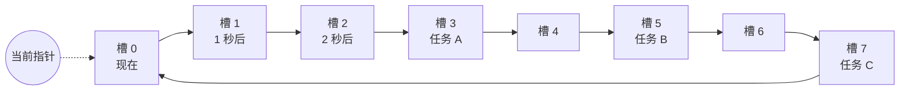
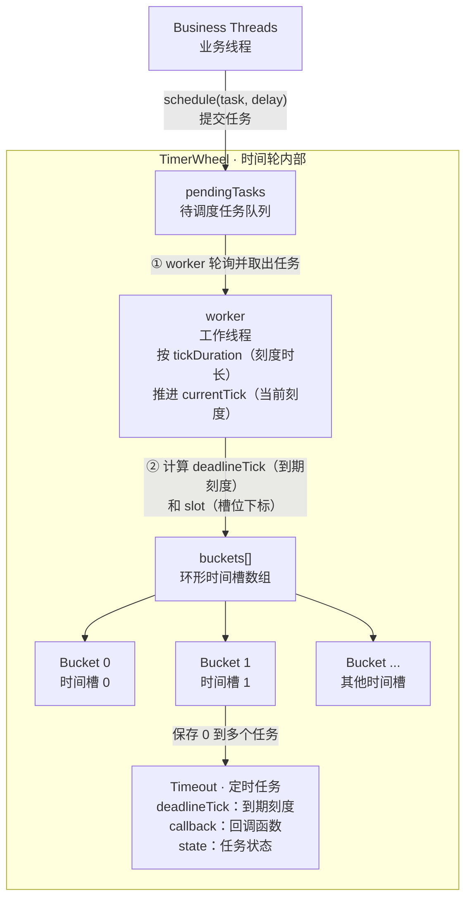
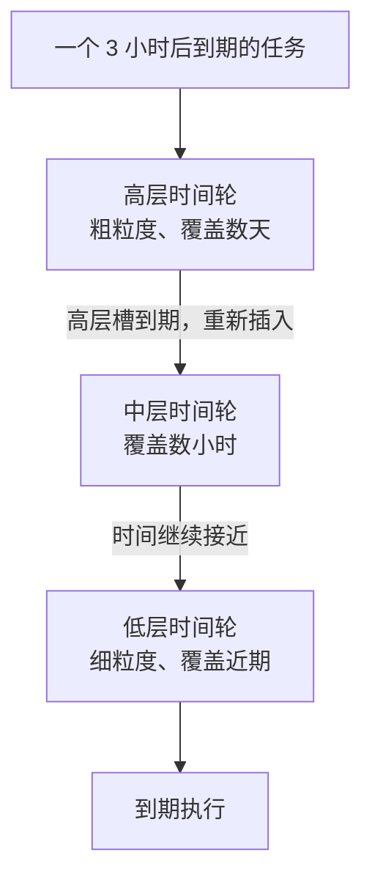

# 从钟表到定时器：时间轮算法原理、实现与工程实践

> 定时任务真正困难的地方，不是“等几秒再执行”，而是如何同时管理几十万甚至几百万个“等几秒再执行”。

在网络服务器里，我们经常会遇到这样的需求：

- 一个连接 30 秒没有收到数据，就断开；
- 一个请求超过 5 秒仍未完成，就判定超时；
- 一条消息发送失败，10 秒后重试；
- 一个订单创建 15 分钟后仍未支付，就自动关闭；
- 一个缓存项在若干秒后失效。

如果系统里只有几个定时任务，怎么实现都不会成为问题。可当一台服务器同时维持百万连接，每个连接又关联心跳、读超时、写超时等多个计时器时，定时任务本身就成了一种需要认真管理的系统资源。

这时，我们关心的不再只是“任务能否按时执行”，还包括：

1. 添加一个定时任务需要多少成本？
2. 取消一个定时任务需要多少成本？
3. 时间每前进一步，需要检查多少任务？
4. 系统暂停、时钟跳变或者某个任务执行很慢时，会发生什么？

时间轮（Timing Wheel）正是为这类问题而生。它把连续的时间切成一个个区间，把到期时间相近的任务放入同一个桶中，再用一个不断前进的指针驱动任务到期。

它的核心思想可以浓缩成一句话：

> 优先队列不断询问“谁最先到期”，时间轮则等待时间走到任务面前。

本文会从定时器的朴素实现开始，一步步推导单层时间轮、哈希时间轮和分层时间轮，最后给出一个可运行的 TypeScript 教学实现，并讨论生产环境中真正棘手的工程问题。

---

## 一、管理海量定时任务，难在哪里？

先把“定时任务”抽象成三个操作：

```text
start(task, delay)   添加一个 delay 时间后执行的任务
stop(task)           取消尚未执行的任务
tick(now)            推进时间，并触发到期任务
```

一个定时器实现得好不好，主要就看这三个操作的成本。

### 1. 每个任务启动一个线程

最直观的写法是：

```java
new Thread(() -> {
    Thread.sleep(delayMillis);
    task.run();
}).start();
```

它几乎没有数据结构可言，但问题也很明显：线程需要栈空间，需要参与操作系统调度，还会带来上下文切换。任务数量从十个增长到十万个时，这种方案完全不可接受。

即使改成线程池，也只是限制了执行任务的线程数，并没有解决“谁负责等待十万个不同的截止时间”这个问题。

### 2. 定期扫描所有任务

另一种办法是把所有任务放入列表，每隔一段时间遍历一次：

```java
for (TimerTask task : tasks) {
    if (task.deadline() <= now) {
        task.run();
    }
}
```

添加任务只需要 `O(1)`，但每次推进时间都要扫描全部 `n` 个任务，复杂度是 `O(n)`。

假设一百万个任务中只有十个到期，系统仍然做了一百万次检查。大部分计算都花在确认“它还没到期”上。

### 3. 使用有序链表或最小堆

既然任务有明确的截止时间，一个自然的想法是按截止时间排序。最小堆尤其适合这件事：

- 堆顶永远是最早到期的任务；
- 查看最近到期任务是 `O(1)`；
- 插入任务通常是 `O(log n)`；
- 删除指定任务通常也是 `O(log n)`，前提是能够定位其堆中位置；
- 每弹出一个到期任务，需要 `O(log n)`。

这是一个很优秀的通用方案。Java 的 `ScheduledThreadPoolExecutor` 一类通用调度器，本质上就需要维护按触发时间组织的任务结构。

但如果系统同时维护几百万个超时，并且任务被频繁添加、刷新和取消，`O(log n)` 仍然可能成为热点。更重要的是，很多超时任务并不要求在某个纳秒精确执行：连接超时晚几十毫秒通常可以接受。

于是我们可以做一笔交易：

> 放弃一部分时间精度，把时间离散化，以换取更低的任务管理成本。

这就是时间轮的出发点。

### 4. 几种方案的直观对比

| 方案 | 添加任务 | 取消任务 | 时间推进 | 特点 |
|---|---:|---:|---:|---|
| 每任务一个线程 | 高 | 高 | 交给系统调度 | 简单，但无法扩展 |
| 全量扫描 | `O(1)` | 视容器而定 | `O(n)` | 大量检查无效任务 |
| 最小堆 | `O(log n)` | `O(log n)` | 每个到期任务 `O(log n)` | 精度高、通用性强 |
| 单层时间轮 | 平均 `O(1)` | 可做到 `O(1)` | `O(1) + O(k)` | `k` 为当前槽任务数 |
| 分层时间轮 | `O(m)` | 可做到 `O(1)` | 与到期槽和级联任务有关 | `m` 为层数，通常很小 |

这里的 `O(1)` 不是“任何情况下都只执行一条指令”。哈希冲突、槽位热点、任务级联和内存分配都会影响实际成本。它表达的是：操作成本通常不随系统中的任务总数 `n` 增长。

---

## 二、从钟表建立时间轮的直觉

时间轮这个名字非常准确，因为它的工作方式真的很像钟表。

| 钟表 | 时间轮 |
|---|---|
| 表盘 | 环形槽位数组 |
| 刻度 | 时间槽（bucket / slot） |
| 秒针 | 当前指针 |
| 秒针移动一格 | 时间推进一个 tick |
| 闹钟 | 定时任务 |

因此，一个最小时间轮可以写成：

```text
时间轮 = 环形数组 + 移动指针 + 每个槽中的任务集合
```

假设我们有一个包含 8 个槽位的时间轮，每个槽代表 1 秒。指针当前位于槽 0：



现在加入三个任务：

- 任务 A：3 秒后执行；
- 任务 B：5 秒后执行；
- 任务 C：7 秒后执行。

我们不需要把三个任务互相比较，只要根据它们的延迟计算槽位，把它们分别放入槽 3、槽 5 和槽 7。

每过一秒，指针向前移动一格：

```text
t = 1s  -> 处理槽 1
t = 2s  -> 处理槽 2
t = 3s  -> 处理槽 3，执行 A
t = 4s  -> 处理槽 4
t = 5s  -> 处理槽 5，执行 B
```

时间轮没有反复扫描 A、B、C，也没有不断维护它们之间的先后关系。任务在加入时已经被分到了未来应该检查的时间区间。

从数据结构角度看，这是一种**时间分桶**。

---

## 三、时间轮的核心模型

上一节用钟表建立了直觉，这一节把它变成可以计算的模型。时间轮做的事情可以分成三步：

```text
真实时间  ->  第几个 tick  ->  数组中的哪个槽位
```

例如，一个任务在真实时间 `3.4s` 到期。时间轮会先把它映射到“不早于 3.4s 的第一个 tick”，再把这个 tick 映射到环形数组中的某个槽位。

理解这三层映射，是理解后续所有公式的关键。

### 1. 先认识核心变量

假设时间轮有 8 个槽，每个槽代表 1 秒：

```text
tickDuration = 1s
wheelSize    = 8
```

相关变量的含义如下：

| 名称 | 含义 |
|---|---|
| `tickDuration` | 一个 tick 持续多久，也就是指针移动一格所需的时间 |
| `wheelSize` | 时间轮一共有多少个槽位 |
| `startTime` | 时间轮启动时的时钟读数，是计算 tick 的时间原点 |
| `monotonicNow` | 当前的单调时钟读数，用于计算经过了多久 |
| `currentTick` | 从启动到现在，时间轮已经走到第几个 tick |
| `currentSlot` | 当前 tick 对应的数组槽位 |
| `delay` | 任务还希望等待多长时间 |
| `deadline` | 任务真正应该到期的时刻 |
| `deadlineTick` | 任务到期时对应的逻辑 tick |
| `slot` | 任务最终应该放入的数组槽位 |

这里的“单调时钟”只适合计算时间间隔，不代表年月日。TypeScript 可以使用 `performance.now()` 获得这种时钟读数。

### 2. tickDuration 和 wheelSize 决定时间轮的形状

`tickDuration` 决定时间轮的精度。比如：

```text
tickDuration = 100ms
```

表示指针每 100 毫秒移动一格。时间轮只能在 `100ms、200ms、300ms……` 这些刻度附近处理任务，无法直接表达 `230ms` 这样的中间位置。

`wheelSize` 决定一圈有多少格。一圈覆盖的时间为：

```text
interval = tickDuration × wheelSize
```

例如：

```text
tickDuration = 1s
wheelSize    = 8
interval     = 1s × 8 = 8s
```

也就是说，指针每秒移动一格，8 秒转完一圈。

### 3. currentTick 和 currentSlot 有什么区别？

`currentTick` 是持续递增的逻辑时间：

```text
currentTick = 0, 1, 2, 3, ...
```

它不会因为时间轮转完一圈就归零。`currentSlot` 才是环形数组下标，通过取模得到：

```text
currentSlot = currentTick % wheelSize
```

当 `wheelSize = 8` 时：

| `currentTick` | `currentSlot` | 含义 |
|---:|---:|---|
| 2 | 2 | 第一圈的槽 2 |
| 8 | 0 | 转完一圈，回到槽 0 |
| 10 | 2 | 第二圈再次到达槽 2 |
| 18 | 2 | 第三圈再次到达槽 2 |

因此：

- `currentSlot` 只能告诉我们“指针位于哪个槽”；
- `currentTick` 还能告诉我们“指针已经走了多远”。

保存一个不断递增的 `currentTick`，可以避免时间轮回绕后丢失圈次信息。

如果要根据真实时间计算当前 tick，可以写成：

```text
currentTick = floor((monotonicNow - startTime) / tickDuration)
```

`floor` 表示向下取整，因为只有完整经过一个 `tickDuration`，时间轮才算走完一个 tick。

### 4. 如何计算任务的 deadlineTick？

任务加入时间轮时，我们先不考虑槽位，先回答一个更直接的问题：

> 这个任务在真实时间线上什么时候到期？

答案是：

```text
deadline = monotonicNow + delay
```

其中：

- `monotonicNow` 是任务加入时的当前时刻；
- `delay` 是任务还要等待的时间；
- `deadline` 是二者相加得到的真正截止时刻。

接下来，把截止时刻换算成从时间轮启动以来的第几个 tick：

```text
deadlineTick = ceil((deadline - startTime) / tickDuration)
```

这个公式可以分三步理解：

```text
deadline - startTime
    = 任务到期时，时间轮一共运行了多久

(deadline - startTime) / tickDuration
    = 这段时间相当于多少个 tick

ceil(...)
    = 向上取整到一个完整 tick，保证任务不会提前执行
```

### 5. 用一个例子走完整个计算过程

假设：

```text
startTime    = 0s    // 时间轮在 0 秒启动
tickDuration = 1s    // 每个 tick 是 1 秒
wheelSize    = 8     // 一圈有 8 个槽
monotonicNow = 2.4s  // 当前真实时间
delay        = 1s    // 任务还要等待 1 秒
```

第一步，计算任务真正的到期时刻：

```text
deadline = monotonicNow + delay
         = 2.4s + 1s
         = 3.4s
```

第二步，把到期时刻换算成逻辑 tick：

```text
deadlineTick = ceil((deadline - startTime) / tickDuration)
             = ceil((3.4s - 0s) / 1s)
             = ceil(3.4)
             = 4
```

第三步，计算任务应该进入哪个槽位：

```text
slot = deadlineTick % wheelSize
     = 4 % 8
     = 4
```

因此，这个任务会进入槽 4，并在时间轮走到第 4 个 tick 时接受到期检查：

```text
0s        1s        2s   2.4s        3s   3.4s        4s
|---------|---------|-----↑----------|-----↑----------|
                         加入任务         真正到期      进入槽 4 的处理时机
```

时间轮没有 `3.4s` 这个刻度，因此只能选择后面的 `4s`，不能选择前面的 `3s`。这就是公式使用 `ceil` 向上取整的原因。


### 6. 环形数组留下了一个问题

到目前为止，我们已经能够计算任务应该进入哪个槽位：

```text
deadline     = monotonicNow + delay
deadlineTick = ceil((deadline - startTime) / tickDuration)
slot         = deadlineTick % wheelSize
```

但是，最后一步的取模运算会丢掉圈次信息。

假设时间轮有 8 个槽，`deadlineTick` 分别为 4、12 和 20 的三个任务，最终都会进入槽 4：

```text
4  % 8 = 4
12 % 8 = 4
20 % 8 = 4
```

三个任务虽然位于同一个槽，却应该分别在第一圈、第二圈和第三圈执行。如果指针第一次到达槽 4 时就执行其中所有任务，后两个任务都会被提前触发。

这说明 `slot` 只能回答：

> 任务应该放在哪个槽？

它无法回答另一个同样重要的问题：

> 指针第几次到达这个槽时，任务才真正到期？

问题由此自然出现：如果任务的延迟超过时间轮一圈能够覆盖的范围，我们应该记录什么额外信息，才能避免任务提前执行？下一章就来解决这个问题。

---

## 四、延迟超过一圈怎么办？

上一章留下的问题是：环形槽位会被重复使用，只有 `slot` 无法判断任务属于哪一圈。解决办法是在槽位之外，再保存一份能够区分圈次的信息。

继续使用一个 8 槽时间轮。假设任务恰好在 `currentTick = 2` 的 tick 边界加入，并希望等待 20 秒：

```text
wheelSize    = 8
tickDuration = 1s
currentTick  = 2
delay        = 20s
```

先计算任务的位置：

```text
ticks        = ceil(20s / 1s) = 20
deadlineTick = 2 + 20 = 22
slot         = 22 % 8 = 6
```

任务会进入槽 6，而指针会在 `currentTick = 6、14、22` 时反复到达这个槽。前两次必须跳过，第三次才能执行。下面介绍两种记录方式。

### 1. 记录 remainingRounds

先准确理解 `remainingRounds` 的含义。它不是“任务总共需要等待几圈”，而是：

> 在最终执行之前，指针还需要跳过多少次这个槽位。

在约定“指针先移动到下一个槽，再处理该槽”的情况下：

```text
remainingRounds = floor((ticks - 1) / wheelSize)
```

`ticks - 1` 表示到期 tick 之前的时间；除以一圈的 tick 数，就得到到期前需要跳过目标槽的次数。几个边界值最能说明公式中的 `-1`。为了让槽位下标更直观，下表暂时假设 `currentTick = 0`：

| 延迟 tick 数 | 目标槽位 | 指针访问目标槽的过程 | 初始 `remainingRounds` |
|---:|---:|---|---:|
| 8 | 0 | tick 8：执行 | 0 |
| 9 | 1 | tick 1：跳过；tick 9：执行 | 1 |
| 17 | 1 | tick 1：跳过；tick 9：跳过；tick 17：执行 | 2 |

延迟正好 8 个 tick 时，指针第一次回到槽 0 就应执行，所以 `remainingRounds` 为 0。如果不减 1，计算结果会是 1，任务就会错误地多等一圈。

工作线程到达目标槽时这样处理：

```text
if remainingRounds > 0:
    remainingRounds--
    本次跳过，不执行
else:
    执行任务
```

对于本章的 20 tick 任务：

```text
remainingRounds = floor((20 - 1) / 8) = 2
```

因此前两次经过槽 6 时各减一次，第三次经过时执行。

> `remainingRounds` 的公式依赖处理顺序。这里采用“先判断，大于 0 就减一并跳过，否则执行”。如果实现的移动和判断顺序不同，公式也必须相应调整。

### 2. 记录 deadlineTick

另一种办法是直接保存第三章计算出的绝对 `deadlineTick`。每次到达目标槽时比较：

```text
if currentTick >= deadlineTick:
    执行任务
else:
    本次跳过，继续等待
```

同一个 20 tick 任务，在两种方案下的处理过程如下：

| 到达槽 6 时 | `remainingRounds` 方案 | `deadlineTick = 22` 方案 |
|---:|---|---|
| `currentTick = 6` | 2 大于 0，减为 1，跳过 | 6 小于 22，跳过 |
| `currentTick = 14` | 1 大于 0，减为 0，跳过 | 14 小于 22，跳过 |
| `currentTick = 22` | 已经为 0，执行 | 22 等于 22，执行 |

两种方案的区别只是保存和判断的信息不同：

| 方案 | 保存的信息 | 到达槽位时的判断 |
|---|---|---|
| `remainingRounds` | 执行前还要跳过几次该槽位 | 圈数大于 0 就减一，否则执行 |
| `deadlineTick` | 任务到期的绝对逻辑 tick | 当前 tick 达到截止 tick 时执行 |

本文的教学实现选择 `deadlineTick`：它不需要持续修改圈数，判断条件也更直接。

---

## 五、单层时间轮的数据结构

一个实用的单层时间轮通常包含三类对象：



### 1. 为什么槽位中通常使用链表？

同一个时间区间可能包含多个任务，所以每个槽位保存的是任务集合。常见选择有：

- 普通链表；
- 双向链表；


如果取消任务时能够拿到任务节点引用，双向链表可以在 `O(1)` 时间内将它摘除。

### 2. 为什么还要有 pendingTasks？

先看一个现实情况：系统里可能有很多业务线程同时调用 `schedule()`，但只有一个时间轮工作线程在转动指针、处理槽位。

如果业务线程直接把任务写入 `bucket`，它就可能和工作线程撞在一起：

```text
工作线程正在遍历槽 3
        ↕ 同时发生
业务线程正在向槽 3 添加任务 A
```

这时会遇到两个问题：

1. 两个线程同时修改同一个槽位，必须加锁，否则可能破坏槽位中的链表；
2. 如果工作线程刚刚处理完槽 3，任务 A 才被放进去，它可能要等指针再转一整圈才能被看到。

给每个槽位加锁可以保护数据结构，却会让添加任务的业务线程和推进时间的工作线程争抢锁，代码也会变得更难推理。

`pendingTasks` 提供了一个更简单的办法：**业务线程先提交，工作线程统一入轮。**


可以把 `pendingTasks` 理解成工作线程的“收件箱”：

- 业务线程只负责把新任务投进收件箱；
- 工作线程定期打开收件箱；
- 工作线程根据最新的 `currentTick` 计算任务位置；
- 最后仍由工作线程把任务放入对应的 `bucket`。

关键点是：**只有工作线程能够修改 bucket。**

这样做有三个好处：

1. `bucket` 可以使用普通链表，不需要为并发写入加锁；
2. 不会出现业务线程添加任务时，工作线程恰好正在遍历同一槽位的冲突；
3. `schedule()` 的路径很短，业务线程把任务放入队列后就可以返回。

它也有一个代价：任务需要先在 `pendingTasks` 中等待工作线程取出，因此会增加一点交接延迟。如果业务线程提交得太快，队列还可能积压，所以生产实现需要监控队列长度。

一句话总结：

> `pendingTasks` 用一次队列交接，换来了“业务线程不碰槽位、工作线程独占槽位”的简单并发模型。

---

## 六、动手实现一个单层哈希时间轮

下面使用 TypeScript 实现一个完整的单层哈希时间轮。它具备这些能力：

- 添加一次性定时任务；
- 使用绝对 `deadlineTick` 支持超过一圈的延迟；
- 通过 `pendingTasks` 将任务提交和槽位修改分成两个阶段；
- 取消尚未执行的任务；
- 使用单调时钟计算经过时间；
- 事件循环停顿后追赶遗漏的 tick；
- 将到期回调重新提交，避免直接混入槽位遍历逻辑。

为了突出核心算法，示例没有实现完整的监控指标、任务持久化、对象池、队列上限以及关闭时返回未完成任务等生产特性。

### 1. 完整实现

TypeScript 通常运行在 JavaScript 单线程事件循环中，因此这个版本不需要为槽位加锁：

- `schedule()` 只把任务放入 `pendingTasks`；
- 时间轮回调统一计算 `deadlineTick` 和 `slot`；
- 只有时间轮回调能够修改 `buckets`；
- `performance.now()` 提供适合计算时间间隔的单调时钟；
- 每次使用 `setTimeout` 规划下一 tick，避免 `setInterval` 产生累计漂移。

完整代码如下：

```typescript
type TimerTask = () => void;
type TaskExecutor = (task: TimerTask) => void;
type TimeoutState = "scheduled" | "cancelled" | "expired";

/**
 * schedule() 返回的任务句柄。
 *
 * deadlineMs 保存基于 performance.now() 的单调截止时刻；
 * deadlineTick 在任务真正进入时间轮时由 worker 计算。
 */
class TimeoutHandle {
  public deadlineTick = 0;
  public readonly task: TimerTask;
  public readonly deadlineMs: number;
  private state: TimeoutState = "scheduled";

  public constructor(task: TimerTask, deadlineMs: number) {
    this.task = task;
    this.deadlineMs = deadlineMs;
  }

  /** 只有尚未到期的任务才能取消成功。 */
  public cancel(): boolean {
    if (this.state !== "scheduled") {
      return false;
    }
    this.state = "cancelled";
    return true;
  }

  public isCancelled(): boolean {
    return this.state === "cancelled";
  }

  /** 从 scheduled 原子语义地转换为 expired。 */
  public markExpired(): boolean {
    if (this.state !== "scheduled") {
      return false;
    }
    this.state = "expired";
    return true;
  }
}

/**
 * 单层哈希时间轮的教学实现。
 *
 * JavaScript/TypeScript 通常运行在单线程事件循环中，因此这里不需要锁：
 * schedule() 只写 pendingTasks，时间轮回调独占 buckets 的修改权。
 */
class HashedWheelTimer {
  private readonly tickDurationMs: number;
  private readonly wheelSize: number;
  private readonly executor: TaskExecutor;
  private readonly buckets: Array<Set<TimeoutHandle>>;
  private pendingTasks: TimeoutHandle[] = [];
  private readonly startTimeMs = performance.now();

  private currentTick = 0;
  private running = true;
  private timerId: ReturnType<typeof setTimeout> | undefined;

  public constructor(
    tickDurationMs: number,
    wheelSize: number,
    executor: TaskExecutor = (task) => setTimeout(task, 0),
  ) {
    if (!Number.isFinite(tickDurationMs) || tickDurationMs <= 0) {
      throw new Error("tickDurationMs must be positive");
    }
    if (!Number.isInteger(wheelSize) || wheelSize <= 0) {
      throw new Error("wheelSize must be a positive integer");
    }

    this.tickDurationMs = tickDurationMs;
    this.wheelSize = wheelSize;
    this.executor = executor;

    // 每个槽使用 Set 保存任务，删除已到期或已取消任务比较方便。
    this.buckets = Array.from({ length: wheelSize }, () => new Set());
    this.scheduleNextTick();
  }

  /**
   * 添加一个一次性任务。
   *
   * 这里先放入 pendingTasks，而不是直接操作 bucket。
   * 下一次 worker 运行时，会基于最新 currentTick 决定任务位置。
   */
  public schedule(task: TimerTask, delayMs: number): TimeoutHandle {
    if (!this.running) {
      throw new Error("timer is closed");
    }
    if (!Number.isFinite(delayMs) || delayMs < 0) {
      throw new Error("delayMs must not be negative");
    }

    // 至少等待一个 tick，避免把新任务放入已经处理过的当前槽。
    const effectiveDelayMs = Math.max(delayMs, this.tickDurationMs);
    const deadlineMs = performance.now() + effectiveDelayMs;
    const timeout = new TimeoutHandle(task, deadlineMs);
    this.pendingTasks.push(timeout);
    return timeout;
  }

  /** 按绝对时间规划下一次唤醒，避免 setInterval 的累计漂移。 */
  private scheduleNextTick(): void {
    if (!this.running) {
      return;
    }

    const nextTick = this.currentTick + 1;
    const nextDeadlineMs =
      this.startTimeMs + nextTick * this.tickDurationMs;
    const waitMs = Math.max(0, nextDeadlineMs - performance.now());

    this.timerId = setTimeout(() => this.advanceClock(), waitMs);
  }

  /** 推进逻辑时间，并追赶事件循环阻塞期间错过的 tick。 */
  private advanceClock(): void {
    if (!this.running) {
      return;
    }

    const nowMs = performance.now();
    const expectedTick = Math.max(
      this.currentTick + 1,
      Math.floor((nowMs - this.startTimeMs) / this.tickDurationMs),
    );

    while (this.currentTick < expectedTick) {
      this.currentTick++;

      // 先把新任务转移到槽位，再处理当前 tick 对应的 bucket。
      this.transferPendingTasks(performance.now());
      this.expireCurrentBucket();
    }

    this.scheduleNextTick();
  }

  /** worker 独占该方法，把 pendingTasks 中的任务放入对应槽位。 */
  private transferPendingTasks(nowMs: number): void {
    // 先替换数组，确保转移期间新提交的任务留到下一轮处理。
    const tasks = this.pendingTasks;
    this.pendingTasks = [];

    for (const timeout of tasks) {
      if (timeout.isCancelled()) {
        continue;
      }

      // 如果任务在 pendingTasks 排队时已经到期，直接提交执行。
      if (timeout.deadlineMs <= nowMs) {
        this.expire(timeout);
        continue;
      }

      const elapsedMs = timeout.deadlineMs - this.startTimeMs;
      const calculatedTick = Math.ceil(elapsedMs / this.tickDurationMs);

      // 当前槽可能已经处理过，最早只能安排到下一个 tick。
      timeout.deadlineTick = Math.max(
        calculatedTick,
        this.currentTick + 1,
      );

      const slot = timeout.deadlineTick % this.wheelSize;
      this.buckets[slot].add(timeout);
    }
  }

  /** 只检查当前槽；同槽的远期任务通过 deadlineTick 判断圈次。 */
  private expireCurrentBucket(): void {
    const slot = this.currentTick % this.wheelSize;
    const bucket = this.buckets[slot];

    for (const timeout of bucket) {
      if (timeout.isCancelled()) {
        bucket.delete(timeout);
      } else if (timeout.deadlineTick <= this.currentTick) {
        bucket.delete(timeout);
        this.expire(timeout);
      }
    }
  }

  /** 改变任务状态，并交给外部执行器，避免在时间轮逻辑中直接运行回调。 */
  private expire(timeout: TimeoutHandle): void {
    if (!timeout.markExpired()) {
      return;
    }

    this.executor(() => {
      try {
        timeout.task();
      } catch (error) {
        console.error("timer task failed", error);
      }
    });
  }

  /** 停止推进；教学实现直接丢弃尚未到期的任务。 */
  public close(): void {
    this.running = false;
    if (this.timerId !== undefined) {
      clearTimeout(this.timerId);
      this.timerId = undefined;
    }
  }
}

// -------------------- 运行示例 --------------------

const begin = performance.now();
const timer = new HashedWheelTimer(100, 8);

const printElapsed = (name: string): void => {
  const elapsed = Math.round(performance.now() - begin);
  console.log(`task ${name} fired at about ${elapsed} ms`);
};

timer.schedule(() => printElapsed("A"), 300);
timer.schedule(() => printElapsed("B"), 1_000);
const cancelled = timer.schedule(() => printElapsed("C"), 2_000);

setTimeout(() => {
  console.log(`cancel C: ${cancelled.cancel()}`);
}, 200);

setTimeout(() => timer.close(), 1_400);
```

在安装了 TypeScript 运行器的项目中，可以这样运行独立示例：

```bash
npx tsx examples/hashed-wheel-timer.ts
```

### 2. 代码的运行流程

调用 `schedule()` 时，任务还不会直接进入槽位：

```text
schedule()
    -> 计算 deadlineMs
    -> 创建 TimeoutHandle
    -> 放入 pendingTasks
```

事件循环唤醒时间轮后，再执行真正的入轮和到期检查：

```text
advanceClock()
    -> 计算理论上应该到达的 tick
    -> 逐格追赶 currentTick
    -> transferPendingTasks()
    -> expireCurrentBucket()
    -> 规划下一次唤醒
```

`transferPendingTasks()` 使用下面的公式定位槽位：

```text
deadlineTick = ceil((deadline - startTime) / tickDuration)
slot         = deadlineTick % wheelSize
```

`expireCurrentBucket()` 只检查当前槽：

```text
deadlineTick <= currentTick  -> 到期，提交回调
deadlineTick > currentTick   -> 尚未到期，继续等待下一圈
```

### 3. 为什么不使用 setInterval？

`setInterval(tickDuration)` 表达的是“每隔一段时间再执行一次”。如果某次事件循环被阻塞，后续执行很容易继续带着之前的延迟。

示例每次都根据绝对 tick 位置计算下一次唤醒时刻：

```text
nextDeadline = startTime + nextTick × tickDuration
wait         = nextDeadline - monotonicNow
```

同时，`advanceClock()` 会计算当前理论上应该到达的 tick：

```text
expectedTick = floor((monotonicNow - startTime) / tickDuration)
```

如果事件循环一次错过了多个 tick，就从 `currentTick + 1` 逐格追赶到 `expectedTick`，不会只移动一格。

### 4. 示例输出为什么不是精确值？

示例输出大致如下：

```text
cancel C: true
task A fired at about 300~400 ms
task B fired at about 1000~1100 ms
```

输出不会恰好固定在 300 毫秒和 1000 毫秒，原因包括：

- 任务加入时间可能不与 tick 边界对齐；
- 向上取整会带来不足一个 tick 的量化误差；
- JavaScript 事件循环可能正忙；
- 到期回调还要等待执行器安排。

任务 B 的延迟为 1000 毫秒，而一圈只有 `100ms × 8 = 800ms`，因此它同时验证了超过一圈的任务仍能正确执行。任务 C 在到期前被取消，所以不会输出。

### 5. 添加任务为什么接近 O(1)？

`schedule()` 只做三件事：

1. 计算绝对截止时间；
2. 创建任务句柄；
3. 把任务追加到 `pendingTasks`。

时间轮随后通过一次除法和一次取模定位槽位，不需要与已有的 `n` 个任务比较，因此平均成本不随任务总数增长。

这个教学版本的 `pendingTasks` 是普通数组，没有容量上限。生产实现应考虑队列长度监控、任务上限和过载拒绝策略。

### 6. 取消任务如何工作？

任务状态只有三种：

```text
scheduled -> cancelled
scheduled -> expired
```

TypeScript 代码运行在单线程事件循环中，`cancel()` 和到期检查不会在同一时刻并行修改状态，因此使用普通状态字段即可：

- `cancel()` 先发生，状态变成 `cancelled`，时间轮不会执行任务；
- 到期检查先发生，状态变成 `expired`，之后调用 `cancel()` 会返回 `false`。

一旦回调已经交给执行器，取消就不能中断正在运行的代码。如果将实现扩展到 Worker Threads 或共享内存环境，则需要改用消息传递或原子操作协调状态。

### 7. 为什么采用惰性取消？

`cancel()` 只修改任务状态，没有立刻从槽位中查找并删除任务。时间轮下次访问对应槽位时，才会清理已取消任务。

这样做的优点是取消路径短，也不会在取消时遍历槽位；缺点是任务对象会继续占用一段时间的内存，最坏接近一圈。大量远期任务频繁取消时，可以改用能够直接定位节点的双向链表，并把主动删除操作也交给时间轮统一处理。

### 8. 一次 tick 的成本是什么？

每个 tick 的基础操作只是推进指针并定位一个槽，成本是 `O(1)`。如果当前槽中有 `k` 个任务，还需要检查这些任务，因此总成本为：

```text
O(1) + O(k)
```

如果几十万个任务集中落入同一个槽位，它们仍会在同一个 tick 被集中处理。时间轮消除的是对全部任务的反复扫描，并不能消除同时到期任务本身的处理成本。

---

## 七、从单层时间轮到分层时间轮

单层时间轮面临一个明显矛盾：

- tick 越小，精度越高；
- wheelSize 越大，一圈覆盖越久；
- 但更小的 tick 会增加推进频率，更大的 wheelSize 会占用更多槽位。

假设系统既要支持 10 毫秒后的网络超时，又要支持 7 天后的任务。如果只用一层并坚持 10 毫秒精度，覆盖 7 天需要：

```text
7 × 24 × 60 × 60 × 100 = 60,480,000 个槽位
```

显然不划算。

### 1. 像钟表一样增加秒针、分针和时针

机械钟表不会在表盘上画出一天中的每一毫秒，而是使用不同速度的指针表达不同尺度的时间。分层时间轮（Hierarchical Timing Wheel）也是如此：

- 最底层粒度最细，负责近期任务；
- 越往上，单个槽位代表的时间越长；
- 远期任务先放进高层轮；
- 时间逐渐接近后，高层槽到期，任务被重新插入较低层；
- 最终进入最底层并执行。



### 2. 每一层覆盖多长时间？

假设每层都有 64 个槽：

| 层级 | 每格粒度 | 单层覆盖范围 |
|---|---:|---:|
| 第 0 层 | 10ms | 640ms |
| 第 1 层 | 640ms | 40.96s |
| 第 2 层 | 40.96s | 约 43.69min |
| 第 3 层 | 约 43.69min | 约 46.6h |
| 第 4 层 | 约 46.6h | 约 124 天 |

只用 `64 × 5 = 320` 个槽位，就可以同时表达 10 毫秒级近期任务和数月后的远期任务。

### 3. 任务应该进入哪一层？

通常选择**能够覆盖该任务的最低一层**：

```text
如果 deadline < 第 0 层当前时间 + 第 0 层覆盖范围
    放入第 0 层
否则如果 deadline < 第 1 层当前时间 + 第 1 层覆盖范围
    放入第 1 层
否则
    继续向更高层查找
```

这样既能避免远期任务在低层被反复检查，又让即将到期的任务尽量靠近细粒度层。

### 4. “下沉”本质上是重新插入

高层某个槽位到期时，其中的任务未必真的到期。系统会把槽内任务取出，按照它们与当前时间的距离重新定位：

```text
高层槽到期
    -> 取出任务
    -> 使用原始 deadline 再次 add
    -> 任务进入更低一层
    -> 最底层到期后执行
```

因此分层时间轮的插入复杂度通常写作 `O(m)`，其中 `m` 是层数。层数一般远小于任务数 `n`，而且通常只是几层，可以视为很小的常数。

---

## 八、工程实现中真正棘手的问题

一个能演示算法的时间轮只有几百行，一个可靠的生产级定时器却需要回答更多问题。

### 1. tickDuration 应该选多大？

`tickDuration` 是精度与成本之间最重要的旋钮。

设置得太小：

- 工作线程唤醒更频繁；
- 空槽也要不断推进；
- 调度、时钟读取和循环本身的成本上升；
- 在普通操作系统上，极小 tick 也未必能带来同等精度。

设置得太大：

- 任务触发误差增大；
- 更多任务聚集到同一槽位；
- 短延迟任务无法被准确表达。

选择它时应该从业务容忍度出发，而不是盲目追求毫秒：

```text
tickDuration <= 业务能够接受的最大额外调度误差
```

如果连接 30 秒无响应才断开，100 毫秒误差可能完全可接受；如果是音视频帧调度或者高精度交易逻辑，时间轮可能就不是正确工具。

### 2. 使用墙上时钟还是单调时钟？

TypeScript 的 `Date.now()` 表示现实世界时间，可能因为人工校时、NTP 同步等原因前跳或回拨。如果用它计算“已经过去多久”，时钟回拨可能让任务凭空多等一段时间。

计算持续时间应使用单调时钟。TypeScript 可以写成：

```typescript
const elapsedMs = performance.now() - startTimeMs;
```

如果业务传入的是“2026-08-23 10:00 执行”，可以在入口处用墙上时钟把它转换成相对延迟，进入时间轮后再使用单调时钟推进。对于跨重启的绝对时间任务，还需要持久化和重建机制。

### 3. 工作线程暂停后不能只走一格

工作线程可能因为以下原因错过 tick：

- 操作系统调度延迟；
- Stop-The-World；
- 虚拟机或容器被暂停；
- 当前槽任务太多；
- 错误地在时间轮线程中执行了慢回调。

假设 tick 为 100 毫秒，线程暂停了 5 秒，恢复后不能只把指针前进一格。正确方式是根据单调时钟计算理论 tick：

```text
expectedTick = (now - startTime) / tickDuration
```

然后从 `currentTick + 1` 逐步追赶到 `expectedTick`，确保遗漏槽位都得到处理。

追赶本身也可能形成负载尖峰。生产系统往往还要限制单轮最大处理量、记录滞后指标，并为严重落后设计降级策略。

### 4. 时间轮线程只负责“判定到期”

不要让时间轮工作线程直接运行不受控的业务逻辑：

```text
时间轮线程：推进时间、摘出到期任务
执行器线程：真正运行任务回调
```

否则一个耗时 3 秒的回调，就可能让整个时间轮停滞 3 秒。

但交给线程池也不代表问题消失了。此时“到期”至少有两个时刻：

1. 时间轮识别任务已经到期；
2. 执行器真正开始运行任务。

线程池排队会扩大二者之间的差距，所以需要分别监控：

- 时间轮 tick 滞后；
- 到期任务提交速率；
- 执行队列长度；
- 从 deadline 到开始执行的延迟；
- 回调执行时长和异常数。

### 5. 如何处理槽位热点？

大量连接可能在同一批次建立，并拥有相同的 30 秒超时，于是几十万个任务会落入同一个槽。

常见手段包括：

- 缩小 tick，让任务分散到更多槽；
- 为非严格超时加入小范围随机抖动；
- 只在时间轮线程中摘出任务，交给有界执行器；
- 限制每轮处理预算，但要接受额外延迟；
- 让槽内任务使用更细一级的数据结构；
- 从业务上合并可以批量处理的超时。

需要注意：随机抖动只能用于业务允许的场景，不能随意改变有明确截止时间的语义。

### 6. 添加、取消与到期的并发语义

至少需要明确这些竞态：

- 任务尚在 pending 队列中就被取消；
- 工作线程正把任务移入槽位时，另一个线程取消；
- 工作线程正准备提交回调时，另一个线程取消；
- 任务已经进入执行器队列，但尚未开始执行；
- 回调已经开始执行。

“取消成功”的准确含义必须写进 API 契约。常见定义是：只有 `SCHEDULED -> CANCELLED` 的原子转换成功，取消才返回 `true`；一旦状态变成 `EXPIRED`，就不保证阻止执行。

### 7. 关闭时怎么办？

关闭不是简单地让线程退出。生产实现通常要定义：

- 是否拒绝新任务；
- 未到期任务是取消、返回给调用方，还是持久化；
- 已到期但尚未提交的任务怎么办；
- 已提交给执行器的任务是否等待；
- 工作线程应等待多久；
- 是否允许在回调内部关闭时间轮。

本文的教学实现在关闭时会停止时间推进并丢弃未到期任务。真实库的 API 应提供更完整的生命周期语义。

### 8. 时间轮不等于可靠任务调度平台

时间轮首先是一个**内存中的定时任务索引结构**。它本身通常不提供：

- 进程崩溃后的恢复；
- 任务持久化；
- 集群故障转移；
- 恰好一次执行；
- Cron 日历语义；
- 跨节点一致性。

订单超时关闭之类的核心业务任务，如果要求服务重启后仍然存在，就不能只放在进程内时间轮里。可以用数据库、日志或消息系统保存事实，再让时间轮承担节点内部的近期任务加速。

---

## 九、什么时候应该使用时间轮？

时间轮更适合以下场景：

- 同时存在大量定时任务；
- 任务被频繁添加、续期和取消；
- 允许一个 tick 左右的时间误差；
- 任务主要用于连接、请求、锁、缓存等超时管理；
- 需要降低任务操作成本，而不是提供日历调度。

以下场景则应谨慎：

- 任务数量很少，通用调度器已经足够；
- 要求非常高的触发精度；
- 任务必须跨进程重启恢复；
- 需要分布式容错或严格的一次性语义；
- 需要复杂 Cron、节假日或时区规则；
- 大多数任务都集中在同一时刻到期，且业务处理本身才是瓶颈。

可以用下面的表格快速选型：

| 需求 | 更合适的起点 |
|---|---|
| 少量进程内延迟任务 | 通用调度线程池 |
| 高精度、需要随时知道最近截止时间 | 最小堆 / 优先队列 |
| 海量近似超时任务 | 单层哈希时间轮 |
| 海量、跨度从毫秒到数天 | 分层时间轮 |
| 可恢复的业务延迟任务 | 数据库或持久化消息系统 |
| 分布式定时调度 | 专用调度平台 |

最好的数据结构不是理论复杂度最低的那个，而是最符合任务规模、时间精度、生命周期和可靠性要求的那个。

---

## 十、真实系统中的时间轮

理解完模型后，再看真实项目会清晰得多。

### 1. Netty 的 HashedWheelTimer

Netty 提供了 `HashedWheelTimer`，官方将它描述为针对**近似 I/O 超时调度**优化的定时器。它允许配置 tick 时长和每圈槽位数；官方文档也明确提醒，不要为每个连接创建一个实例，因为每个实例都会关联专用工作线程，通常应该在应用内共享。

这与本文的推导完全一致：网络连接超时数量大、添加和取消频繁，同时通常允许一定误差，是哈希时间轮非常典型的使用场景。

不过，使用框架时仍然应该确认当前组件是否已经有更合适的 EventLoop 调度能力，而不是看到“超时”就主动创建新的时间轮。

参考：[Netty `HashedWheelTimer` 官方 API 文档](https://netty.io/4.2/api/io/netty/util/HashedWheelTimer.html)

### 2. Kafka 的分层时间轮

Kafka 当前源码中的 `TimingWheel` 明确实现了分层时间轮：底层轮负责细粒度时间范围，超出当前层覆盖范围的任务会进入按需创建的 `overflowWheel`。高层槽到期后，任务被重新插入，从而逐步进入更细粒度的轮。

它还把槽位 `TimerTaskList` 放入 `DelayQueue`。这里延迟队列管理的不是每一个任务，而是**有到期时间的槽位桶**：大量任务共享同一个桶的唤醒事件。这是一种很值得注意的组合设计。

参考：

- [Kafka `TimingWheel.java`](https://github.com/apache/kafka/blob/trunk/server-common/src/main/java/org/apache/kafka/server/util/timer/TimingWheel.java)
- [Kafka `SystemTimer.java`](https://github.com/apache/kafka/blob/trunk/server-common/src/main/java/org/apache/kafka/server/util/timer/SystemTimer.java)
- [Kafka `TimerTaskList.java`](https://github.com/apache/kafka/blob/trunk/server-common/src/main/java/org/apache/kafka/server/util/timer/TimerTaskList.java)

观察这些源码时，可以沿着四个问题阅读：

1. 任务如何根据 deadline 定位槽位？
2. 超出当前层覆盖范围时如何创建和进入高层轮？
3. 槽位到期后如何重新插入任务？
4. 取消任务如何从链表中摘除？

有了这四条线索，源码中的字段和方法就不再是孤立细节。

---

## 十一、重新认识时间轮的复杂度

我们经常用“时间轮插入和删除都是 `O(1)`”来概括它，但这句话需要几个限定条件。

### 添加

单层哈希时间轮通过计算直接定位槽位，平均为 `O(1)`。分层时间轮可能逐层查找，复杂度为 `O(m)`，其中层数 `m` 通常很小。

### 取消

如果任务句柄保存了所在链表节点，主动摘除可做到 `O(1)`；如果只标记取消，取消操作本身是 `O(1)`，但清理成本被推迟到了以后。

### 推进

访问一个空槽是 `O(1)`，处理当前槽是 `O(k)`。如果线程错过 `d` 个 tick，需要追赶 `d` 个槽；如果高层槽到期，还会产生级联重插入。

### 执行

任何数据结构都无法消除真正的业务工作。十万个任务同时到期，至少要对这十万个任务做一次状态处理。时间轮优化的是**定位应该处理的任务**，不是让业务回调免费执行。

因此，更准确的描述是：

> 时间轮把许多与任务总数 `n` 相关的排序和扫描成本，转化成与槽位、当前到期任务数以及有限层级相关的成本。

---

## 十二、总结

从最朴素的定时器出发，我们经历了这样一条演进路线：

```text
每任务一个线程
    -> 全量扫描
    -> 按截止时间排序
    -> 单层哈希时间轮
    -> 分层时间轮
```

现在可以从三个角度理解时间轮。

从数据结构看：

> 时间轮是一个环形槽位数组，每个槽位保存一组到期时间相近的任务。

从算法思想看：

> 时间轮通过离散化和分桶，把全局排序问题转化成按时间访问局部任务的问题。

从工程角度看：

> 时间轮用可控的时间精度，换取海量定时任务下更稳定的添加、取消和到期定位成本。

它不是所有定时任务问题的标准答案，也不是一个天然可靠的分布式调度系统。但在网络超时、请求超时、缓存过期、延迟重试等海量近似计时场景中，它是一种极其漂亮的设计：数据结构本身就是一只钟，指针不需要寻找未来，未来会随着时间主动来到指针面前。

---

## 参考资料

1. George Varghese, Tony Lauck, [Hashed and Hierarchical Timing Wheels: Data Structures for the Efficient Implementation of a Timer Facility](https://www.cs.columbia.edu/~nahum/w6998/papers/sosp87-timing-wheels.pdf)
2. [Netty `HashedWheelTimer` API Reference](https://netty.io/4.2/api/io/netty/util/HashedWheelTimer.html)
3. [Apache Kafka `TimingWheel.java`](https://github.com/apache/kafka/blob/trunk/server-common/src/main/java/org/apache/kafka/server/util/timer/TimingWheel.java)
4. [Apache Kafka `SystemTimer.java`](https://github.com/apache/kafka/blob/trunk/server-common/src/main/java/org/apache/kafka/server/util/timer/SystemTimer.java)
5. [Apache Kafka `TimerTaskList.java`](https://github.com/apache/kafka/blob/trunk/server-common/src/main/java/org/apache/kafka/server/util/timer/TimerTaskList.java)
