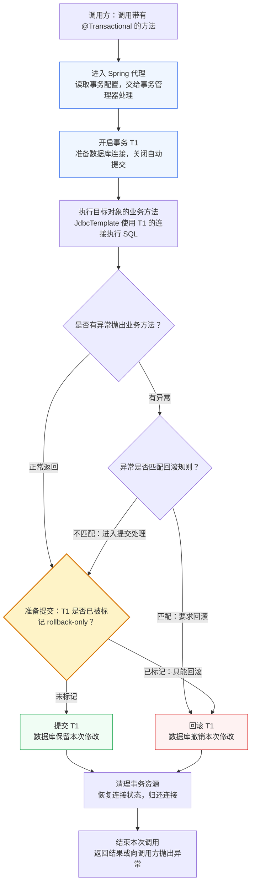
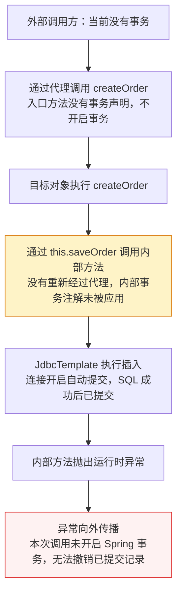
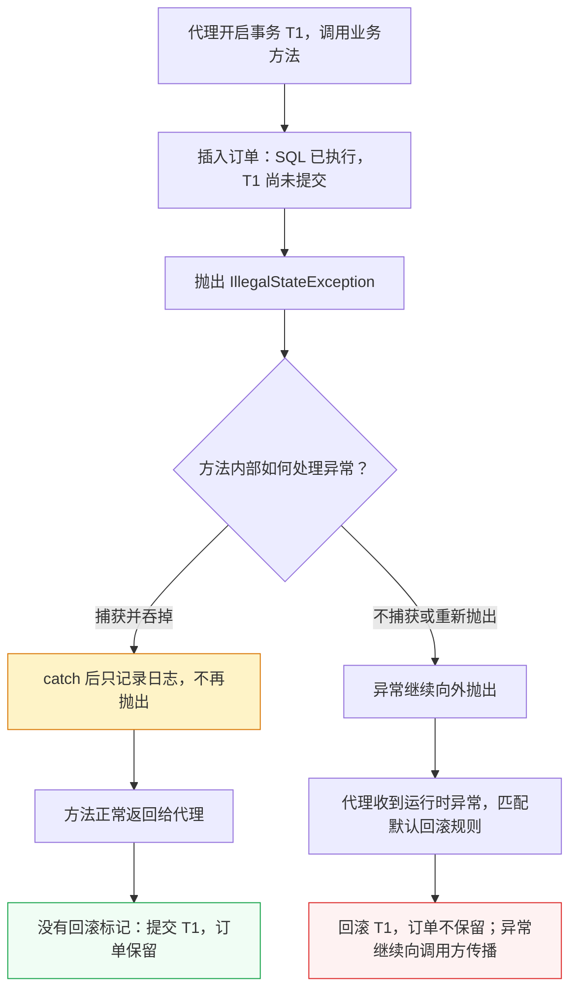
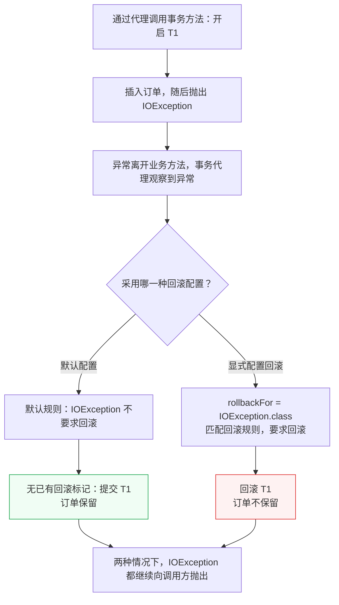
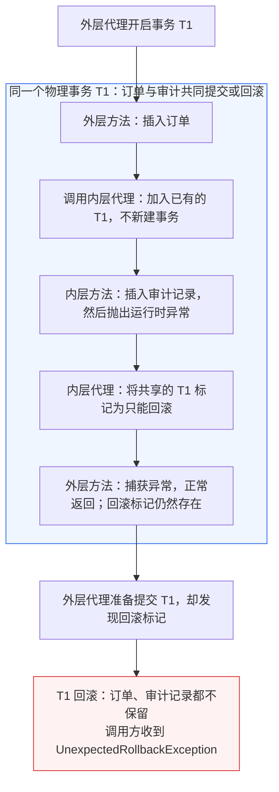
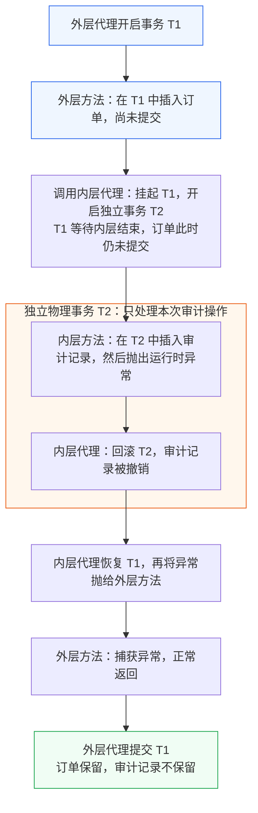
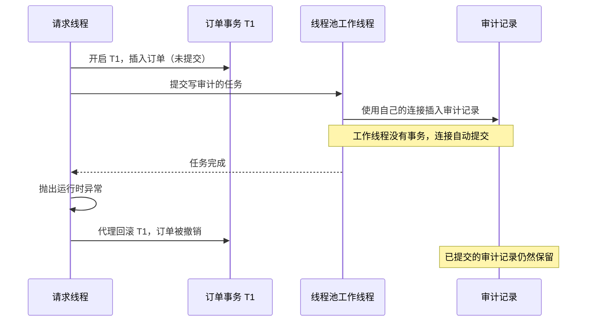
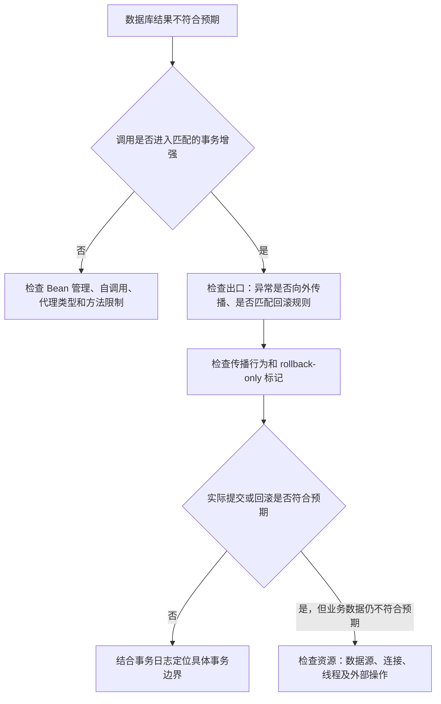

# 为什么 Spring 的 @Transactional 有时会失效？从代理机制讲起

给方法加上 `@Transactional`，在发生异常时让数据库回滚，是 Spring 开发中很常见的用法。但实际项目里，我们经常会遇到这样的现象：注解写了，异常也抛了，数据库里的记录却还在。

本文先讲 `@Transactional` 如何通过代理管理事务，再分别分析代理未生效、回滚结果不符合预期、操作没有参与事务这三类问题，最后给出排查思路。


## 一、@Transactional 的原理：一次调用经历了什么？

在默认代理模式下，调用方先调用 Spring 创建的代理对象，代理再调用业务对象，并在方法执行前后处理事务。

下面以**没有外层事务、默认 REQUIRED 传播行为、同步 JDBC 操作**为例。`REQUIRED` 表示有事务就加入，没有就新建。T1 是本次调用新建的事务。`rollback-only`（只能回滚）是事务状态标记；标记后事务不能提交，但不一定立即回滚。即使异常不匹配回滚规则，已有的 rollback-only 标记仍会阻止提交。



## 二、第一类：事务增强没有执行

### 2.1 自调用：内部方法没有重新经过代理

下面的 `createOrder()` 在同一个类中调用带事务注解的 `saveOrder()`：

```java
@Service
public class OrderService {
    private final JdbcTemplate jdbcTemplate;

    public OrderService(JdbcTemplate jdbcTemplate) {
        this.jdbcTemplate = jdbcTemplate;
    }

    public void createOrder(long id) {
        saveOrder(id);
    }

    @Transactional
    public void saveOrder(long id) {
        jdbcTemplate.update("insert into purchase_order(id) values (?)", id);
        throw new IllegalStateException("模拟失败");
    }
}
```

假设外部通过 Spring 代理调用 `createOrder()`，当前没有已有事务，连接开启自动提交。调用路径如下：



`createOrder()` 进入目标对象后，`saveOrder(id)` 相当于 `this.saveOrder(id)`：它直接调用目标对象，没有再次经过代理，内部方法的事务属性因此没有应用。

#### 自调用场景想使用事务，怎么解决？

根据需要的事务范围，可以选择以下三种方案。

**方案一：整个业务操作共用事务——把注解放到外部调用的入口方法上。**

```java
// OrderService：由调用方通过 Spring 代理调用 createOrder()
@Transactional
public void createOrder(long id) {
    saveOrder(id);
}

private void saveOrder(long id) {
    // 使用 JdbcTemplate 保存订单
}
```

代理在进入 `createOrder()` 前开启事务，内部 `saveOrder()` 的数据库操作参与这个事务，不需要再给它加注解。内部方法抛出的运行时异常如果继续传播到入口方法之外，代理就会按默认规则回滚。

**方案二：内部方法需要自己的事务属性——提取到另一个 Bean，通过代理调用。**

```java
@Service
public class OrderService {
    private final OrderWriter orderWriter;

    public OrderService(OrderWriter orderWriter) {
        this.orderWriter = orderWriter;
    }

    public void createOrder(long id) {
        orderWriter.saveOrder(id);
    }
}

@Service
public class OrderWriter {
    @Transactional
    public void saveOrder(long id) {
        // 使用 JdbcTemplate 保存订单
    }
}
```

注入的 `OrderWriter` 是 Spring 提供的代理引用，调用会进入其事务拦截逻辑。如果需要独立事务，可以在 `saveOrder()` 上配置 `REQUIRES_NEW`：存在外层事务时先挂起它，再开启新事务。

**方案三：只让方法中的一段代码使用事务——使用 TransactionTemplate。**

`TransactionTemplate` 提供一种显式划定事务范围的方式：把需要放在事务中的代码写进回调。Spring 在执行回调前处理事务，在回调结束后处理提交或回滚。

```java
@Service
public class OrderService {
    private final TransactionTemplate transactionTemplate;
    private final JdbcTemplate jdbcTemplate;

    public OrderService(TransactionTemplate transactionTemplate,
                        JdbcTemplate jdbcTemplate) {
        this.transactionTemplate = transactionTemplate;
        this.jdbcTemplate = jdbcTemplate;
    }

    public void createOrder(long id) {
        validateOrder(id); // 事务回调之外

        transactionTemplate.executeWithoutResult(status -> {
            // 事务回调开始
            saveOrder(id);
            saveOrderLog(id);
            // 事务回调结束
        });
    }

    private void validateOrder(long id) {
        if (id <= 0) {
            throw new IllegalArgumentException("订单 ID 必须为正数");
        }
    }

    private void saveOrder(long id) {
        jdbcTemplate.update("insert into purchase_order(id) values (?)", id);
    }

    private void saveOrderLog(long id) {
        jdbcTemplate.update("insert into order_log(order_id) values (?)", id);
    }
}
```

这里假设调用方**没有已有事务**，`transactionTemplate` 使用的事务管理器与 `jdbcTemplate` 使用同一数据源。执行过程如下：

1. `validateOrder()` 在回调外执行，此时没有由本次模板调用开启的事务。
2. 进入 `executeWithoutResult()` 时，模板开启事务，然后调用回调。
3. `saveOrder()` 和 `saveOrderLog()` 使用同一个事务连接。它们虽然是内部方法调用，但事务由模板管理，不需要通过方法代理开启。
4. 回调正常结束且事务未被标记回滚时，模板提交事务；如果运行时异常从回调中抛出，模板回滚事务并继续向外抛出异常。

如果调用时已有事务，默认的 `REQUIRED` 会加入它，回调结束时通常不会立即提交；回调外的校验也可能已处于外层事务中。

### 2.2 对象来源：自己 new 出来的对象

假设调用方当前没有事务，手动创建本章自调用示例中的 `OrderService` 并调用它的 `saveOrder()`：

```java
OrderService service = new OrderService(jdbcTemplate);
service.saveOrder(2L);
```

`new` 创建的是普通对象，没有事务代理，`saveOrder()` 上的注解不会开启事务。在连接自动提交的条件下，成功执行的插入可能保留。

应该通过 Spring 注入 `OrderService`，再调用其事务方法，让调用经过代理：

```java
@Service
public class OrderFacade {
    private final OrderService orderService;

    public OrderFacade(OrderService orderService) {
        this.orderService = orderService;
    }

    public void create() {
        orderService.saveOrder(2L);
    }
}
```

### 2.3 方法限制：分别看 JDK 与 CGLIB 的支持范围

判断一个方法能否应用事务增强，需要先确认代理类型。下面以 **Spring 6.x 默认事务注解配置**为前提；“支持”均指方法具有可识别的事务配置，且调用经过对应代理。

#### Spring 如何选择代理？

Spring Framework 的默认 AOP 策略中，目标类实现了接口时通常使用 JDK 代理；没有接口时使用 CGLIB。也可以通过配置强制使用类代理。

Spring Boot 3.x 的 AOP 自动配置默认使用 CGLIB，即使目标类实现了接口也是如此。将 `spring.aop.proxy-target-class` 设置为 `false` 后，在没有其他强制类代理配置的情况下，有接口的目标类通常使用 JDK 代理；没有接口时仍使用 CGLIB。具体可通过第五章的 `AopUtils` 检查实际 Bean。

规则可参考 [Spring Framework 代理机制](https://docs.spring.io/spring-framework/reference/6.2/core/aop/proxying.html)和 [Spring Boot AOP 自动配置](https://docs.spring.io/spring-boot/3.5/reference/features/aop.html)。

#### JDK 动态代理：看方法是否通过代理接口暴露

JDK 代理实现业务接口，再把接口调用交给拦截器和目标对象。因此，事务入口必须是**代理接口暴露的 public 实例方法**。实现类中额外声明的 public 方法，以及 protected、包可见、private 方法，都不能作为该接口代理的事务入口。

JDK 代理不需要继承目标类或覆盖目标方法，所以实现类或实现方法是 `final` 不妨碍接口代理。

#### CGLIB 类代理：看目标类能否继承、方法能否覆盖

CGLIB 生成目标类的子类，通过覆盖可增强的方法接收调用。因此，`final` 类无法创建这种子类代理；`final` 方法和 `private` 方法无法被覆盖，不能应用相应的事务增强。

Spring 6.0 起，默认事务注解处理也支持类代理上的 protected 和包可见方法，但方法必须对代理子类可见、可覆盖。例如，跨包继承的父类包可见方法不满足这个条件。调用方也必须符合 Java 访问规则，并通过代理调用。

#### 不同情况的支持对照

| 方法或类的情况 | JDK 接口代理 | CGLIB 类代理 |
| --- | --- | --- |
| public 实例方法，在代理接口中声明 | 支持 | 支持，要求方法可覆盖 |
| public 实例方法，仅在实现类中声明 | 不支持，代理接口不暴露该方法 | 支持，要求方法可覆盖 |
| protected 实例方法 | 不支持作为事务入口 | 支持，要求对代理子类可见且可覆盖 |
| 包可见实例方法 | 不支持作为事务入口 | 支持，要求对代理子类可见且可覆盖 |
| private 方法 | 不支持 | 不支持，无法覆盖 |
| public final 实现方法 | 支持，要求对应方法在代理接口中暴露 | 不支持，无法覆盖 |
| final 实现类 | 可以通过其业务接口创建代理 | 不支持，无法继承 |
| static 方法 | 不支持实例代理事务增强 | 不支持实例代理事务增强 |

静态方法属于类，调用不经过代理对象；CGLIB 也不能通过覆盖静态方法来拦截调用。

表中的“不支持”表示**不能通过该方法调用应用其事务属性**，不等于方法中的 SQL 一定没有事务；它仍可能处于调用方已经建立的事务中。另外，两种代理都不能让目标对象内部的普通自调用重新经过事务拦截器。

支持范围可参见 [Spring 事务方法可见性说明](https://docs.spring.io/spring-framework/reference/6.2/data-access/transaction/declarative/annotations.html#transaction-declarative-annotations-method-visibility)和 [Spring AOP 代理机制文档](https://docs.spring.io/spring-framework/reference/6.2/core/aop/proxying.html)。

## 三、第二类：事务已执行，但提交结果与预期不同

### 3.1 rollback-only 是什么，什么时候会被设置？

`rollback-only` 表示**事务最终只能回滚，不能提交**。设置标记时，数据库回滚不一定已经执行；事务可能要等到外层边界结束时才真正回滚。

下面看两种常见的设置方式。

#### 情况一：业务代码主动要求回滚

```java
@Transactional
public void createOrder(long id) {
    insertOrder(id);

    if (!checkOrder(id)) {
        // 当前业务无法继续，明确要求事务回滚
        TransactionAspectSupport.currentTransactionStatus().setRollbackOnly();
        return;
    }
}
```

检查失败时，代码主动标记当前事务回滚。即使方法正常返回，事务完成时仍会回滚。

#### 情况二：内层 REQUIRED 方法失败，标记共享事务

内层方法通过代理加入外层事务后，如果异常离开内层方法并匹配回滚规则，默认配置下，事务管理器会把共享事务标记为 rollback-only。标记发生在内层事务拦截器处理异常时，外层随后 catch 不会清除它。

### 3.2 单方法场景：异常在内部被捕获，为什么事务没有回滚？

事务代理在业务方法外面管理事务，只能根据方法退出时观察到的结果作判断。

看下面的例子。假设调用通过 Spring 代理进入，没有已有事务，SQL 成功执行，后续抛出的是普通业务异常：

```java
@Transactional
public void createOrder(long id) {
    jdbcTemplate.update(
        "insert into purchase_order(id, status) values (?, ?)",
        id, "CREATED"
    );

    try {
        throw new IllegalStateException("模拟后续业务失败");
    } catch (IllegalStateException ex) {
        log.warn("后续业务失败", ex);
    }
}
```

插入执行后，事务尚未提交。随后异常被方法内部的 `catch` 捕获，只记录日志，没有重新抛出，因此方法正常返回给代理。**代理没有收到异常，事务也没有回滚标记，就会进入提交处理，保留订单记录。**`@Transactional` 不会监听方法内部发生过的每一次异常。



如果业务失败时整个订单都应回滚，可以不在方法内部捕获该异常，或者记录日志后重新抛出：

```java
try {
    throw new IllegalStateException("模拟后续业务失败");
} catch (IllegalStateException ex) {
    log.warn("后续业务失败", ex);
    throw ex; // 让异常离开方法，由代理按回滚规则处理
}
```

如果业务必须在方法内捕获异常并返回，也可以在当前事务中显式标记回滚：

```java
catch (IllegalStateException ex) {
    log.warn("后续业务失败", ex);
    TransactionAspectSupport.currentTransactionStatus().setRollbackOnly();
}
```

这样方法虽然正常返回，但代理完成事务时会发现回滚标记，最终回滚。

### 3.3 单方法场景：异常不匹配回滚规则

`RuntimeException` 和 `Error` 会触发回滚，受检异常默认不会。因为Spring 沿用了 EJB 的事务约定：运行时异常通常被视为程序或系统发生了意外，默认应回滚；受检异常则可能表示调用方预期并需要处理的业务情形，默认不自动回滚。例如，一个操作完成后抛出受检异常，告知调用方某项非关键业务处理未完成，业务可能仍希望保留已完成的数据库修改。

```java
@Transactional
public void createOrder(long id) throws IOException {
    jdbcTemplate.update(
        "insert into purchase_order(id, status) values (?, ?)",
        id, "CREATED"
    );
    throw new IOException("读取订单附件失败");
}
```

如果没有其他失败因素或回滚标记，事务仍会提交，之后异常继续抛给调用方。**调用方收到异常，并不必然意味着数据库已回滚。**



需要这类异常也触发回滚时，可以明确声明：

```java
@Transactional(rollbackFor = IOException.class)
```

也可以根据业务约定设置 `rollbackFor = Exception.class`，但应统一异常语义。Spring 6.2 还支持通过 `@EnableTransactionManagement(rollbackOn = ALL_EXCEPTIONS)` 调整全局默认策略，分析项目行为时需要检查是否启用了它。

以上回滚规则及配置方式见 [Spring 回滚文档](https://docs.spring.io/spring-framework/reference/6.2/data-access/transaction/declarative/rolling-back.html)和[事务注解配置文档](https://docs.spring.io/spring-framework/reference/6.2/data-access/transaction/declarative/annotations.html)。

### 3.4 多方法场景：REQUIRED 共享事务，捕获异常仍会回滚

与 3.2 节不同，这次异常先经过内层事务代理，再被外层方法捕获。`OrderService` 和 `AuditService` 是两个 Spring Bean，通过注入的代理调用：

```java
// OrderService：通过其代理进入
@Transactional
public void createOrder(long id) {
    insertOrder(id);
    try {
        // AuditService 是另一个 Spring Bean，通过其代理调用
        auditService.writeAudit(id);
    } catch (IllegalStateException ex) {
        log.warn("审计失败，继续执行业务", ex);
    }
}

// AuditService
@Transactional(propagation = Propagation.REQUIRED)
public void writeAudit(long id) {
    insertAudit(id);
    throw new IllegalStateException("审计失败");
}
```

内层通过代理进入 REQUIRED 方法，会加入外层 T1。异常离开内层方法时，内层代理已经按回滚规则将共享事务标记为 rollback-only。外层再捕获异常，只改变 Java 执行路径，不会恢复 T1 的提交能力。



### 3.5 多方法场景：REQUIRES_NEW 使用独立事务

如果把内层改成 `REQUIRES_NEW`，内层代理会挂起外层 T1，开启独立的 T2；内层结束后再恢复 T1。下面保持“内层失败、外层捕获”的条件不变，只改变内层方法的配置：

```java
@Transactional(propagation = Propagation.REQUIRES_NEW)
public void writeAudit(long id) {
    insertAudit(id);
    throw new IllegalStateException("审计失败");
}
```

这里假设审计写入不依赖外层尚未提交的订单，也不会等待外层持有的锁，并且连接池有足够连接。如果审计表的外键或锁依赖尚未提交的订单，内层可能阻塞或失败，无法保证执行到示例中的模拟异常。



挂起不会提交或回滚 T1；外层等待内层事务 T2 结束后再继续执行。

| 同一个失败场景 | 内层 REQUIRED | 内层 REQUIRES_NEW |
| --- | --- | --- |
| 内层 SQL 属于哪个事务 | 与订单共用 T1 | 使用独立的 T2 |
| 内层失败时的处理 | 将共享的 T1 标记为只能回滚 | 回滚 T2，再恢复 T1 |
| 外层捕获异常后能否提交订单 | 不能，T1 已被标记回滚 | 可以，前提是 T1 没有其他失败或回滚标记 |
| 最终数据库结果 | 订单和审计记录都不保留 | 订单保留，审计记录不保留 |

如果内层异常继续抛出外层方法，外层仍可能按自己的规则回滚。反过来，内层已提交的数据也不会因外层回滚而撤销。

外层连接通常会保留，内层还需要另一条连接，因此要考虑连接池容量和锁等待。详见 [Spring 事务传播文档](https://docs.spring.io/spring-framework/reference/6.2/data-access/transaction/declarative/tx-propagation.html)。

## 四、第三类：操作没有参与预期事务

只有参与同一事务的操作才会一起提交或回滚。

### 4.1 数据源与连接是否匹配？

多个数据源场景下，要确认 `@Transactional` 选择的事务管理器管理的是 SQL 实际使用的数据源，必要时显式指定：

```java
@Transactional(transactionManager = "orderTransactionManager")
```

直接调用 `dataSource.getConnection()` 获得的连接，不应被假定自动加入 Spring 当前事务；应使用 `JdbcTemplate` 等能够正确参与资源管理的方式，或正确使用 `DataSourceUtils`。

### 4.2 跨线程执行：为什么外层回滚了，异步操作却保留了？

假设创建订单时，除了插入订单，还要在线程池中写一条审计记录：

```java
// 通过 Spring 代理调用；jdbcTemplate 和 executor 均已注入
@Transactional
public void createOrder(long id) {
    // 请求线程：插入订单
    jdbcTemplate.update("insert into purchase_order(id) values (?)", id);

    // 工作线程：插入审计记录
    Future<?> task = executor.submit(() -> {
        jdbcTemplate.update("insert into order_audit(order_id) values (?)", id);
    });
    try {
        task.get(); // 等工作线程执行完，便于观察示例结果
    } catch (InterruptedException ex) {
        Thread.currentThread().interrupt();
        throw new IllegalStateException("等待审计任务时被中断", ex);
    } catch (ExecutionException ex) {
        throw new IllegalStateException("审计任务执行失败", ex.getCause());
    }

    throw new IllegalStateException("模拟后续业务失败");
}
```

这里假设调用方没有已有事务，工作线程没有单独开启事务、连接默认自动提交，审计表没有依赖未提交订单的外键或其他约束，连接池有足够连接。`task.get()` 正常返回后，才抛出示例中的运行时异常。如果等待被中断或任务失败，代码将异常转换成运行时异常，让外层事务按默认规则回滚。

运行后会看到：**订单记录被回滚，审计记录却保留了。**



**原因是事务关联的是当前线程的数据库连接。**代理在请求线程开启事务时，Spring 把事务连接关联到请求线程。线程池任务在另一条线程运行，不会自动拿到这份事务上下文，而是获取自己的连接。示例中这条连接开启自动提交，所以审计 SQL 成功后已经提交；请求线程后来回滚的是自己的 T1。

`task.get()` 只是让请求线程等待工作线程结束，并不会把两条线程的事务合并。等待被中断时，工作线程不一定随之停止，审计任务仍可能继续并提交。工作线程也可以通过另一个 Spring Bean 的代理开启自己的事务，但那仍是独立事务，不能随 T1 自动一起回滚。

如果订单和审计记录必须**同时成功或同时回滚**，最直接的做法是在同一事务、同一线程中执行两次写入。只有业务允许审计异步处理、并接受独立提交结果时，才应将它放到线程池中；如果需要可靠的异步通知，还需设计失败重试等机制。

### 4.3 操作是否属于数据库本地事务？

数据库本地事务也不会自动撤销已经发送的 HTTP 请求、邮件或其他外部副作用。这里需要先确认我们期望回滚的对象是否在事务管理范围内。

## 五、排查顺序：入口、出口、资源

依次检查代理入口、回滚规则和事务资源：



### 5.1 先画调用路径

写出“谁通过哪个引用调用哪个方法”，尤其标记跨 Bean 调用与 `this` 调用。必要时检查注入对象：

```java
// 是否是 Spring AOP 代理（包括 JDK 和 CGLIB 代理）
AopUtils.isAopProxy(orderService);
// 是否是 JDK 动态代理
AopUtils.isJdkDynamicProxy(orderService);
// 是否是 CGLIB 类代理
AopUtils.isCglibProxy(orderService);
```

对象是 AOP 代理，只能说明它具有代理机制，不能单独证明某个方法已经应用了事务增强。

### 5.2 在关键位置观察当前事务

在本文讨论的同步命令式事务中，可以临时输出：

```java
// 当前线程是否存在实际的事务
TransactionSynchronizationManager.isActualTransactionActive();
// 获取当前事务名称；没有名称时可能返回 null
TransactionSynchronizationManager.getCurrentTransactionName();
```

在外层入口和内层方法中分别观察，更容易发现“内层事务属性没应用，但外层事务还在”的情况。事务名称可以辅助分析，但不能作为区分所有物理事务的唯一标识。

### 5.3 打开对应的事务日志

对于 JDBC 本地事务，可以从以下配置开始：

```yaml
logging:
  level:
    # 观察事务拦截器对方法调用的处理
    org.springframework.transaction.interceptor: TRACE
    # 观察 JdbcTransactionManager 的事务处理
    org.springframework.jdbc.support.JdbcTransactionManager: DEBUG
    # 观察 JDBC 连接上的事务开启、提交和回滚
    org.springframework.jdbc.datasource.DataSourceTransactionManager: DEBUG
```

重点观察是否创建事务、是否加入已有事务、是否标记 rollback-only，以及最终提交还是回滚。具体日志类别取决于实际事务管理器实现。

## 六、总结

`@Transactional` 的效果取决于一条完整链路：调用通过代理，事务属性被解析，事务管理器建立或加入事务，数据库操作参与其中，最后根据异常、回滚标记和传播行为完成事务。排查时先确认调用经过哪个事务边界，再沿着异常和数据库操作的路径检查。

## 参考资料

- [Spring Framework 6.2：Using @Transactional](https://docs.spring.io/spring-framework/reference/6.2/data-access/transaction/declarative/annotations.html)
- [Spring Framework 6.2：Proxying Mechanisms](https://docs.spring.io/spring-framework/reference/6.2/core/aop/proxying.html)
- [Spring Framework 6.2：Rolling Back a Declarative Transaction](https://docs.spring.io/spring-framework/reference/6.2/data-access/transaction/declarative/rolling-back.html)
- [Spring Framework 6.2：Transaction Propagation](https://docs.spring.io/spring-framework/reference/6.2/data-access/transaction/declarative/tx-propagation.html)
