# 为什么随着多轮会话进行，LLM 的 KV Cache 复用率往往会越来越高，甚至接近 1？

在调用大语言模型时，一个常见现象是：同一个会话进行得越久，跨请求 KV Cache 的复用率往往越高。

表面上的解释是“前面的对话重复了”。但从推理系统的视角看，更准确的原因是：

> 多轮会话会形成一个不断增长、并且通常保持不变的 Token 前缀；与此同时，每轮真正追加的 Token 数量相对有限。

当缓存能够复用这个公共前缀时，随着会话轮数增加，缓存覆盖的旧 Token 占总输入的比例自然越来越高。

## 1. 先给出直观结论

假设一个对话按下面的方式增长。

第 1 轮请求：

```text
System Prompt
User1
```

模型生成 `Assistant1`。

第 2 轮请求：

```text
System Prompt
User1
Assistant1
User2
```

模型生成 `Assistant2`。

第 3 轮请求：

```text
System Prompt
User1
Assistant1
User2
Assistant2
User3
```

如果把消息序列经过 Chat Template 和 Tokenizer 后的结果写成 Token 序列，可能类似：

```text
Round 1: [A B C D]
Round 2: [A B C D E F]
Round 3: [A B C D E F G H]
```

可以看到，第 2 轮并不是一段完全不同的输入，而是在第 1 轮前缀后追加了新内容；第 3 轮又是在第 2 轮前缀后继续追加。

因此，随着会话继续，下一次请求中的绝大多数 Token，实际上已经在上一轮被模型处理过。

如果推理系统能够在不同请求之间保留公共 Token 前缀对应的 KV 状态，那么旧前缀的 K/V 可以直接复用，新请求通常只需要处理最后追加的少量 Token。

这里最关键的不是“两个 Prompt 内容相似”，而是：

> 新 Prompt 的 Token 序列，以旧 Prompt 的 Token 序列作为前缀。

这正是多轮聊天天然适合跨请求复用 KV Cache 的原因。

## 2. 从 Transformer 推理过程解释

要理解模型为什么能够复用历史计算，需要先看 Transformer 的自回归推理。

### 2.1 每个 Token 都会产生 Key 和 Value

在一个 Transformer Attention 层中，输入隐藏状态会被投影为 Query、Key 和 Value：

$$
\begin{aligned}
Q &= XW_Q \\
K &= XW_K \\
V &= XW_V
\end{aligned}
$$

当模型处理一段 Token：

$$
T_1,T_2,T_3,\ldots,T_N
$$

每一层都会产生对应的 Key 和 Value：

$$
(K_1,V_1),(K_2,V_2),(K_3,V_3),\ldots,(K_N,V_N)
$$

生成下一个 Token 时，新的 Query 需要与历史 Token 的 Key 做 Attention，并使用对应的 Value 计算结果。

如果每生成一个 Token 都重新计算 $T_1,\ldots,T_N$ 的 K/V，会产生大量重复计算。于是推理系统会保存历史 Token 的 K/V，这就是 KV Cache。

### 2.2 KV Cache：一次生成过程中的复用

假设模型已经处理了：

```text
A B C D E
```

并正在继续生成 `F`。

KV Cache 中已经保存：

$$
(K_A,V_A),(K_B,V_B),(K_C,V_C),(K_D,V_D),(K_E,V_E)
$$

计算 `F` 时，只需要为 `F` 计算新的 K/V，然后让它的 Query 访问历史 KV：

```text
历史 KV：复用 A～E
新增计算：F
```

因此，KV Cache 主要解决的是：

> 在同一次自回归生成中，避免每生成一个新 Token 就重新计算全部历史 Token。

### 2.3 KV Cache：不同请求之间的复用

KV Cache 并不一定只能活到当前请求结束。推理系统也可以保留某段稳定 Token 前缀已经产生的 KV 状态，供后续请求继续使用。

例如，上一轮请求处理了：

```text
A B C D E
```

下一轮请求变成：

```text
A B C D E F G
```

如果 `A～E` 的 Token、位置、模型和相关计算配置都没有变化，那么推理系统可以直接加载 `A～E` 的 KV Cache，只为新增的 `F、G` 执行 Prefill。

因此，本文讨论的不是另一种独立缓存，而是同一类 KV 状态在更长生命周期中的复用：

- 同一次生成内，KV Cache 被 Decode 阶段反复访问；
- 不同请求之间，稳定 Token 前缀对应的 KV Cache 可以再次被加载。

## 3. 用公式严格证明 KV 复用率为什么逼近 1

先定义第 $n$ 轮请求中的几个量：

- $P_n$：第 $n$ 轮的总输入 Token 数；
- $\Delta_n$：相比第 $n-1$ 轮新增的 Token 数；
- $C_n$：第 $n$ 轮直接复用 KV Cache 的 Token 数；
- $H_n$：第 $n$ 轮输入 Token 中，直接复用 KV Cache 的比例。

这一节先假设会话满足以下条件：历史只在尾部追加，没有编辑、裁剪或重新排序；上一轮的 KV Cache 仍然存在；模型和推理配置没有变化。

在这些条件下：

$$
\begin{aligned}
P_n &= P_{n-1}+\Delta_n \\
C_n &= P_{n-1}
\end{aligned}
$$

因此，第 $n$ 轮的 KV 复用率为：

$$
\begin{aligned}
H_n
&= \frac{C_n}{P_n} \\
&= \frac{P_{n-1}}{P_{n-1}+\Delta_n} \\
&= 1-\frac{\Delta_n}{P_n}
\end{aligned}
$$

最后一种写法揭示了问题的本质：KV 复用率与 1 之间的差距，恰好等于“本轮新增 Token 占总输入的比例”。

$$
1-H_n=\frac{\Delta_n}{P_n}
$$

所以，在上述缓存条件成立时，有一个比“每轮新增 200 Token”更一般的结论：

$$
H_n\to 1
\quad\Longleftrightarrow\quad
\frac{\Delta_n}{P_n}\to 0
$$

也就是说，真正需要的条件不是“对话轮数很多”，而是：

> 每轮新增 Token 的增长速度，必须慢于整个 Prompt 的增长速度。

### 3.1 每轮增量不完全相同时，结论仍然成立吗？

现实中每轮新增长度并不相同。假设存在常数 $M$，使每轮新增量都有上界：

$$
0\leq\Delta_n\leq M
$$

只要会话历史持续增长，即 $P_n\to\infty$，就有：

$$
0
\leq 1-H_n
=\frac{\Delta_n}{P_n}
\leq\frac{M}{P_n}
$$

因为 $M/P_n\to 0$，根据夹逼定理：

$$
1-H_n\to 0
\quad\Longrightarrow\quad
H_n\to 1
$$

因此，“每轮固定新增 200 Token”只是最容易理解的特例。更一般地，只要单轮增量是有界的，或者至少满足 $\Delta_n=o(P_n)$，KV 复用率就会逼近 1。

### 3.2 什么情况下不会逼近 1？

如果每轮新增内容与已有历史成固定比例，例如：

$$
\Delta_n=\alpha P_{n-1},\qquad \alpha>0
$$

那么：

$$
\begin{aligned}
H_n
&=\frac{P_{n-1}}{P_{n-1}+\alpha P_{n-1}} \\
&=\frac{1}{1+\alpha}
\end{aligned}
$$

此时 KV 复用率是一个常数，不会趋近 1。例如每轮新增内容都和旧上下文一样长，即 $\alpha=1$，那么复用率始终为 50%。

这说明“轮数增加”本身不是充分条件。决定极限的是 $\Delta_n/P_n$，也就是新增部分相对总输入是否趋近于零。

综上，“KV 复用率逼近 1”并不是来自模糊的经验观察，而是直接来自：

$$
H_n=1-\frac{\Delta_n}{P_n}
$$

当稳定旧前缀持续增长，而本轮新增部分在总输入中的占比趋近于零时，KV Cache 复用率必然趋近于 1。

## 4. 用图观察缓存比例的变化

下面使用一个固定增量的简化会话：每轮新增 200 Token。浅蓝色表示其 KV 可以直接复用的历史 Token，深蓝色表示本轮必须执行 Prefill 的新增 Token；图中每个色块代表 100 Token。

以下相册依次提供第 1、2、3、5 和 10 轮的静态画面。点击轮次标题即可切换。

<details name="kv-cache-rounds" open>
<summary><strong>Round 1 · KV 复用率 0%</strong></summary>
<p>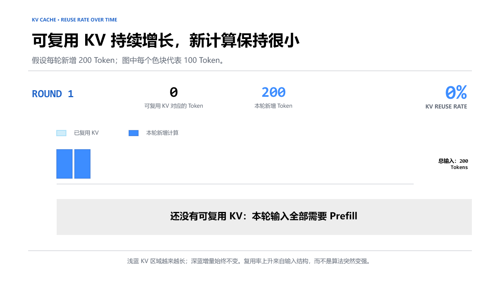</p>
</details>

<details name="kv-cache-rounds">
<summary><strong>Round 2 · KV 复用率 50%</strong></summary>
<p>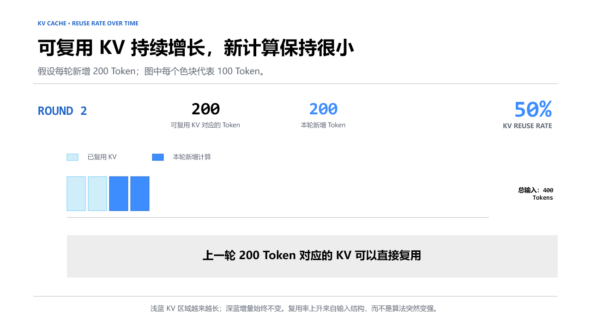</p>
</details>

<details name="kv-cache-rounds">
<summary><strong>Round 3 · KV 复用率 67%</strong></summary>
<p>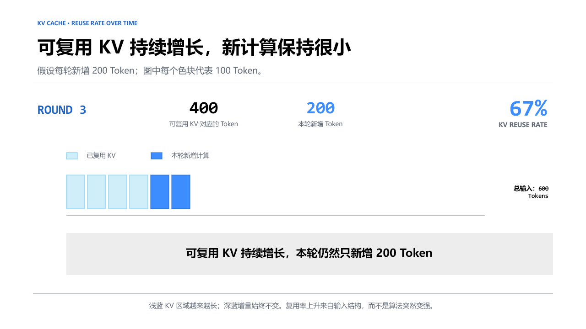</p>
</details>

<details name="kv-cache-rounds">
<summary><strong>Round 5 · KV 复用率 80%</strong></summary>
<p>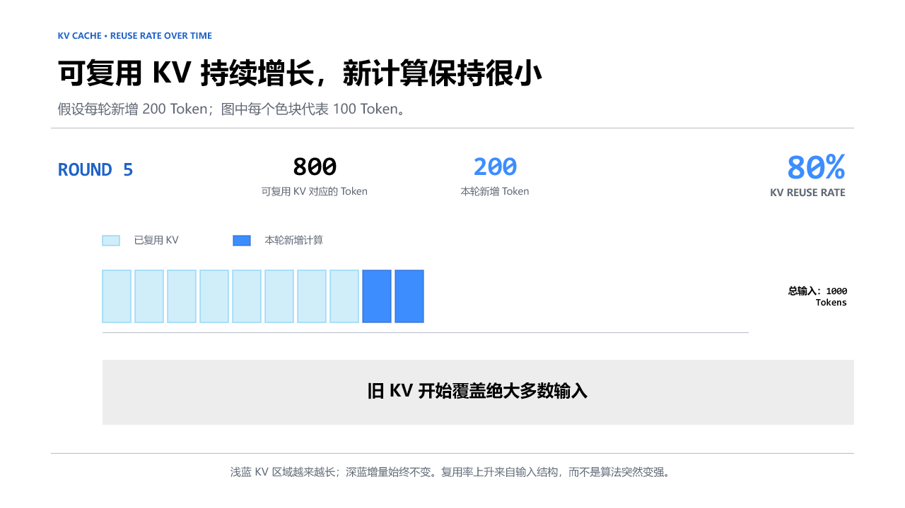</p>
</details>

<details name="kv-cache-rounds">
<summary><strong>Round 10 · KV 复用率 90%</strong></summary>
<p>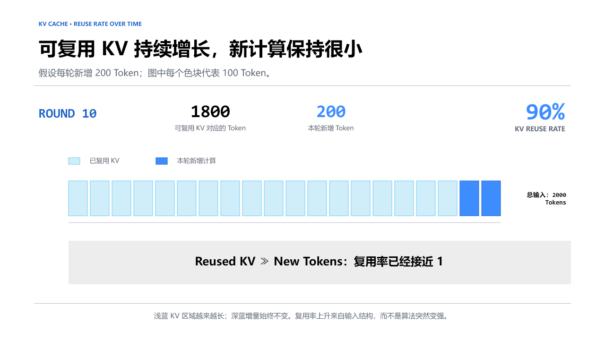</p>
</details>

第 1 轮还没有历史缓存，两个 Block 都需要计算；从第 2 轮开始，上一轮处理过的内容逐渐成为可复用前缀，而每轮新增计算始终保持为两个 Block。

到了第 10 轮，总输入已经增长到 20 个 Block，其中 18 个 Block 来自缓存，仍然只有最后两个 Block 需要新计算。画面中浅蓝区域越来越长，深蓝区域的宽度却没有变化，因此缓存部分在整个输入中的占比会自然上升。

这组图说明：KV 复用率上升来自输入结构的变化——旧上下文不断累积，而本轮新增内容相对稳定——并不是缓存算法随着会话轮数增加而突然变强。

## 5. 什么情况下会破坏复用性？

跨请求复用 KV Cache 通常遵循“最长公共前缀”原则：从输入的第一个 Token 开始比较新旧请求，连续一致的前缀可以复用；遇到第一个不同的 Token 后，匹配停止，失配点及其后的 KV 通常都需要重新计算。

这是因为一个 Token 的 K/V 不只依赖它自己，也依赖它之前的上下文和所在位置。前面任何位置发生插入、删除、移动或修改，都可能改变后续 Token 的计算状态。因此，缓存系统关心的是“从开头连续相同了多长”，而不是两段 Prompt 整体上有多相似。

### 5.1 常见的破坏复用场景

下面这些情况，本质上都会改变 Token、位置或因果上下文。

#### 1. System Prompt 被修改

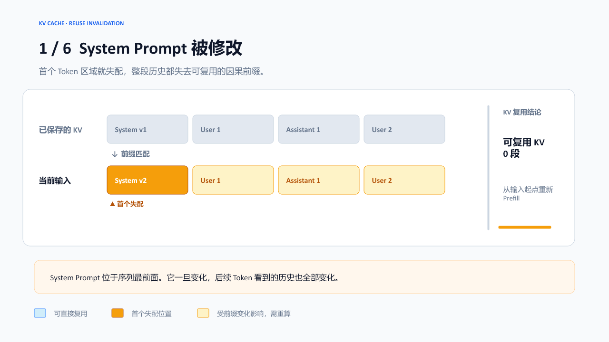

修改发生在最前面。变化点之后的 Token 即使文本不变，它们的因果上下文也已经变化，因此后面的大部分 KV 都需要重新计算。

#### 2. 历史消息被重新排序

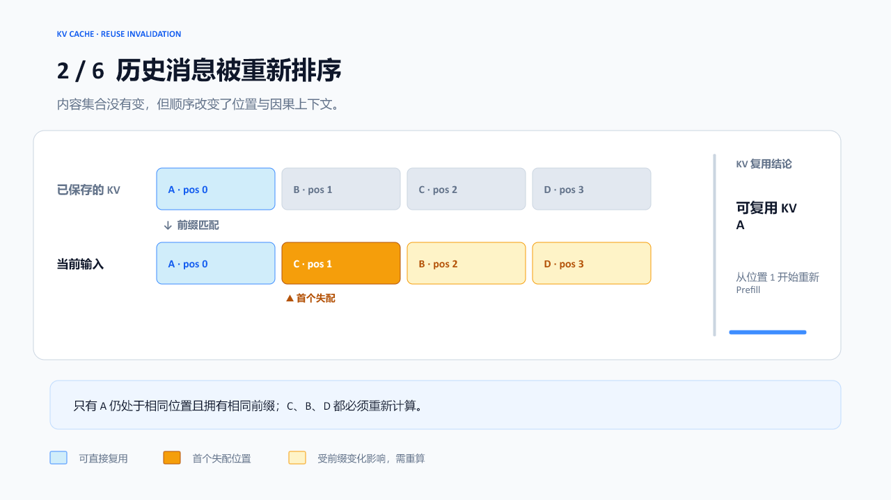

公共前缀只剩下 `A`。被移动消息的 Position ID 发生改变，后续 Token 的因果上下文也随之改变。

#### 3. 中间消息被编辑

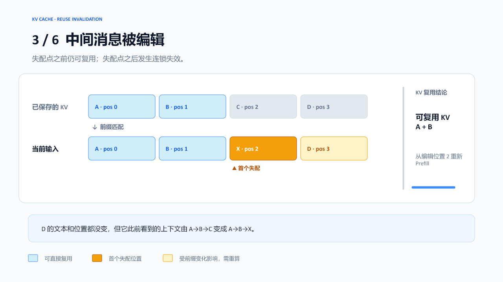

例如把很早的一条 `User1` 改掉。后面的 Token 即使仍处于相同位置，也会因为此前上下文变化而产生不同的隐藏状态。系统通常只能复用编辑点之前的前缀。

#### 4. Prompt 前部加入时间戳或随机数

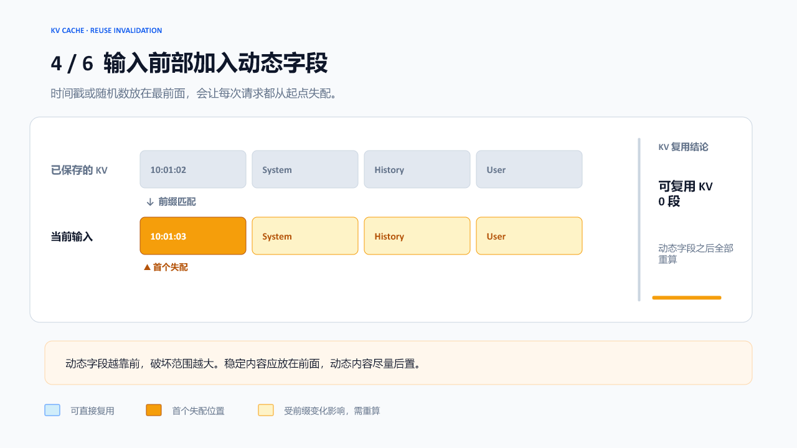

如果动态字段被放在 Prompt 开头，每个请求都会从很靠前的位置发生变化。动态内容改变了因果上下文；如果长度也发生变化，还会进一步移动后续 Token 的位置。

#### 5. 上下文窗口裁剪

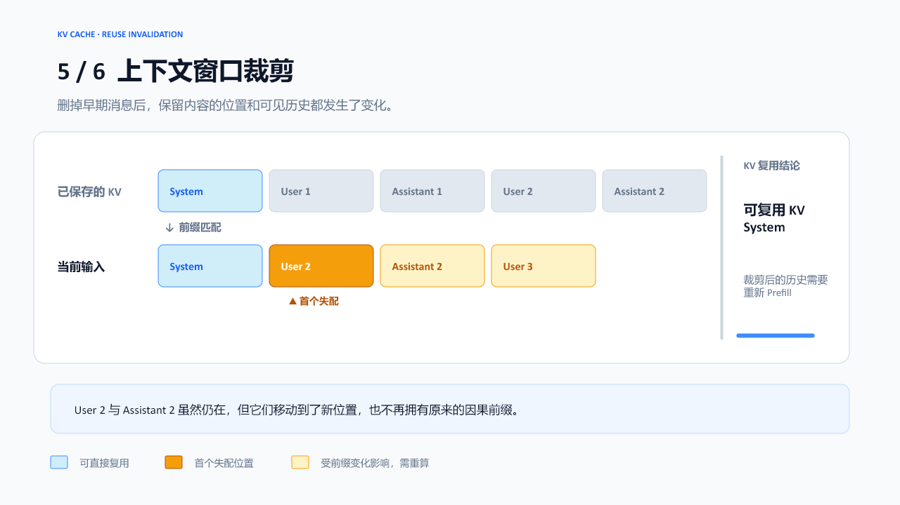

即使大部分语义内容仍然相似，保留下来的历史 Token 也会移动到新的位置，并获得不同的因果前缀。除非推理系统专门实现了安全的 KV 位移或重计算机制，否则原缓存不能直接复用。

#### 6. 对历史消息执行 Summary 或 Compression

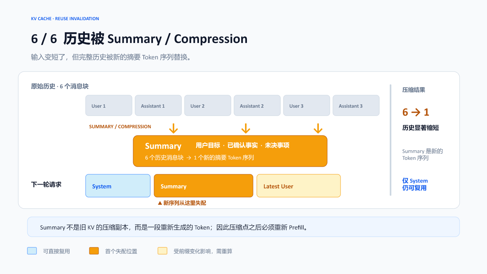

压缩能减少上下文长度，却可能使压缩点之后已有的 KV Cache 失效。工程上需要权衡“更短的输入”和“更高的 KV 复用率”。

### 5.2 前缀没有变化，也不一定能够复用

还有一些场景没有修改 Prompt 前缀，但缓存可能已经过期、被淘汰、无法被当前实例访问，或者与当前模型不兼容。这些属于缓存生命周期、路由和运行环境问题。

#### 1. 超过缓存生命周期 TTL

如果服务端只保留缓存几分钟，而两次请求间隔太久，旧缓存可能已经过期。此时计算结果在数学上仍可复用，只是物理缓存已经不存在。

#### 2. 缓存被淘汰

GPU 显存和缓存容量有限。高负载时，较早或较少使用的 KV Block 可能被 LRU 等策略淘汰。这同样属于缓存可用性问题，而不是位置编码发生变化。

#### 3. 模型或推理实例发生变化

不同模型的层数、权重、Tokenizer、KV 形状可能不同，缓存通常不能混用。

即使模型相同，如果请求被路由到另一个无法访问原 KV 的实例，也可能无法命中。分布式推理系统因此经常采用会话亲和性路由，或者提供跨实例共享的 KV Cache 存储。

所以，更完整的判断方式是：

```text
缓存未命中
├─ 计算状态不再等价
│  ├─ Token ID 改变
│  ├─ Position ID 改变
│  └─ 此前因果上下文改变
└─ 前缀未变，但缓存不可用或不兼容
   ├─ TTL 过期或被淘汰
   ├─ 被路由到其他实例
   └─ 模型或推理配置不兼容
```

## 6. 如何设计更容易复用 KV Cache 的输入？

生产系统通常会尽量把稳定内容放在前面，把频繁变化的内容放在后面。

一种缓存友好的布局是：

```text
System Prompt
↓
固定工具定义
↓
固定 Few-shot Examples
↓
按时间追加的历史消息
↓
最新用户输入
```

它能形成一个不断增长的稳定前缀：

```text
[长期固定内容][旧历史][本轮新增]
```

相反，下面的布局很不利于缓存：

```text
随机数或当前时间
↓
最新用户输入
↓
System Prompt
↓
历史消息
```

因为 Prompt 前部每次都变化，最长公共前缀可能只有几个 Token，后面即使存在大量相同内容也无法命中。

KV Cache 的跨请求复用通常不能跳过变化部分，再继续复用后面的离散片段：

```text
旧请求：[A B X C D E]
新请求：[A B Y C D E]
```

即使 `C D E` 完全相同，最长公共前缀通常也只有：

```text
[A B]
```

这就是为什么动态字段应尽量靠后放置。

工程上可以把这种设计原则称为“稳定前缀设计”。常见实践包括：

- 固定 System Prompt 的文本和格式；
- 固定工具定义的顺序；
- 对 JSON Schema 使用确定性的字段排序；
- 不在前缀中插入时间戳、请求 ID 和随机数；
- 使用稳定的 Chat Template 和 Tokenizer 版本；
- 历史消息尽量采用尾部追加，而不是原地修改；
- 对同一会话采用实例亲和性路由；
- 监控缓存 Token 数，而不只监控“请求是否命中”；
- 分别统计 Prefill、Decode、KV 读取和端到端延迟。

具体推理系统的最低复用长度、TTL 和路由方式可能不同，但核心原则是一致的：

```text
越稳定、越靠前、越长的公共 Token 前缀
→ 越高的缓存复用价值
```

## 7. 总结

本文讨论的核心并不是“缓存保存了多少内容”，而是多轮会话的输入结构如何变化。

正常的多轮聊天通常采用尾部追加模式：System Prompt、工具定义和旧消息保持不变，新的用户消息与模型回复被追加到末尾。随着对话继续，稳定公共前缀越来越长，而每轮新增内容只占总输入的一小部分，因此能够直接复用的 KV Cache 比例会持续提高。

理解这个过程时，不需要引入另一类缓存名称。无论是同一次生成过程中供 Decode 访问，还是在不同请求之间重新加载稳定前缀的计算结果，真正被保存和复用的都是各层 Attention 已经产生的 K/V。区别只在于 KV Cache 的生命周期和可见范围。

缓存复用也不只是比较文本是否相似。Token ID、Position ID、此前的因果上下文以及模型配置都必须兼容。修改 System Prompt、编辑或重排历史消息、裁剪上下文以及改变 Tokenization，都可能使变化点之后的 KV 失效。TTL、缓存淘汰和实例路由则可能让原本可复用的缓存变得不可访问。

因此，生产系统应尽量构造稳定前缀：把 System Prompt、固定工具定义和 Few-shot Examples 放在前面，把时间戳、请求 ID、随机数和最新输入等动态内容放在后面，并尽量避免修改已经发送过的历史消息。

最终可以把全文结论概括为一句话：

> 多轮会话天然形成不断增长的稳定公共前缀；只要每轮新增内容相对较少，能够跨请求复用的 KV Cache 比例就会越来越高。
